# Job Registry — architecture

**Status:** Approved on 28 Oct 2026. Change it only on purpose: update this document in the same piece of work as the code.

This document explains how the app is built and why. It covers:
- how the parts fit together
- the rules that keep them loosely coupled
- how to extend the app without breaking it.

The plan in [plan.md](plan.md) covers *what* gets built and in which order. Each key choice has a short record in [decisions/](decisions/).

The diagrams use Mermaid. They render on GitHub, or in VS Code with the "Markdown Preview Mermaid Support" extension.

---

## Contents

1. [Quality goals](#1-quality-goals)
2. [System context](#2-system-context)
3. [Containers](#3-containers)
4. [Server modules](#4-server-modules)
5. [Events](#5-events)
6. [Ports and adapters](#6-ports-and-adapters)
7. [Key flows](#7-key-flows)
8. [Data model](#8-data-model)
9. [API contract](#9-api-contract)
10. [Dashboard](#10-dashboard)
11. [Browser extension](#11-browser-extension)
12. [AI design](#12-ai-design)
13. [Cross-cutting concerns](#13-cross-cutting-concerns)
14. [Testing strategy](#14-testing-strategy)
15. [Dependency rules and how they're enforced](#15-dependency-rules-and-how-theyre-enforced)
16. [How to extend](#16-how-to-extend)
17. [Risks](#17-risks)
18. [Changes from the plan](#18-changes-from-the-plan)

---

## 1. Quality goals

When two goals pull against each other, the higher one wins.

| # | Goal | What it means in practice |
|---|------|---------------------------|
| 1 | **Private** | All data stays on your PC. The server listens on `127.0.0.1` only. The AI runs locally. Nothing calls a cloud service unless you add one. |
| 2 | **Fast to find** | From the first keystroke to search results takes under 50 ms on 1,000 jobs. Opening a call sheet takes under 200 ms. |
| 3 | **Fast to save** | Saving never waits for the AI. The AI fills in details afterwards. |
| 4 | **Maintainable** | Small modules with clear owners. Outside systems sit behind interfaces. The rules are checked by a script, not just written down. |
| 5 | **Swappable AI** | Changing the model or the AI server is a settings change, not a code change. |
| 6 | **Simple to run** | Run `setup.bat` once, then `start.bat`. You don't need to install a database server, Docker or Office. |

---

## 2. System context

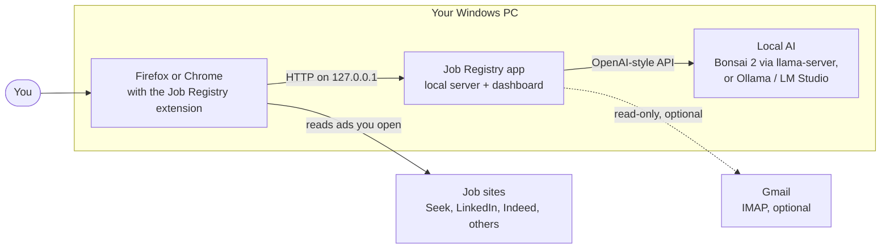

- **You** use the dashboard (a browser tab) and the extension.
- **The extension** reads only the job pages you open. It never crawls sites in the background.
- **The app** stores everything and owns all the logic.
- **The local AI** is a separate program the app talks to over HTTP. The app can start and stop it.
- **Gmail** is optional and read-only (Phase 5).

---

## 3. Containers

A "container" here means a separately running or separately stored part. It's not Docker.

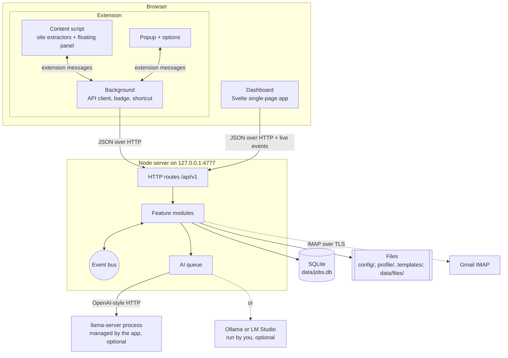

| Container | Technology | What it does | Talks to |
|-----------|-----------|--------------|----------|
| Node server | Node.js LTS, TypeScript (run directly, no build), Fastify | API, business logic, serves the dashboard, manages the AI process | SQLite, files, AI server, IMAP |
| Dashboard | Svelte 5 + Vite, built to static files | Search, call sheet, job details, document editor, settings, inbox | Server API, plus a live event stream (SSE) |
| Extension | TypeScript + Svelte, built with esbuild, two manifests (Firefox, Chrome) | Reads job pages, shows the save and rating panel, toolbar popup | Server API, **from the background script only** |
| SQLite database | `better-sqlite3`, WAL mode, FTS5 | Jobs, ads, contacts, notes, documents, search index | — |
| Files | Plain text and CSS on disk | Settings, secrets, profile, templates, attachments, backups, logs | — |
| llama-server | PrismML's build of llama.cpp | Runs Bonsai 2 on the GPU. Started on demand, stopped when idle | — |

Content scripts run inside the job site's page, so the browser's cross-site rules (CORS) apply to them. The background script has host permission for `127.0.0.1` (any port), so it can call the server freely. That's why every server call goes through the background, and why the server sends no CORS headers at all (§13).

---

## 4. Server modules

### 4.1 Module map

The server is split **by feature**. Each module owns its own data. No other module touches that data directly.

| Module | Owns | Public functions (examples) | Depends on |
|--------|------|-----------------------------|------------|
| `system` | backups, health check, shutdown, logs | `health()`, `backupNow()`, `shutdown()` | — |
| `settings` | `config/settings.json`, `config/secrets.json` | `get()`, `update(patch)`, `statuses()`, `secrets()` (only whether each is set), `emailPassword()`, `updateSecrets()` | — |
| `profile` | `profile/*.md`, `templates/*.css` | `read(name)`, `file(name)`, `write(name, text)`, `hash()`, `installStarters()` | — |
| `capture` | nothing (stateless) | `fromUrl(url)`, `fromText(text)` | — |
| `ai` | AI process and queue (no tables) | `parseJob()`, `rateJob()`, `writeDocument()` (streamed), `status()`, `test()`, `stop()`, `classifyEmail()` | — |
| `jobs` | `jobs`, `postings`, `status_history` | `save()`, `check()`, `get()`, `list()`, `update()`, `changeStatus()`, `addPosting()`, `applyParsed()`, `setParseState()`, `setRating()`, `listIdsByParseState()`, `setFollowUp()`, `listFollowUps()` | — |
| `contacts` | `contacts`, `job_contacts`, `interactions` | `create()`, `update()`, `linkToJob()`, `logInteraction()`, `listForJob()`, `findByPhoneDigits()` | — |
| `notes` | `notes` | `add()`, `update()`, `remove()`, `listForJob()` | — |
| `ratings` | `rating_cache` | `rate(input, { signal, key })` | `ai`, `profile` |
| `enrich` | nothing | listens for new ads, then parses and rates them; `reparse(jobId)`, `sweep()` (jobs still waiting) | `jobs`, `ai`, `ratings` |
| `documents` | `documents`, `attachments`, `data/files/` | `list()`, `listAll()`, `get()`, `saveVersion()`, `copyFrom()`, `markSent()`, `latestSent()`, `render()`, `exporters()`, `export()`, `generate()`, `attach()`, `listAttachments()`, `attachmentFile()` | `ai`, `profile`, `jobs` |
| `search` | `search_index` | `query(q)`, `reindexJob(id)`, `rebuild()` | `jobs`, `contacts`, `notes` |
| `callsheet` | nothing (read-only view) | `get(jobId)`: everything for the one-screen view | `jobs`, `contacts`, `notes`, `documents` |
| `email` | `email_suggestions`, `email_state` | `checkNow()`, `status()`, `test()`, `listSuggestions()`, `confirm()`, `dismiss()`, `start()` / `stop()` (the timer) | `ai`, `jobs`, `contacts`, `notes` |
| `live` | open dashboard connections | forwards chosen events to the dashboard | — |

Every module also uses `core` (config, database connection, events, errors, logger) and `shared` (contracts and pure helpers).

**Modules get their settings as plain functions.** For example, `ai` receives `getAiConfig()` from `app.ts`. It never imports the `settings` module. So only `app.ts` knows where settings come from.

### 4.2 Allowed dependencies

An arrow means "may call". There are no cycles. A module may only call modules shown below it.

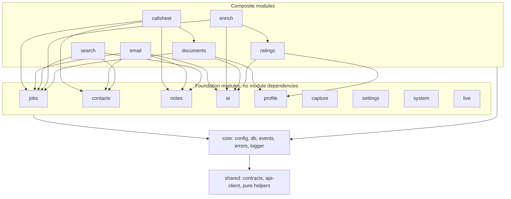

Why it's shaped like this:
- **`jobs` doesn't depend on `ai`.** The `enrich` module does the AI work after a save. So saving can't wait for the AI, by design and not just by care.
- **`ai` knows nothing about jobs.** It takes text in and gives typed results back. It can be tested with plain strings.
- **`search` reads through services, not tables.** It rebuilds a job's index entry by asking `jobs`, `contacts` and `notes` for the current data.
- **`callsheet` is a read-only view.** It joins data from four modules for one screen, so the dashboard makes one request instead of six.

### 4.3 Inside a module

```
server/modules/jobs/
  index.ts       public surface: createJobsModule(deps) → { service, routes } and exported types
  service.ts     the logic. Plain inputs, plain outputs. No Fastify, no SQL.
  repo.ts        all SQL for this module's tables. Nothing else in the app writes these tables.
  routes.ts      Fastify routes. Checks input with shared contracts, calls the service, returns DTOs.
  match.ts       pure helper (finding duplicates), used by service.ts
  *.test.ts      tests sit next to the code
```

- **Other modules import only `index.ts`.** Everything else in the folder is private.
- A service receives what it needs as arguments: its repo, the event bus, other modules' services and config functions. It never builds these itself.

### 4.4 Composition root

`server/app.ts` is the only place that creates and connects things. It's plain code, with no dependency-injection framework.

```ts
export function buildApp(opts: AppOptions, fakes: Partial<Fakes> = {}) {
  const db = openDb(opts.paths.db);               // runs migrations, WAL mode, foreign keys on
  const bus = createEventBus(logger);
  const settings = createSettingsModule({ paths: opts.paths, bus });
  const profile = createProfileModule({ dir: opts.paths.profile });  // profile.changed comes with the Phase 4 editors

  const ai = createAiModule({
    provider: fakes.ai ?? createOpenAiCompatibleProvider(() => settings.get().ai),
    runtime: () => fakes.runtime ?? pickRuntime(settings.get().ai),  // LlamaServerRuntime or NoopRuntime, chosen per task
    getConfig: () => settings.get().ai,
    bus,
  });

  const jobs = createJobsModule({ db, bus, statuses: () => settings.statuses() });
  const contacts = createContactsModule({ db, bus });
  const notes = createNotesModule({ db, bus });
  const ratings = createRatingsModule({ db, ai: ai.service, profile: profile.service });
  createEnrichModule({ bus, jobs: jobs.service, ai: ai.service, ratings: ratings.service });
  const documents = createDocumentsModule({ db, bus, ai: ai.service, profile: profile.service,
                                            jobs: jobs.service, filesDir: opts.paths.files,
                                            exporters: [printHtmlExporter, docxExporter] });
  const search = createSearchModule({ db, bus, jobs: jobs.service, contacts: contacts.service, notes: notes.service });
  const callsheet = createCallsheetModule({ jobs: jobs.service, contacts: contacts.service,
                                            notes: notes.service, documents: documents.service });
  const mail = fakes.mail ?? createImapMailSource(() => ({ ...settings.get().email, password: settings.emailPassword() }));
  const email = createEmailModule({ db, bus, mail, ai: ai.service, jobs: jobs.service, contacts: contacts.service,
                                    notes: notes.service, statuses: () => settings.statuses(),
                                    getConfig: () => settings.get().email, password: () => settings.emailPassword() });
  const live = createLiveModule({ bus });

  const http = Fastify({ logger });
  registerSecurity(http, opts.server);            // Host and Origin checks, JSON-only writes
  registerErrorHandler(http);                     // AppError → HTTP status
  for (const m of [settings, profile, capture, ai, jobs, contacts, notes, ratings,
                   documents, search, callsheet, email, live, system]) {
    http.register(m.routes, { prefix: '/api/v1' });
  }
  serveDashboard(http, opts.paths.webDist);
  return { http, db, bus, close };
}
```

Tests call the same `buildApp` with fakes, such as `FakeAiProvider`, `FakeRuntime`, `FakeMailSource` and an in-memory database. So tests run the real wiring.

---

## 5. Events

Events let modules react to each other without calling each other. All event names and payloads are defined in one typed map, in `server/core/events.ts`. That map is the contract between modules.

| Event | Payload | Sent by | Heard by |
|-------|---------|---------|----------|
| `job.saved` | `{ jobId }` | jobs | search, live |
| `job.updated` | `{ jobId, fields }` | jobs | search, live |
| `job.statusChanged` | `{ jobId, from, to, source }` | jobs | search, live |
| `posting.added` | `{ jobId, postingId }` | jobs | enrich, search |
| `note.added` / `note.updated` / `note.removed` | `{ jobId, noteId }` | notes | search, live |
| `contact.saved` | `{ contactId, jobIds }` | contacts | search, live |
| `contact.linked` / `contact.unlinked` | `{ contactId, jobId }` | contacts | search, live |
| `interaction.logged` | `{ interactionId, contactId, jobId }` | contacts | search, live |
| `document.saved` / `document.sent` | `{ jobId, documentId }` | documents | live |
| `attachment.added` | `{ jobId, attachmentId }` | documents | live |
| `profile.changed` | `{ name }` | profile, when a file is saved in Settings | live. Ratings don't need it: they work out the profile hash from the files each time, so a hand edit counts at once |
| `settings.changed` | `{ keys }` (`secrets` when the app password changes, never its value) | settings | ai (switch runtime and stop the old one), email (on `email` or `secrets`: check at once when email was just turned on, otherwise restart the timer), live |
| `ai.stateChanged` | `{ state, detail }` | ai | live; enrich (on `ready`, reads jobs that were waiting for the AI) |
| `enrich.done` / `enrich.failed` | `{ jobId, step, error? }` | enrich | live |
| `email.suggestionsAdded` | `{ count }` | email, at the end of a check that added cards | live (the Inbox and the header's count) |
| `email.suggestionHandled` | `{ suggestionId, state }` (`confirmed` or `dismissed`) | email | live |
| `email.checked` | `{ ok, error }` | email, after every check | live |

**Delivery rules**

1. Events are sent **after** the database transaction commits. A listener never sees data that might still roll back.
2. Payloads are **small**: IDs plus what changed. Listeners read the current data through services, so they never act on a stale copy.
3. Listeners run straight away, one after another. Each runs inside its own try/catch. A failing listener is logged and **never** breaks the action that sent the event. For example, a search-index failure can't stop a save.
4. Slow work, like anything involving the AI, goes onto the AI queue. It never runs inside the listener.
5. If the search index ever drifts, **Settings → Rebuild search index** rebuilds it from scratch.

---

## 6. Ports and adapters

Every outside system sits behind a small interface, called a **port**. The code behind it, the **adapter**, can be swapped without touching the rest of the app. The interfaces below are the contract. Field names may change a little during the build.

### 6.1 `AiProvider` — talking to any AI server

```ts
interface AiProvider {
  chat(req: ChatRequest, opts?: { signal?: AbortSignal }): Promise<ChatResult>;
  chatStream(req: ChatRequest, opts?: { signal?: AbortSignal }): AsyncIterable<ChatChunk>;
  health(): Promise<{ ok: boolean; models?: string[]; detail?: string }>;
}

type ChatRequest = {
  messages: { role: 'system' | 'user' | 'assistant'; content: string }[];
  model?: string;
  temperature?: number;
  maxTokens?: number;
  jsonSchema?: { name: string; schema: object };   // constrained JSON output
  thinking?: boolean;                               // sent as reasoning_effort
  thinkingEffort?: 'low' | 'medium' | 'xhigh';      // when thinking is on (default medium)
  extra?: Record<string, unknown>;                  // added to the body last, from settings; null removes a field
};
type ChatChunk = { kind: 'text' | 'thinking'; text: string };
```

| Adapter | Covers | Notes |
|---------|--------|-------|
| `OpenAiCompatibleProvider` | llama-server, Ollama, LM Studio, vLLM, any `/v1/chat/completions` server | `thinking: false` is sent as `reasoning_effort: "none"`, which both PrismML's llama-server (Bonsai 2) and Ollama honour. Bonsai 2's template ignores `chat_template_kwargs` for this, and refuses `"high"`, so thinking on defaults to `"medium"`. A task's `extra: { "reasoning_effort": null }` removes the field for a server that refuses it. Thinking comes back from `reasoning_content` (llama-server), `reasoning` (Ollama) or `<think>…</think>` blocks, as `kind: 'thinking'`, and is never put into a parsed field or a document. Every failure becomes a sentence that names the server's address. |
| `FakeAiProvider` | tests | Returns scripted replies and can simulate slowness, errors and cancelling. |
| *(later, optional)* `AnthropicProvider` or another cloud API | — | Only if you ever want it. It goes against the "private" goal, so it would be off by default. |

### 6.2 `ModelRuntime` — starting and stopping the AI program

```ts
interface ModelRuntime {
  ensureRunning(signal?: AbortSignal): Promise<void>;  // starts the process if needed, waits for /health
  touch(): void;                                        // resets the idle timer
  stop(): Promise<void>;
  stopNow(): void;                                      // at once, for a crash or the app exiting
  state(): 'off' | 'starting' | 'ready' | 'error';     // "busy" is added by the AI service while a task runs
  detail(): string | null;                              // why it's "error", in a sentence
  onStateChange(fn: (state) => void): () => void;
}
```

| Adapter | Used when |
|---------|-----------|
| `LlamaServerRuntime` | The preset is "Bonsai 2 via llama-server" and `managed: true`. It spawns `llama-server.exe` with no console window and sends its logs to `data/logs/llama.log`. If something is already answering on the port, it uses that and won't kill a process it didn't start. On Windows the server can't outlive the app: Node puts child processes in a job object that ends them with it. On macOS and Linux, the app keeps the running server's pid and launch settings in `data/llama-server.pid`, so after a crash the next start knows the server is its own and stops it as usual. Windows ignores that file, so a reused pid can never point it at another program. A stop cancels a start in progress. A change to the program, arguments or address restarts it at the next task. |
| `NoopRuntime` | Ollama, LM Studio or a custom server you run yourself. `ensureRunning` only checks that the server is there. |

### 6.3 `MailSource` — reading email

```ts
interface MailSource {
  // Oldest first. With no cursor, or one from another UIDVALIDITY, it reads by date.
  fetchSince(cursor: MailCursor | null, opts: { maxMessages: number; sinceDays: number; now: Date; signal?: AbortSignal }):
    Promise<{ messages: MailMessage[]; cursor: MailCursor; more: boolean }>;
  test(): Promise<void>;   // logs in and opens the mailbox; throws a sentence to show
}
type MailCursor = { uidValidity: string; lastUid: number };
type MailMessage = { id: string; from: string; fromName: string | null; to: string; subject: string;
                     receivedAt: string; text: string; after: MailCursor };   // after: the cursor just past this email
```

Adapters: `ImapMailSource` (`email/adapters/imap.ts`, Gmail over IMAP with an app password, using imapflow), `FakeMailSource` (tests), and later, if needed, `GmailApiMailSource`.

`ImapMailSource`:
- **Read-only.** It opens the mailbox with EXAMINE (`readOnly: true`), so nothing is marked read, moved, flagged or deleted. imapflow's own logging is off.
- **One login per round.** It logs in, reads at most `maxMessages` emails (oldest first), and logs out. `more` says there are newer ones.
- **The cursor** is the mailbox's UIDVALIDITY (a string, because imapflow gives a BigInt) and the last UID read. With the same UIDVALIDITY, it reads `UID last+1:*` and drops UIDs it already had (a `*` range always includes the newest). Otherwise it searches by date (`SINCE` today − `sinceDays`). A round with no more mail ends at UIDNEXT − 1.
- **Text:** the first plain-text part that isn't an attachment, else the first HTML part as text (`core/html-text.ts`), at most 64 KB. It reads every header first, then downloads each text part, because imapflow can't run a command inside a fetch.
- **One bad email never blocks the rest.** A text that won't download gives empty text; a batch Gmail won't fetch is asked for one email at a time, and an email that still fails is left out; a broken date becomes the time it was read. The cursor still moves past them.
- **A refused search** (imapflow answers `false`) fails the round, so the cursor never moves past mail it didn't read.
- **Errors are sentences:** a wrong password (AUTHENTICATIONFAILED, or Gmail's "Invalid credentials" and "Application-specific password required"); any other refused login, with Gmail's words; can't connect; a certificate swapped by antivirus email scanning; no such mailbox; anything else as "Gmail said: …".

### 6.4 `DocumentExporter` — turning a document into a file

```ts
interface DocumentExporter {
  id: 'print-html' | 'docx' | string;
  label: string;                                   // shown on the button
  export(doc: { title: string; markdown: string; css: string }):
    Promise<{ contentType: string; fileName: string; body: Buffer | string }>;
}
```

Adapters, in `server/modules/documents/exporters/` (the port is `documents/exporter.ts`, and `app.ts` wires the list):
- `PrintHtmlExporter`, "Save as HTML": the same A4 page as the print view (`shared/document-page.ts`), as a file.
- `DocxExporter`, "Export .docx": built with the `docx` library from `lexMarkdown`'s tokens. Word can't read CSS, so it gets a fixed, plain layout (Calibri 11, A4, real Word bullets and numbering). Raw HTML becomes plain text.

The dashboard asks the server which exporters exist (`GET /documents/exporters`), and shows one button per exporter. Printing to PDF isn't an exporter: **Print / PDF** opens the print view (`GET /documents/:id/render`) and you use the browser's Save to PDF.

### 6.5 `SiteExtractor` — reading a job site (in the extension)

```ts
interface SiteExtractor {
  id: 'seek' | 'linkedin' | 'indeed' | 'generic' | string;
  matches(url: URL): boolean;
  currentJobId(url: URL, doc: Document): string | null;  // handles split-pane search pages
  extract(doc: Document, url: URL, now: Date): Capture | null;  // null until the ad's text is there; the watcher waits
}
```

Adapters: one file each in `extension/src/sites/`. The registry tries them in order, and `generic` comes last. Generic uses the text you selected first (if it's over 200 characters), then the page's schema.org `JobPosting` data, then Mozilla Readability.

### 6.6 Shared types used by the ports

```ts
type Capture = {                // what the extension or capture module produces
  sourceUrl: string; canonicalUrl: string; sourceSite: string; externalId?: string;
  title?: string; company?: string; location?: string;
  jdText: string; structured?: Partial<ParsedJob>; capturedAt: string;
};
type ParsedJob = {
  title: string; company: string | null; agency: string | null; location: string | null;
  workMode: 'onsite' | 'hybrid' | 'remote' | 'unknown';
  employmentType: 'full-time' | 'part-time' | 'contract' | 'temporary' | 'casual' | 'unknown';
  salary: { min: number | null; max: number | null; currency: string | null;
            period: 'year' | 'day' | 'hour' | null; text: string | null };
  closingDate: string | null; summary: string;
  requirements: string[]; niceToHave: string[]; responsibilities: string[];
  adContact: { name: string | null; email: string | null; phone: string | null } | null;
};
type Rating = {
  verdict: 'strong' | 'good' | 'stretch' | 'weak'; score: number;  // 0–100
  why: string[]; whyNot: string[]; dealBreakers: string[]; salaryNote: string | null;
};
```

All of these are zod schemas in `shared/contracts/`. The TypeScript types are derived from those schemas, so there's one source of truth.

---

## 7. Key flows

### 7.1 Save a job from the extension, with the "Same job?" check

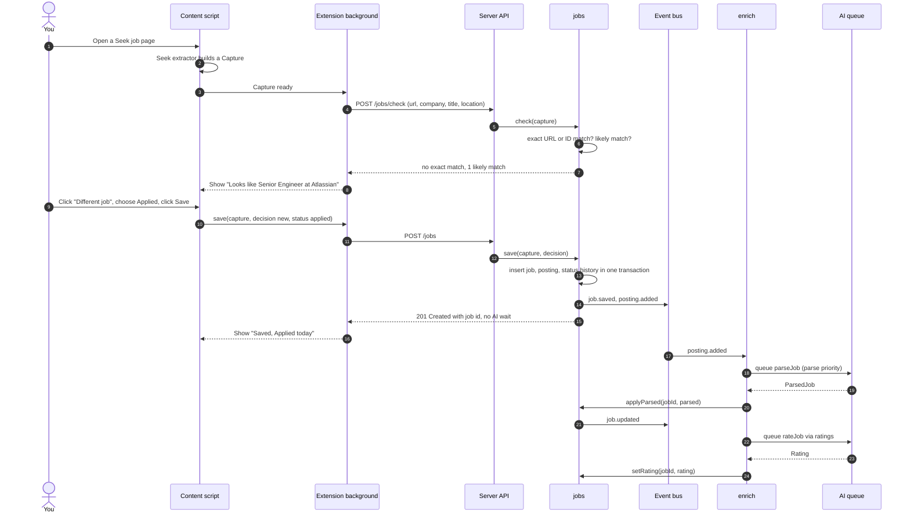

Notes:
- **Fields you've edited by hand are never overwritten.** `applyParsed` only fills empty fields, or fields that still hold an earlier AI value. Each field remembers whether it came from you, the ad's structured data or the AI.
- **If the AI can't be reached** (not running, not installed, didn't start), the job stays saved and waits: `parse_state = pending`, with the reason in `parse_error`. It's read the next time an AI task works (a task finishing moves the AI from `busy` to `ready`, which starts a sweep), and at the next start. The job page says why and offers **Read again**.
- **If the server refuses this ad, or doesn't answer it in time** (`AiRefusedError`: an HTTP error or a timeout), the job is `failed` with the server's message, and shows **Read again**. Other jobs carry on.
- **If the AI's answer never fits** (even after one retry, `AiAnswerError`), the job is `failed` with the reason, and shows **Read again**.
- **The sweep** reads waiting jobs one at a time at background priority, so a job you save meanwhile goes first. It stops at the first "can't reach the AI", and every job left in that round gets the same reason. A refused ad is marked failed and the round carries on, but two refusals in a row with the same message mean the server refuses everything (a wrong model, say), so the round stops and those jobs wait too.

### 7.2 Recruiter calls: search, then the call sheet

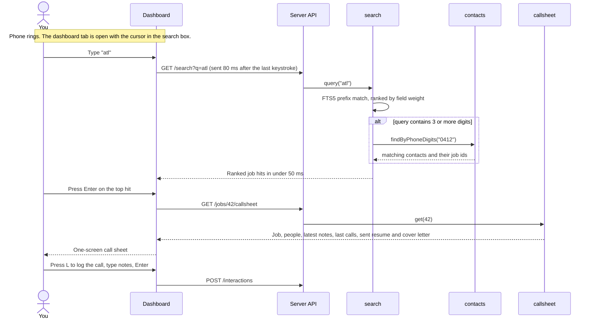

Order of results:

1. Phone-number matches come first.
2. Then open jobs come before closed ones.
3. Within each group, the best text match comes first. The company, agency and title count most (weight 10), then people: names, emails and phones (5). Then notes, calls and location (2), and the ad text last (1).
4. If two results tie, the most recently updated comes first.

Archived jobs are left out. A person shows as their own result only when they aren't linked to any job, because otherwise their jobs already show.

### 7.3 Match rating, with stale requests cancelled

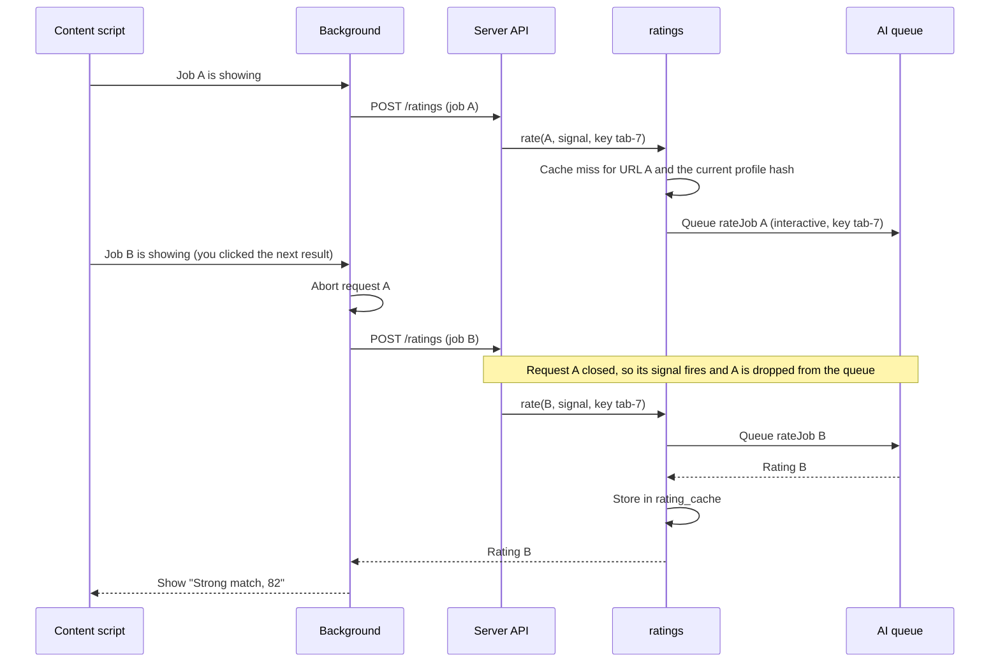

The queue also enforces "latest wins" per key. A new task with the same key cancels the older one, even if the browser didn't abort it.

### 7.4 Generate a resume, check it, send it

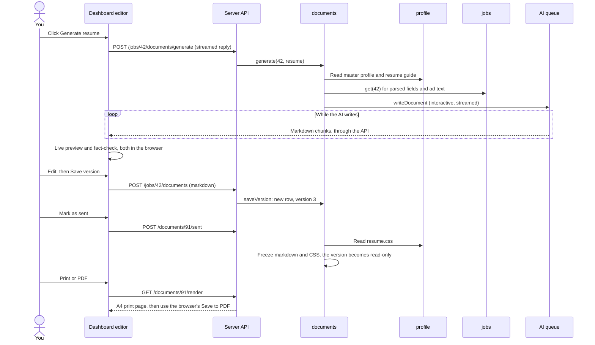

The fact-check is plain code in `shared/fact-check.ts`. The browser runs it 300 ms after you stop typing. It needs the master profile text, which the editor loads once.
- **What it looks for:** numbers, percentages, money, years, date ranges and capitalised names (runs of capitalised words, or words like `AWS` and `ISO27001`). It flags the ones the profile doesn't have.
- **What counts as the same fact:** numbers compare by value ($150k is $150,000, "30 %" is 30%, and the profile's "eight" counts as 8). Phone numbers compare as digits.
- **Numbers written as words** ("ten years", from two to twenty) are checked like digits.
- **What it ignores:** resume headings and letter words ("Professional Summary", "Referees", "Dear Hiring Manager"), months, days and states, a letter's own date, and the job's title, company and agency.
- **A capitalised word that just starts a sentence** is ignored when it reads as an ordinary word: a common verb or small word ("Led", "The"), or a word the draft or profile also has in lower case.
- **Words it never ignores, even at a sentence start:**
  - words on a heading line
  - seniority words ("Lead", "Principal")
  - acronyms
  - a label ("Deloitte:", "Telstra |"), one of a list ("Python, Go") or a line of its own ("- Kubernetes").
- **Flags are the draft's own text**, so the preview can highlight them. Only whole words and numbers are highlighted.

Generating streams NDJSON: one `GenerateChunk` per line (`text`, then `done`, or `error` with a sentence to show). So the editor can tell a finished draft from a cut-off one. Pressing **Stop** or closing the tab ends the request, which cancels the AI task. Nothing is saved until you press **Save version**. Text you haven't saved is kept in the browser's `localStorage` (`jr-draft:<jobId>:<kind>`) until you save or discard it.

### 7.5 Email suggestion, then you confirm

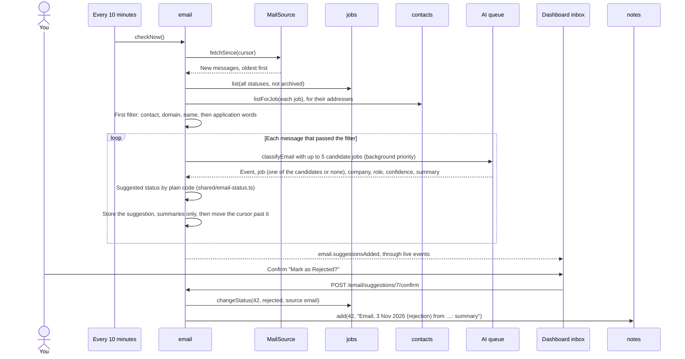

The rules:
- **Nothing changes without your OK.** A check, the timer and the AI only add suggestion rows. Only **Confirm** changes a status (source `email`) or adds a note. All `/email` writes are dashboard-only.
- **The first filter** (`email/filter.ts`, plain code), first rule that applies:
  1. never your own address
  2. a contact's address
  3. the company's, agency's or a contact's own domain (never free mail like gmail.com)
  4. a company or agency named in the subject, or in the text next to a job word
  5. an application phrase ("thank you for applying", "not progressing", "invitation to interview" …) from anyone, with no job.
- **The AI only reads.** It may pick a job only from the candidates it was shown, or none. The suggested status is worked out by `suggestStatus`: received → Applied, rejected → Rejected, interview → the next interview stage, assessment → Screening, offer → Offer. It only moves forward, never repeats the status the job has, and a closed job reopens only for an interview or an offer. It's worked out again from the job's status when the card is shown and when you confirm, so a card that waited never moves a job backwards.
- **Not about a job:** an answer of "other" with no job, or one that isn't sure (under 0.6), keeps only the message id and date (`ignored`), so it isn't read again.
- **The AI can't be reached:** the check stops, the cursor stays before that email, and the Inbox says "Waiting for the AI: …". The next check carries on from there.
- **The AI server refuses an email** (any HTTP error, or a timeout): the email is held back. If a later email in the same check is read, the refusal was about that one email, so it gets a card: "The AI couldn't read this email. Open Gmail to read it." If none is, the server refuses everything (a wrong model, say): the check stops before the first held email, with "Waiting for the AI: …". An email refused on three checks in a row gets the card anyway, so it never holds up the inbox. The count lives in `email_state` (`refused:<message id>`). An answer that never fits makes that card at once. Its note uses the email's subject.
- **The cursor** is saved after each email, with the address and mailbox it belongs to. A new address or mailbox starts again by date. A check reads up to 10 rounds of `maxPerCheck` emails. The first check goes back `firstCheckDays` (14).
- **Only summaries are kept:** sender, subject (300 characters at most), date, event, summary (200), company and role (120 each). Never the email. The body is in memory for one AI call. A check logs one line with counts, or the reason it stopped.
- **One check at a time.** A second **Check now** joins the one running. Closing the app cancels a check, and the next one starts where it stopped.
- **The timer** starts a minute after the app, then every `pollMinutes` (5 to 1,440), only while email is on, set up, and has an app password.

### 7.6 AI process states

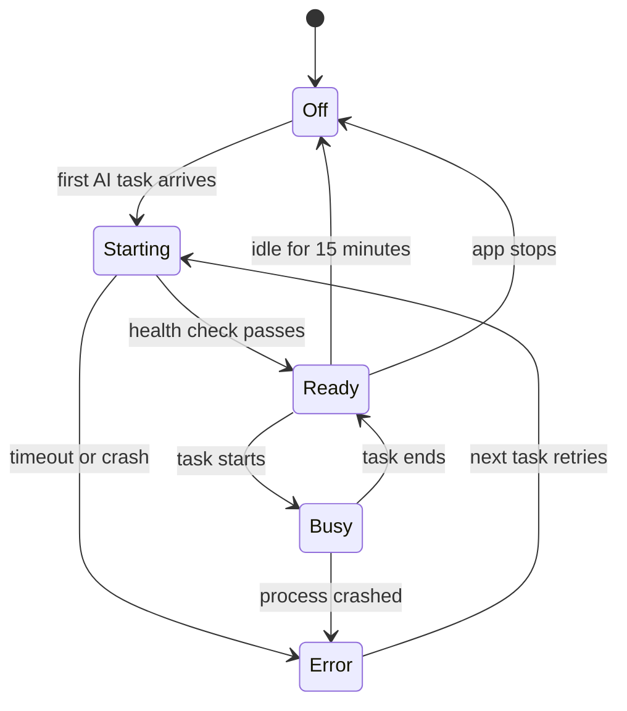

The dashboard shows this state in a small pill in the header, which updates live.

---

## 8. Data model

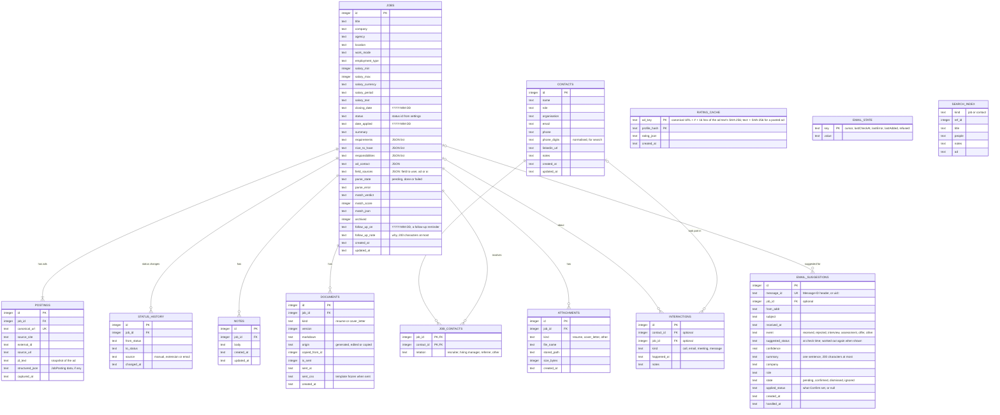

**Conventions**
- **IDs and keys:** IDs are whole numbers. Foreign keys are switched on. The database uses WAL mode, so reads never block writes.
- **Time:** timestamps are ISO 8601 in UTC (`2026-10-28T03:15:00Z`). Plain dates like `closing_date` and `date_applied` are local dates (`YYYY-MM-DD`). The dashboard shows dates in Australian format ("28 Oct 2026").
- **JSON columns:** the module's repo checks them with zod on every read and write.
- **Statuses** are stored by a stable **id**, such as `interview_1`, not by label. Renaming "Interview 1" to "First interview" in settings doesn't break history.
- **Documents are append-only.** Each save adds a version. A sent version can't be changed. The repo has no update except marking a version as sent, once. Two triggers in `003_documents.sql` also make the database itself refuse to change a version's text, or a sent version at all.
- **Attachments** are stored as `data/files/<jobId>/<8 hex>-<clean name>`, with `stored_path` relative to `data/files/`, so a moved data folder still works.
- **Follow-ups** are one date and an optional reason per job, set only through `PUT /jobs/:id/follow-up`. Nothing else changes them: not a status change, an edit, the AI or archiving (archived jobs are just left out of the list).
- **Jobs are archived, never deleted**, so history and links stay whole. Deleting for real is a separate, deliberate action in settings.
- **Unique keys:**
  - `postings.canonical_url` is unique.
  - So is `(source_site, external_id)` when `external_id` is set.
  - So is `(job_id, kind, version)` for documents.
- **`SEARCH_INDEX`** is an FTS5 virtual table using the `unicode61` tokeniser, with prefix indexes for 2 and 3 characters. Phone numbers are searched separately, through `contacts.phone_digits`, so a search matches any part of the number.
- **Migrations:** numbered SQL files in `server/core/db/migrations/` (`001_init.sql`, …). The runner applies new ones in order, inside a transaction, and records the version in `PRAGMA user_version`. It backs up the database before each migration.

---

## 9. API contract

- **Where it lives:** all endpoints sit under `/api/v1`. Every request and response body is a zod schema in `shared/contracts/<module>.ts`.
- **Who uses it:** the server validates with those schemas, and the dashboard and extension import the same schemas and types. `shared/api-client.ts` is a thin typed wrapper around `fetch`, used by both clients.
- **Change-safe:** if an endpoint's shape changes, the TypeScript build of the dashboard and extension fails straight away.

**Errors** always look like `{ "error": { "code": "not_found", "message": "Job 42 not found" } }`.

| Code | HTTP status | Meaning |
|------|-------------|---------|
| `validation` | 400 | Also used for a 415 (a body that isn't JSON). |
| `forbidden` | 403 | The Host or Origin check failed (§13). |
| `not_found` | 404 | |
| `conflict` | 409 | An ad that is already saved on another job, or an edit to a sent document. Possible duplicates are not errors: see `POST /jobs`. |
| `ai_unavailable` | 503 | |
| `internal` | 500 | |

**Endpoints**

| Area | Method and path | Purpose |
|------|-----------------|---------|
| System | `GET /health` · `POST /system/shutdown` · `POST /system/backup` | Health check for `start.bat` · Used by `stop.bat` · Back up now |
| Live | `GET /events` | Server-sent events stream for the dashboard |
| Capture | `POST /captures/preview` `{ url }` or `{ text }` | Build a Capture from a pasted URL or text |
| Jobs | `POST /jobs/check` | Exact or likely duplicates for a Capture |
| | `POST /jobs` `{ capture, fields?, status?, decision?, source? }` | Save. Replies `{ result }`: `created` (201), `linked`, `exists` or `needs_decision` (with candidates; resend with `decision` = `new` or `{ linkTo: jobId }`). `fields` are what you typed, and win over the ad. A note typed at save time is a second call, `POST /jobs/:id/notes`, so `jobs` never depends on `notes` |
| | `GET /jobs?status=&archived=&sort=` · `GET /jobs/:id` · `PATCH /jobs/:id` | List · get · edit (a follow-up can't be set here) |
| | `PUT /jobs/:id/follow-up` `{ on, note? }` · `GET /jobs/follow-ups` | Set a follow-up (`on: null` clears it and its reason; a `note` left out or blank means no reason) · `{ today, due, soon }`: due is today or late (oldest first), soon is the next 7 days, both by the server's local date, archived jobs left out |
| | `POST /jobs/:id/status` `{ status }` | Change status, which logs history |
| | `POST /jobs/:id/postings` `{ capture }` | Link another ad to this job |
| | `GET /postings/lookup?url=` | Fast "already saved?" check for the extension badge |
| | `POST /jobs/:id/reparse` | Run AI parsing again (202). Served by `enrich`, so `jobs` never knows about the AI |
| Call sheet | `GET /jobs/:id/callsheet` | Everything for the one-screen view |
| Search | `GET /search?q=` | Ranked hits |
| Notes | `GET /jobs/:id/notes` · `POST /jobs/:id/notes` · `PATCH /notes/:id` · `DELETE /notes/:id` | |
| Contacts | `GET /contacts?q=` · `POST /contacts` · `PATCH /contacts/:id` | |
| | `POST /jobs/:id/contacts` · `DELETE /jobs/:id/contacts/:contactId` | Link or unlink a contact |
| | `POST /interactions` · `GET /jobs/:id/interactions` | Call log |
| Ratings | `POST /ratings` `{ capture, key? }` · `GET /ratings/status` | Rating, from cache or the AI, as `{ rating, cached, reason }` (`rating` is null with a `reason` when there's no master profile). `key` is "latest wins", one per browser tab. Closing the request cancels the rating · whether ratings can run |
| Documents | `GET /jobs/:id/documents` · `POST /jobs/:id/documents` `{ kind, markdown, origin }` or `{ fromDocumentId }` | List · save a version (201) or copy one |
| | `GET /documents?kind=` · `GET /documents/:id` | Every job's versions of one kind, with the job's title and company, for "Start from another job's version" · one version, with its Markdown |
| | `POST /jobs/:id/documents/generate` `{ kind }` | Streamed Markdown as NDJSON (`application/x-ndjson`): `{kind:"text",text}` lines, then `{kind:"done"}` or `{kind:"error",message}`. A missing job (404) or master profile (400) is refused before the stream starts. Nothing is saved |
| | `POST /documents/:id/sent` · `GET /documents/:id/render` · `GET /documents/:id/export?format=` | Freeze · print view, with a strict Content Security Policy · download (`Content-Disposition: attachment`) |
| | `GET /documents/exporters` | Which export buttons to show |
| Attachments | `POST /jobs/:id/attachments?kind=resume\|cover_letter\|other` (multipart, one `file`) · `GET /attachments/:id` | Attach (201): up to 15 MB, PDF, Word, RTF, text or OpenDocument only · download |
| Profile | `GET /profile/:name` · `PUT /profile/:name` `{ text }` | `master-profile`, `preferences`, `resume-guide`, `cover-letter-guide` (Markdown in `profile/`) and `resume`, `cover-letter` (CSS in `templates/`), as `{ name, text, updatedAt }`. `PUT` is dashboard-only |
| Settings | `GET /settings` · `PATCH /settings` · `GET /settings/secrets` · `PUT /settings/secrets` `{ emailPassword }` | Secrets are never returned: `/settings/secrets` answers `{ emailPassword: true \| false }`. `PATCH` and `PUT` are accepted from the dashboard only, not from extensions (§13). A blank or null password removes it |
| AI | `GET /ai/status` · `POST /ai/test` | `{ state, detail, preset, baseUrl }` · `{ ok, detail, models, replyMs }`, sent the way reading an ad is (the parse task's model, thinking and extra fields, and a small JSON schema); never an HTTP error. A failed test also shows in the pill |
| Email | `GET /email/status` · `POST /email/check` · `POST /email/test` · `GET /email/suggestions` · `POST /email/suggestions/:id/confirm` `{ jobId?, status? }` · `POST /email/suggestions/:id/dismiss` | `{ enabled, configured, checking, lastCheckAt, lastError, lastAdded, pending }` · check now (400 "Connect Gmail first: Settings → Email." until it's set up), then the status · `{ ok, detail }`, never an HTTP error · the pending cards, newest first · confirm: `jobId` picks another job, `status` null only adds the note; left out, both follow the card (409 when already handled) · dismiss. Every POST is dashboard-only |

---

## 10. Dashboard

**Pages**

| Path | Page |
|------|------|
| `/` | Search box (focused on load), a **Follow up** section ("Due" with how late, "Coming up" for the next 7 days, a **Done** per job; shown only when there's something in it) + job list with status filter chips |
| `/board` | Board: a column per status in your order (closed ones with **Show closed statuses**, remembered in `localStorage`), plus an "Other" column for a status your settings no longer have. Each card shows the role, company, date applied and any follow-up, and has a **Move to** menu with a **Move** button. Choosing in the menu never moves the card by itself (on Windows an arrow key changes a closed menu, and a typed letter does everywhere); **Move** does. Drag a card to another column (a drag carries its own data type, so dragged text never moves a job; nothing can be dropped on Other), or use **Move**: the card moves at once, the status change is sent (`POST /jobs/:id/status`, so it's in the history), the move is announced and the focus stays on the card's menu (or goes to the Board heading when its new column is hidden). A refused move puts the card back, says why, and keeps the focus on it |
| `/jobs/:id` | Call sheet at the top. Then the full ad, documents, attachments and a timeline |
| `/jobs/:id/documents/:docId` · `/jobs/:id/documents/new?kind=resume\|cover_letter` | Editor: text on the left, live A4 preview on the right, fact-check list, version picker, Generate and Stop, Save version, Mark as sent, Print / PDF, one button per exporter, Start from another job's version |
| `/settings` | Statuses, AI (preset, test), Email (on or off, Gmail address, the app password with **Save password**, **Replace** and **Remove**, minutes between checks; **Save email settings** and **Test connection** save a typed password too), Profile (master profile, preferences, the two guides), Templates (the two CSS files), backups |
| `/inbox` | Inbox: the last check ("Last checked 5 min ago · 2 new emails", or why it failed), **Check now**, and one card per email: what it is ("Rejection", "Not sure" when the AI wasn't), sender and date, subject, summary, the job ("Senior Engineer at Atlassian · now Applied") or "No job matched", the question ("Mark as Rejected?"), a status picker with "Don't change the status", **Confirm** (**Add note** when the status won't change), **Pick another job** ("Pick a job" when none matched; a search that Escape closes) and **Dismiss**. The last-check line is announced when a check ends, and the focus moves to the next card after Confirm or Dismiss, and to the status after a pick. Nothing changes until you confirm. The header's **Inbox** link shows how many wait |

**Structure**
- **Folders:** `web/src/pages/` holds one component per page (`DocEditorPage` is the editor). `web/src/components/` holds shared pieces: `SearchBox`, `JobList`, `CallSheet`, `Timeline`, `LogCallDialog`, `NewJobDialog`, `SamePrompt`, `DocumentsPanel`, `DocPreview`, `FactCheckList`, `CopyFromDialog`, `ProfileFilesSection`, `AiPill`, `EmailSettingsSection`, `SuggestionCard`, `JobPicker`, `FollowUps`, `FollowUpDialog`, `BoardCard`. `InboxPage` is the Inbox and `BoardPage` the board.
- **The preview** is an iframe with `sandbox=""` whose `srcdoc` is `documentPage(...)` from `shared/document-page.ts`, the same page the print view serves. It's redrawn 300 ms after you stop typing. A sent version uses its frozen CSS. Fact-check flags are `<mark>`ed in the preview only, never in print.
- **API calls:** `web/src/lib/api.ts` creates the shared typed API client. Pages load data when they open.
- **Live updates:** `web/src/lib/live.svelte.ts` listens to `GET /events`. A page reloads its data only when an event is about what's on screen, such as `job.updated` for the open job. There's no global state library.
- **Markdown:** rendered by `shared/markdown.ts` (`marked`, GFM, line breaks kept). It escapes any raw HTML, turns links other than `http:`, `https:` and `mailto:` into plain text, and shows images as their alt text. The page shell carries a Content Security Policy (`default-src 'none'; style-src 'unsafe-inline'; img-src data:; base-uri 'none'; form-action 'none'`) as a meta tag, and the print view sends it as a header too. Every `<` in template CSS becomes the CSS escape `\3c`, so a template can't end its own `<style>`.

**Keyboard**

| Key | Action |
|-----|--------|
| `/` or `Ctrl+K` | Jump to search |
| `↑` `↓` `Enter` | Move through and open results |
| `Esc` | Clear search, or go back |
| `N` | New job |
| `Ctrl+V` (when not typing in a field) | New job from the clipboard |
| `L` | Log a call (on a job page) |
| `S` | Change status (on a job page) |
| `E` | Edit fields (on a job page) |
| `F` | Follow up: set, change or clear the job's follow-up (on a job page) |

---

## 11. Browser extension

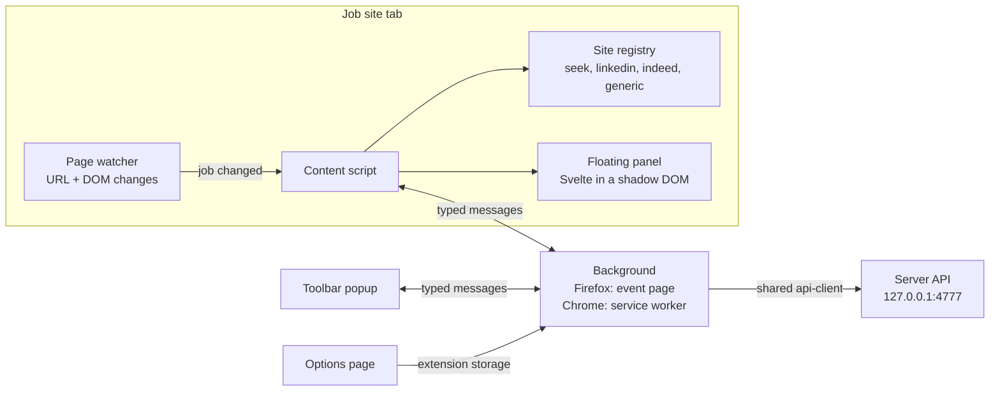

- **Content scripts** run only on Seek, LinkedIn and Indeed (`matches` in the manifest: `www.seek.com.au`, `www.seek.co.nz`, `*.linkedin.com`, `*.indeed.com`). On any other site, the popup's **Save this page** injects the generic reader (`generic.js`) once, using `activeTab` and `scripting`, so the extension doesn't need permission to read every website.
- **Readers** (`extension/src/sites/`): each site's selectors first, then the page's own JobPosting data (only when its title matches the title on screen), then nothing. On the three job sites, the ad's header facts (title, company, location, work type, salary) go above the description in the saved ad text, because the salary is often only in the header. A reader returns `null` until the ad's text is there, and when a split pane's own job link names another job. The generic reader uses your selection (over 200 characters), then the JobPosting data, then Readability. `npm run ext:check -- page.html URL` runs a reader on a page you saved.
- **Single-page sites:** Seek, LinkedIn and Indeed change the job without reloading the page. The page watcher (`watcher.ts`) checks the URL and the job id every 500 ms, and on page changes. When the id changes, it waits up to 5 seconds for that job's details, ignoring a pane that still shows the last job, reports the job, and reports again if more of it arrives in that time. If nothing arrives, the panel says it couldn't read the job and offers **Save selection** and **Save page**.
- **The panel** is a Svelte component in a shadow root (closed, so the site's scripts can't read your saved status or rating; the test build opens it). The site's CSS can't break it, and it can't break the site. It shows which job it's about, then one of: checking; already saved ("Saved · Applied 12 Oct", **Open in Job Registry**); likely the same as another job (**Same job** / **Different job**); new (**Save**, with Saved or Applied and an optional note); couldn't read; the app isn't running (**Try again**). The rating shows below. **Hide** (or Esc) tucks it away, and it stays tucked away.
- **Messages** between the content script, popup and background are one typed union in `extension/src/messages.ts`: `check`, `rate`, `save`, `captureActiveTab`, `openJob`, `health`. The background's work is in `handlers.ts`, behind a small `ChromeLike` port, so it's tested without a browser. Replies are `{ ok, data }` or `{ ok: false, error, offline }`.
- **Ratings:** one per tab at a time. A newer one aborts the older request in the browser, which cancels it on the server too, and the server's "latest wins" key (`tab-<id>`) is a second guard. Replies for a job you've left are dropped.
- **Badge:** the toolbar icon shows ✓ on pages you've already saved, from the `check` reply's exact match.
- **Shortcut:** `Alt+Shift+J` opens the popup.
- **Options:** server address (`http://127.0.0.1` or `http://localhost`, any port; default `:4777`), and rating jobs automatically, on or off. If you've taken away the extension's permission to reach this computer, the options page says so and offers **Allow access**.
- **Two browsers, one codebase:**
  - `manifest.base.json` holds what both share.
  - `manifest.firefox.json` adds `background.scripts` and `browser_specific_settings.gecko` (id `job-registry@local`, Firefox 140 or later).
  - `manifest.chrome.json` adds `background.service_worker`.
  - `build.mjs` (esbuild + esbuild-svelte) merges them into `extension/dist/firefox` and `extension/dist/chrome`; `--e2e` also builds `chrome-e2e` for the browser tests, which reads copies of the sites at `http://127.0.0.1:4798` and talks to the test server on 4799.
  - The code uses the promise-based `chrome.*` API, which works in both browsers.
- **Permissions:** `storage`, `activeTab`, `scripting`. Host permissions: `http://127.0.0.1/*`, `http://localhost/*` and the three job sites.
- **Signing:** `npm run ext:sign` signs the Firefox build as an unlisted add-on with your addons.mozilla.org keys (`WEB_EXT_API_KEY`, `WEB_EXT_API_SECRET`), so it stays installed in normal Firefox.

---

## 12. AI design

### 12.1 Tasks

| Task | Input | Output | Queue priority | Thinking | Streamed |
|------|-------|--------|----------------|----------|----------|
| `parseJob` | ad text (the page's `JobPosting` fields are already on the job, and the AI never overwrites them) | `ParsedJob` (JSON schema) | parse (background for the start-up sweep) | off | no |
| `rateJob` | master profile, preferences, ad | `Rating` (JSON schema) | interactive | off | no |
| `writeDocument` | kind, master profile, guide, the job's fields as plain text, its newest ad, today's date (cover letters) | Markdown | interactive, key `doc-<jobId>-<kind>` | on (`ai.tasks.write`: temperature 0.6, 8192 tokens, effort medium) | yes: it holds the queue until the stream ends, is cancelled, or the reader stops |
| `classifyEmail` | sender, subject, date, the email's new text (quoted history cut, a forward kept, 4,000 characters at most), up to 5 candidate jobs as `[id] Title at Company (Status)` | `{ event, jobId, company, role, confidence, summary }`: a `jobId` that wasn't a candidate becomes null; summary 200 and names 120 characters at most. The suggested status is plain code, not the AI (§7.5) | background | off (`ai.tasks.email`: temperature 0.1, 1024 tokens) | no |

- **Settings per task:** each task has its own block in `settings.json` (`ai.tasks.parse`, `ai.tasks.rate`, …), with model, temperature, maxTokens, thinking, thinkingEffort and extra request fields. So you can use the 27B model for documents and a smaller, faster one for ratings.
- **Thinking off** is `reasoning_effort: "none"` (§6.1). Bonsai 2 thinks at length by default, so tasks that don't need it turn it off.
- **Prompts are text files** in `server/modules/ai/prompts/*.md`, with `{{placeholders}}`. You can change wording without touching code.
- **Prompt order helps the cache.** The fixed part comes first: the instructions, then your profile. The ad comes last. llama-server reuses the cached start of the prompt, so repeat ratings are much faster.
- **Size limits:** ad text over about 12,000 characters is trimmed. The 32K context leaves room for the profile (usually 3–6K tokens), the ad and the answer.

### 12.2 Structured output

1. The request asks for `response_format: { type: "json_schema", … }`. The schema comes from the zod contract. llama-server, Ollama and LM Studio all support this.
2. The reply is checked with zod.
3. If the check fails, the request is retried once, with the error message added.
4. If it still fails, the task fails with a clear message. For parsing, the job keeps its raw ad and shows **Read again**.

### 12.3 Queue

- **One task runs at a time**, because there's one GPU.
- **Priority:** `interactive` (you're waiting) > `parse` > `background`. A waiting interactive task jumps ahead of parse and background tasks, but never stops one that's already running.
- **Cancelling:** every task takes an `AbortSignal`. Cancelling removes a waiting task, or aborts the HTTP call of a running one.
- **"Latest wins" keys:** a new task with the same key cancels the older one. Ratings use a key per browser tab.
- **Idle timer:** each task calls `runtime.touch()` when it ends, which resets the idle timer.

### 12.4 Runtime management (llama-server)

- **Start:** `spawn(exe, args, { windowsHide: true })`. The arguments come from settings, by default `-m ai/models/Ternary-Bonsai-2-27B-PQ2_0.gguf -ngl 99 -fa on -c 32768 --jinja --port 8080`, so a new PrismML release never needs a code change. `download-ai.bat` fetches the pinned build (`prism-b10777-e3de715`, CUDA 12.4) and the model, and checks each file's SHA-256.
- **Health check:** polls `http://127.0.0.1:8080/health` every 500 ms, for up to 120 seconds.
- **Stop:** after the idle timer (15 minutes by default), and whenever the app exits. On Windows it uses `taskkill /T /F`, so no orphaned process is left holding GPU memory. If taskkill doesn't finish in 10 seconds, the process is forced. A crash ends it synchronously on the way out, and the pid file covers anything that still slips through.
- **Already running:** if the port already answers when the app starts, the app uses that server and never stops it.

---

## 13. Cross-cutting concerns

**Configuration and secrets**

`config/settings.json` is checked by a zod schema. Missing keys fall back to defaults, so old files keep working after an upgrade. It contains:
- server port
- backup folder
- statuses
- AI preset and tasks
- auto-rate
- email (`enabled`, `address`, `host`, `port`, `mailbox`, `pollMinutes`, `firstCheckDays`, `maxPerCheck`; off by default).

`config/secrets.json` holds the IMAP app password (`{ "emailPassword": "…" }`). Both files are git-ignored. Paths in settings may be relative to the app folder.
- **Never sent out:** the API only says whether it's set. Only `app.ts` hands it to the email module, as a function.
- **Read fresh each time,** so a hand edit counts at once. A broken file gives a fixed sentence that never quotes the file's text.
- **Spaces are removed,** because Google shows an app password in groups of four.
- **Not backed up:** backups copy the database, attachments, profile and templates, never `config/`.

Each status has these settings:
- `id`
- `label`
- `closed` (true or false)
- `order`
- `setsAppliedDate` (true for Applied, so date-applied logic doesn't hard-code a status name).

**Errors**
- `server/core/errors.ts` defines `AppError` and its subclasses: `NotFound`, `Validation`, `Conflict` and `AiUnavailable`.
- One Fastify error handler maps them to the error shape in §9.
- Unknown errors are logged with a stack trace and returned as `internal`, without leaking details.

**Logging:** pino, through Fastify. In development it logs to the console. Otherwise it logs to `data/logs/app-YYYY-MM-DD.log` and keeps 14 days. The AI process logs to `data/logs/llama.log`. Logs never include email bodies or secrets: imapflow's logging is off, and an email check logs only counts or the reason it stopped.

**Security** (local only, by design):
- The server listens on `127.0.0.1` only.
- **Host check:** the `Host` header must be `127.0.0.1:4777` or `localhost:4777`. This blocks DNS-rebinding attacks.
- **Origin check on writes:** every `POST`, `PATCH`, `PUT` and `DELETE` must carry an Origin that is the dashboard itself, `moz-extension://…` or `chrome-extension://…`. Writes must also be JSON or multipart uploads, so a plain HTML form on another website can't submit to the app.
- **CORS:** none, for anyone. Job Registry's extension reaches the server through its host permission, so it doesn't need CORS; with CORS, any other installed extension could read your data. (Changed in Phase 3; the earlier plan allowed CORS for extension origins.)
- **nosniff:** every reply says `X-Content-Type-Options: nosniff`.
- **Dashboard-only writes:** a route can declare `config: dashboardOnly(message)`, and then refuses extension origins too. `PATCH /settings` does: settings choose which program the app runs and where your profile and ads are sent, so no installed extension may change them.
- **Markdown:** escaped and sandboxed (see §10).
- **Email:** read-only over IMAP with TLS. Every `/email` write and the secrets endpoint are dashboard-only, so no installed extension can confirm a suggestion or read the password. An email's text is only data: the AI may only pick a candidate job, and the status comes from plain code.
- **Phone access over the home network** was offered in Phase 6 and not chosen, so the server still listens on `127.0.0.1` only. Adding it would need a passcode and a session cookie first.

**Backups**
- On each start, and every 24 hours while running, the app uses SQLite's online backup (safe while the app runs). Copies go to `backupDir`. The newest copy from each of the last 14 days that have one is kept (`backups.keep`). One backup runs at a time, so a second request joins the one already running.
- In the same pass, three folders are copied into the backup folder: `data/files/` (attachments) to `<backupDir>/files/`, plus `profile/` and `templates/` under their own names. Git never keeps the last two, so this is their only copy outside the app folder.
  - Only new and changed files are copied, by size and by time within 2 seconds (FAT and OneDrive keep times to 2 seconds). Nothing in the backup is deleted, so a file removed by mistake is still there.
  - A file that can't be copied is logged and skipped. The rest are still copied, and the database backup still counts.

**Profile, templates and attachments**
- `profile/` (your Markdown files) and `templates/` (the CSS) are git-ignored. The starters in `starters/profile/` and `starters/templates/` (the two guides and the two templates) are copied in at start-up wherever a file is missing, and never over one. There's no starter master profile or preferences file, because one would be rated as if it were yours.
- Attachments: 15 MB at most, and only `.pdf .docx .doc .rtf .txt .odt` files (by extension). The name is cleaned: no path, no characters Windows refuses, no device names like `CON`, and 100 characters at most. Downloads are always `Content-Disposition: attachment`, with `nosniff`.
- Keep the live database out of OneDrive. Pointing the backup folder at OneDrive is fine.

**Locale:** Australian English in the UI, dates shown as "28 Oct 2026", AUD as the default currency for salary display, local timezone for display.

---

## 14. Testing strategy

| Level | What | How | Fakes |
|-------|------|-----|-------|
| Pure functions | `shared/canonical-url`, `shared/phone`, `shared/fact-check`, `capture/jsonld`, `jobs/match`, search query builder | Vitest, table-driven cases | none |
| Services | each module's logic, with its real repo | Vitest, in-memory SQLite (`:memory:`) with real migrations | `FakeAiProvider`, `FakeRuntime`, `FakeMailSource`, fake clock |
| API | routes, validation, error shape, Host and Origin checks | `fastify.inject` on `buildApp()` with fakes | as above |
| Site extractors | Seek, LinkedIn, Indeed, generic; the page watcher | Vitest + `linkedom`, on HTML fixtures in `tests/fixtures/sites/` (hand-made from each site's structure, plus a trimmed real LinkedIn page), fake timers for the watcher | — |
| Extension background | check, save, rate (latest wins), badge, offline, no permission, time limits | Vitest, `handlers.ts` against a real listening test app | `FakeChrome`, fake AI |
| Extension end to end | the panel on copies of the sites, saving, five quick clicks with one finished rating, the popup | Playwright, the real extension (test build) in Chromium; Firefox has no way to load an extension in Playwright, so it's covered by `web-ext lint` and the Windows checklist | fake AI |
| Dashboard | paste, search, status, call log, document edit and preview, print view | Playwright against the built app, started with `JR_FAKE_AI=1` | fake AI wired by `app.ts` |
| AI quality | parsing accuracy per field on 8–10 real ads | `npm run eval:parse` against the real model. A report, not a pass/fail test | none |
| Architecture | the dependency rules in §15 | `npm run check:deps` | — |
| Email | the first filter, `suggestStatus`, email text; the service (checks, cursor, confirm, the timer); the IMAP adapter | Vitest, table-driven; the service through `buildApp`; the adapter against hoodiecrow-imap (a strict IMAP server for tests, dev only) on a free port, without TLS | `FakeMailSource`, fake AI |
| Windows scripts | `setup.bat`, `start.bat`, `stop.bat`, `download-ai.bat`, shortcuts, llama-server on Windows | The handover checks (`scripts/handover/`, run by Bonsai 2 from `docs/handover/runbook.md`) on a test copy of the app; their logic and HTTP checks are tested on the Mac in `tests/handover.test.ts`, against a fake llama-server | fake llama-server (Mac only) |

**When the site fixtures need refreshing:** if a job site changes its layout, save a new copy of the page into the fixtures. The failing test then shows exactly which field broke.

---

## 15. Dependency rules and how they're enforced

| # | Rule | Enforced by |
|---|------|-------------|
| R1 | No import cycles anywhere. | dependency-cruiser `no-circular` |
| R2 | A module imports another module only through its `index.ts`. | dependency-cruiser path rule |
| R3 | A module may depend only on the modules shown in §4.2. | dependency-cruiser allow-list, one rule per composite module, and "no module imports" for foundation modules |
| R4 | `service.ts` and `repo.ts` never import `fastify`. | dependency-cruiser |
| R5 | Only `repo.ts` files and `core/db` import `better-sqlite3`. | dependency-cruiser |
| R6 | `shared/` imports nothing from `server/`, `web/` or `extension/`. Only `zod` and `marked` are allowed. | dependency-cruiser |
| R7 | `web/` and `extension/` never import from `server/`. | dependency-cruiser |
| R8 | Only `server/app.ts` imports module factories, adapters and the settings module. Another module may import a module's `index.ts` for its types only; the service itself arrives as an argument. `main.ts` reaches modules only through `app.ts`. | dependency-cruiser `only-app-wires-modules` (runtime imports between modules) and `main-uses-app` |
| R9 | TypeScript uses erasable syntax only, so Node can run it directly. That means no `enum` and no constructor parameter properties. | `tsconfig` `erasableSyntaxOnly` + `tsc --noEmit` |
| R10 | `core` never imports from a module. | dependency-cruiser `core-not-modules` |
| R11 | `service.ts` files never use database code from `core/db` (types are fine). SQL helpers such as constraint checks live in `repo.ts`. | dependency-cruiser `no-sql-in-services` |
| R12 | In the extension, only the background script (`background.ts`, `handlers.ts`) uses `shared/api-client.ts`. Content scripts, the panel and the popup ask the background. | dependency-cruiser `only-background-calls-server` |

`adapters-only-from-index` also covers `server/modules/<name>/runtime/` and `exporters/`. Module code uses the ports (`ai/provider.ts`, `ai/runtime.ts`, `documents/exporter.ts`), and only `index.ts` exposes the adapters, runtimes and exporters, for `app.ts` to wire.

`npm test` runs `tsc --noEmit`, then `check:deps`, then Vitest. One test file deliberately breaks a rule, inside a temporary folder, and confirms the check fails, so the rules can't quietly stop working.

---

## 16. How to extend

**Add a job site**
1. Add `extension/src/sites/<site>.ts` that implements `SiteExtractor`.
2. Register it in `extension/src/sites/index.ts`, before `generic`.
3. Add its URL rule to `shared/canonical-url.ts`, with tests.
4. Add the site to `matches` and `host_permissions` in `manifest.base.json`.
5. Save a fixture page to `tests/fixtures/sites/` and add an extractor test.

**Swap the AI model or server:** Settings → AI → pick a preset, or enter a URL and model name, then click **Test**. No code change.

**Add a new kind of AI service** (for example, one that doesn't speak the OpenAI API): write an adapter that implements `AiProvider`, and choose it in `app.ts` by preset name.

**Read mail another way** (say, the Gmail API): implement `MailSource` in `email/adapters/` and choose it in `app.ts`. The cursor is the adapter's to define.

**Add an export format:** implement `DocumentExporter` and add it to the `exporters` list in `app.ts`. The button appears in the editor by itself.

**Add or rename a status:** Settings → Statuses. History stays valid because it stores status ids.

**Add a new module**
1. Create a folder with `index.ts`, `service.ts`, `repo.ts` and `routes.ts`, plus a migration if it owns tables.
2. Wire it in `app.ts`.
3. Add its events to `core/events.ts`.
4. Add its allowed dependencies to the dependency-cruiser config and to §4.2 of this document.

---

## 17. Risks

| Risk | Impact | What we do about it |
|------|--------|---------------------|
| A job site changes its page layout | Its extractor stops finding fields | One small file per site, fixture tests, a generic fallback, and "save highlighted text" always works |
| PrismML changes llama-server flags or file formats | AI won't start | Arguments live in settings, not code. Setup downloads a pinned, known-good release. You can switch to Ollama with another model |
| Small-model quality varies | Wrong fields or weak drafts | JSON-schema output with checks, a per-field eval set, model choice per task, edit-before-save everywhere, fact-check highlights |
| `better-sqlite3` has no prebuilt binary for a very new Node version | `npm ci` fails on Windows | Setup checks for a supported Node LTS version, and `.nvmrc` and `engines` pin it |
| Firefox signing needs an addons.mozilla.org account | Extension disappears after a restart | One-time setup, documented. Temporary loading still works for testing |
| Gmail app passwords might get restricted | Email reading stops | Rechecked on 28 Oct 2026: still offered with 2-Step Verification, no end date (work and school accounts may not offer them). `MailSource` lets us switch to a Gmail API adapter |
| Thinking tokens leaking into documents | Garbage in the resume | The adapter separates `thinking` chunks, including `<think>` tags split across stream chunks. Tests cover this |
| Firefox doesn't grant (or you take away) the extension's permission to reach `127.0.0.1` | The extension can't save or rate | It says so in plain words, and its options page has **Allow access**. If Firefox proves unreliable here, CORS can come back for the extension's own routes only |
| Antivirus software that scans email swaps Gmail's certificate | Email reading stops with a certificate error | The error says so in plain words. Node's `--use-system-ca` would trust the Windows certificate store; it's checked on the PC first (handover) |
| A Chrome service worker may be stopped while a fetch waits more than about 30 seconds | A first rating while the AI loads could be lost | The panel then asks you to reload the page; the Windows checklist checks a first rating with Bonsai in Chrome. If it happens, ratings can move to a long-lived port (`runtime.connect`) |
| A server refuses a request field (for example `reasoning_effort`) | Every AI task fails | The error names the server and shows its message. A task's `extra` can remove the field, and Test connection sends what reading an ad sends |

---

## 18. Changes from the plan

Writing this document turned up a few improvements. [plan.md](plan.md) has been updated to match.

1. **Five new small modules:**
   - `profile`: owns the profile and template files.
   - `ratings`: owns the rating cache.
   - `enrich`: runs the AI after a save, so `jobs` never depends on `ai`.
   - `callsheet`: the read-only one-screen view.
   - `live`: pushes events to the dashboard.

   Plus `system` for health, backups and shutdown.
2. **The fact-check moved to `shared/fact-check.ts`**, so it runs in the browser as you type. The plan had it on the server, which would mean a request on every keystroke.
3. **Duplicate matching lives in `server/modules/jobs/match.ts`.** The plan named two different places.
4. **Markdown rendering is shared** (`shared/markdown.ts`). The dashboard preview, the print view and the .docx export all render the same way.
5. **The extension's content scripts never call the server themselves.** The background script makes every call, because of browser cross-site rules.
6. **Statuses have stable ids and a `setsAppliedDate` flag**, so renaming a status never breaks history.
7. **Secrets live in their own git-ignored `config/secrets.json`.**
8. **Fields you edit by hand are never overwritten by the AI.** Each job tracks where each field came from.
9. **The extension's popup and panel use Svelte too**, so the whole app uses one UI framework.
