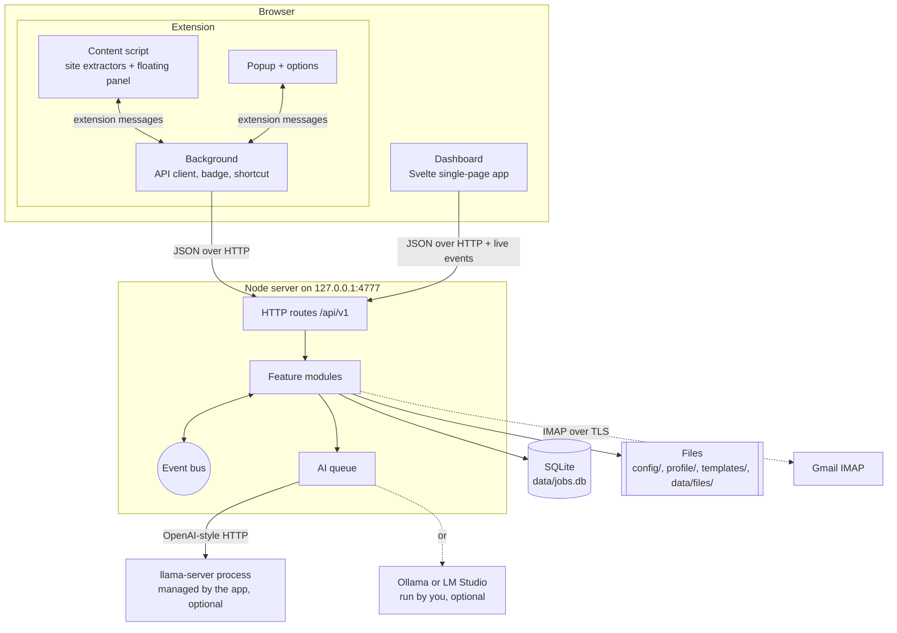
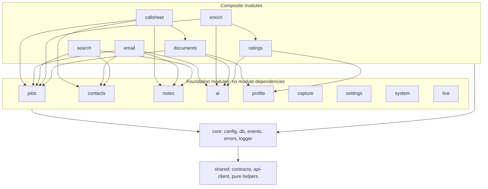
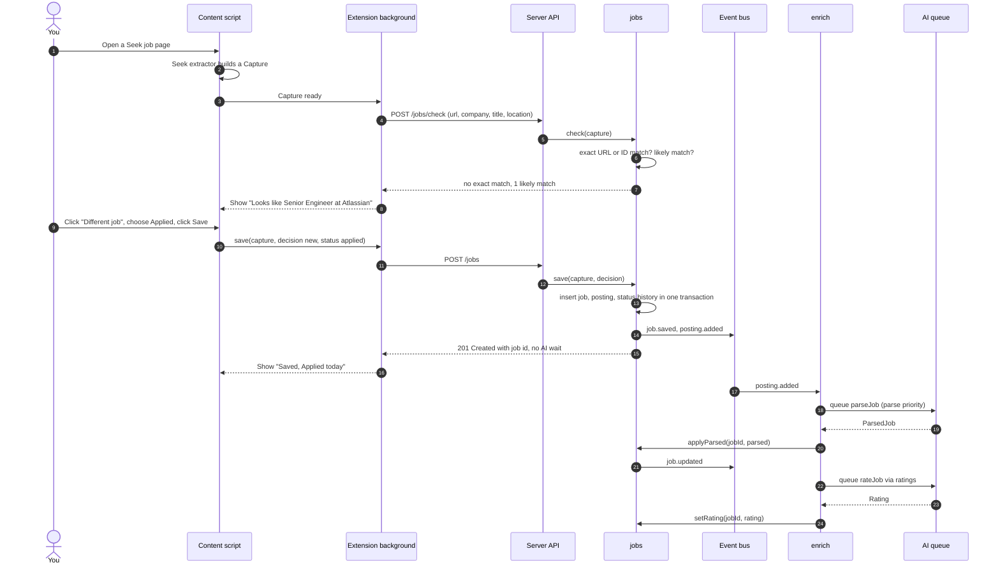
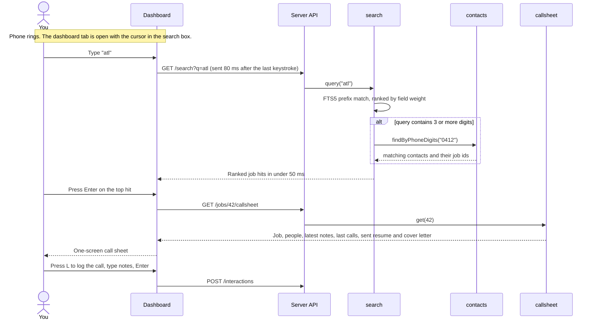
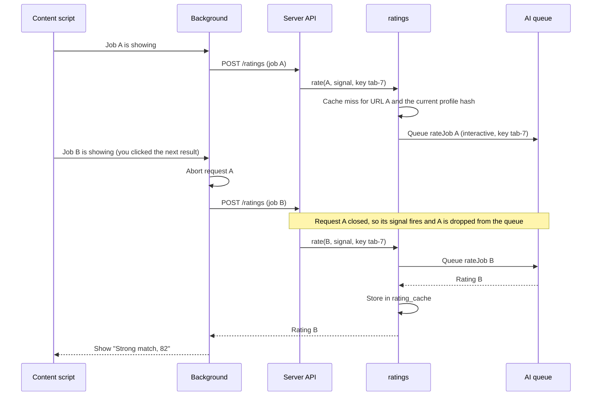
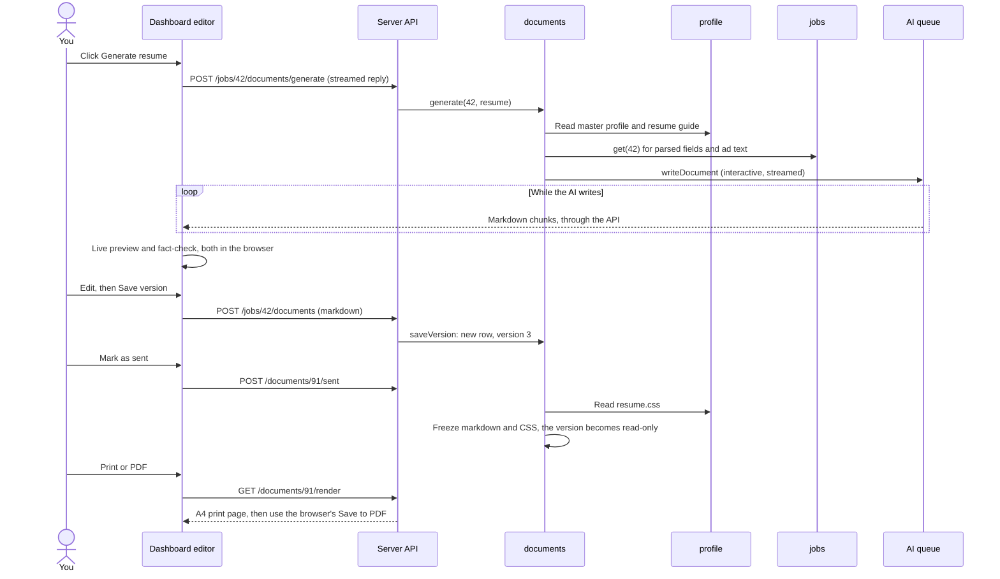
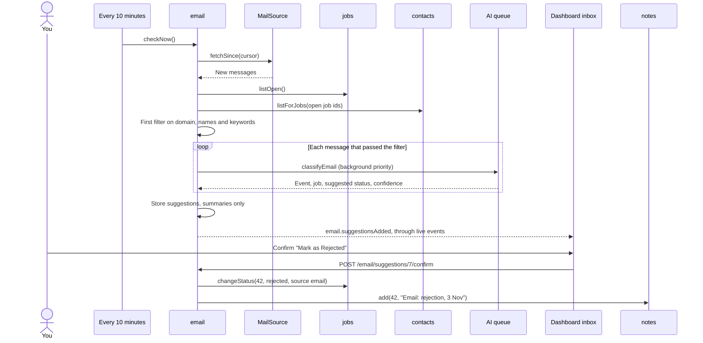
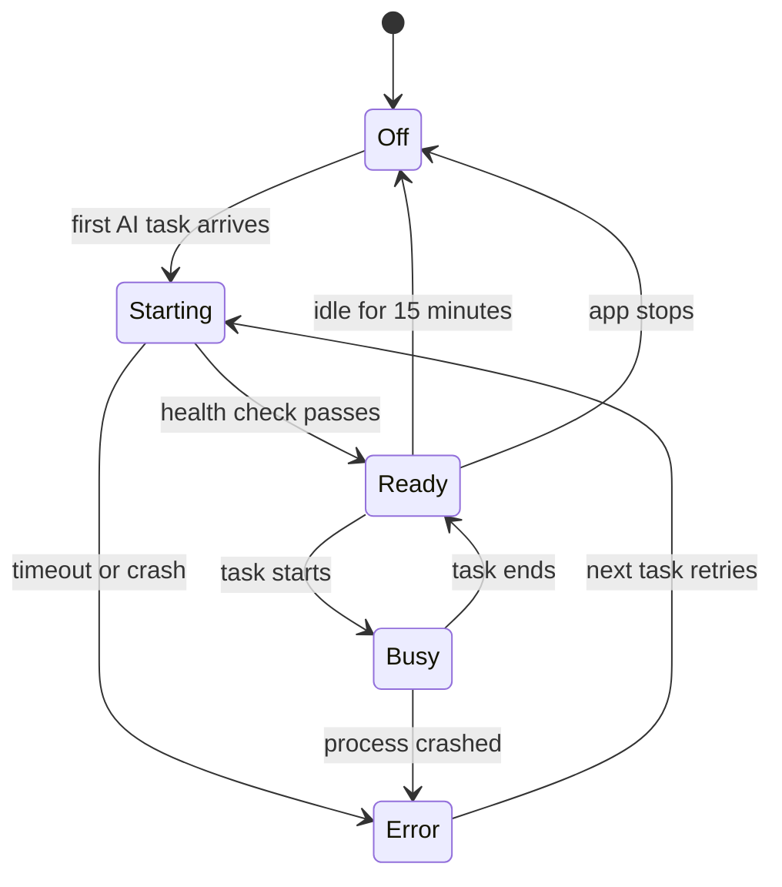
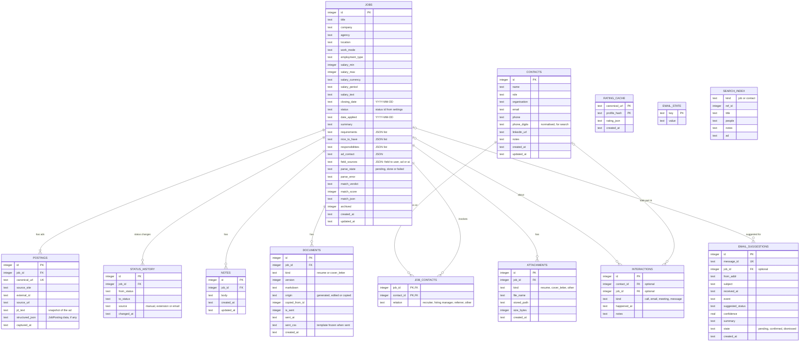
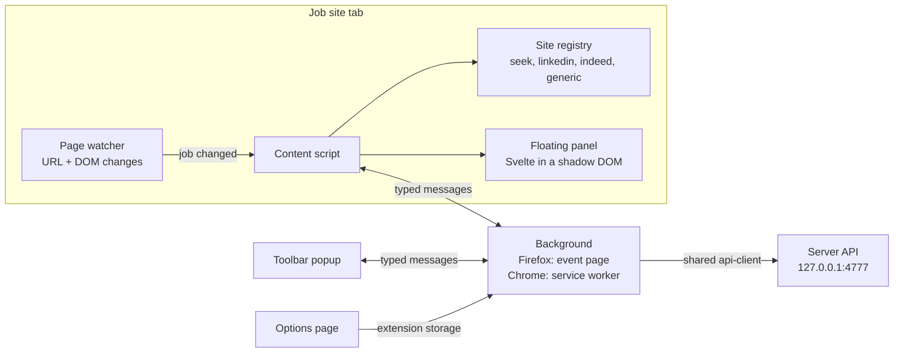

# Job Registry — architecture

**Status:** Approved on 28 Oct 2026. Change it only on purpose: update this document in the same piece of work as the code.

This document explains how the app is built and why. It covers:
- how the parts fit together
- the rules that keep them loosely coupled
- how to extend the app without breaking it.

The plan in [plan.md](plan.md) covers *what* gets built and in which order. Each key choice has a short record in [decisions/](decisions/).

The diagrams use Mermaid. They render on GitHub, or in VS Code with the "Markdown Preview Mermaid Support" extension.

---

## Contents

1. [Quality goals](#1-quality-goals)
2. [System context](#2-system-context)
3. [Containers](#3-containers)
4. [Server modules](#4-server-modules)
5. [Events](#5-events)
6. [Ports and adapters](#6-ports-and-adapters)
7. [Key flows](#7-key-flows)
8. [Data model](#8-data-model)
9. [API contract](#9-api-contract)
10. [Dashboard](#10-dashboard)
11. [Browser extension](#11-browser-extension)
12. [AI design](#12-ai-design)
13. [Cross-cutting concerns](#13-cross-cutting-concerns)
14. [Testing strategy](#14-testing-strategy)
15. [Dependency rules and how they're enforced](#15-dependency-rules-and-how-theyre-enforced)
16. [How to extend](#16-how-to-extend)
17. [Risks](#17-risks)
18. [Changes from the plan](#18-changes-from-the-plan)

---

## 1. Quality goals

When two goals pull against each other, the higher one wins.

| # | Goal | What it means in practice |
|---|------|---------------------------|
| 1 | **Private** | All data stays on your PC. The server listens on `127.0.0.1` only. The AI runs locally. Nothing calls a cloud service unless you add one. |
| 2 | **Fast to find** | From the first keystroke to search results takes under 50 ms on 1,000 jobs. Opening a call sheet takes under 200 ms. |
| 3 | **Fast to save** | Saving never waits for the AI. The AI fills in details afterwards. |
| 4 | **Maintainable** | Small modules with clear owners. Outside systems sit behind interfaces. The rules are checked by a script, not just written down. |
| 5 | **Swappable AI** | Changing the model or the AI server is a settings change, not a code change. |
| 6 | **Simple to run** | Run `setup.bat` once, then `start.bat`. You don't need to install a database server, Docker or Office. |

---

## 2. System context


- **You** use the dashboard (a browser tab) and the extension.
- **The extension** reads only the job pages you open. It never crawls sites in the background.
- **The app** stores everything and owns all the logic.
- **The local AI** is a separate program the app talks to over HTTP. The app can start and stop it.
- **Gmail** is optional and read-only (Phase 5).

---

## 3. Containers

A "container" here means a separately running or separately stored part. It's not Docker.



| Container | Technology | What it does | Talks to |
|-----------|-----------|--------------|----------|
| Node server | Node.js LTS, TypeScript (run directly, no build), Fastify | API, business logic, serves the dashboard, manages the AI process | SQLite, files, AI server, IMAP |
| Dashboard | Svelte 5 + Vite, built to static files | Search, call sheet, job details, document editor, settings, inbox | Server API, plus a live event stream (SSE) |
| Extension | TypeScript + Svelte, built with esbuild, two manifests (Firefox, Chrome) | Reads job pages, shows the save and rating panel, toolbar popup | Server API, **from the background script only** |
| SQLite database | `better-sqlite3`, WAL mode, FTS5 | Jobs, ads, contacts, notes, documents, search index | — |
| Files | Plain text and CSS on disk | Settings, secrets, profile, templates, attachments, backups, logs | — |
| llama-server | PrismML's build of llama.cpp | Runs Bonsai 2 on the GPU. Started on demand, stopped when idle | — |

Content scripts run inside the job site's page, so the browser's cross-site rules (CORS) apply to them. The background script has host permission for `127.0.0.1:4777`, so it can call the server freely. That's why every server call goes through the background.

---

## 4. Server modules

### 4.1 Module map

The server is split **by feature**. Each module owns its own data. No other module touches that data directly.

| Module | Owns | Public functions (examples) | Depends on |
|--------|------|-----------------------------|------------|
| `system` | backups, health check, shutdown, logs | `health()`, `backupNow()`, `shutdown()` | — |
| `settings` | `config/settings.json`, `config/secrets.json` | `get()`, `update(patch)`, `statuses()` | — |
| `profile` | `profile/*.md`, `templates/*.css` | `read(name)`, `write(name, text)`, `hash()` | — |
| `capture` | nothing (stateless) | `fromUrl(url)`, `fromText(text)` | — |
| `ai` | AI process and queue (no tables) | `parseJob()`, `rateJob()`, `writeDocument()`, `classifyEmail()`, `state()`, `test()` | — |
| `jobs` | `jobs`, `postings`, `status_history` | `save()`, `check()`, `get()`, `list()`, `update()`, `changeStatus()`, `addPosting()`, `applyParsed()`, `setRating()`, `listOpen()` | — |
| `contacts` | `contacts`, `job_contacts`, `interactions` | `create()`, `update()`, `linkToJob()`, `logInteraction()`, `listForJob()`, `findByPhoneDigits()` | — |
| `notes` | `notes` | `add()`, `update()`, `remove()`, `listForJob()` | — |
| `ratings` | `rating_cache` | `rate(input, { signal, key })` | `ai`, `profile` |
| `enrich` | nothing | listens for new ads, then parses and rates them; `reparse(jobId)` | `jobs`, `ai`, `ratings` |
| `documents` | `documents`, `attachments`, `data/files/` | `generate()`, `saveVersion()`, `markSent()`, `render()`, `export()`, `copyFrom()`, `attach()` | `ai`, `profile`, `jobs` |
| `search` | `search_index` | `query(q)`, `reindexJob(id)`, `rebuild()` | `jobs`, `contacts`, `notes` |
| `callsheet` | nothing (read-only view) | `get(jobId)`: everything for the one-screen view | `jobs`, `contacts`, `notes`, `documents` |
| `email` | `email_suggestions`, `email_state` | `checkNow()`, `listSuggestions()`, `confirm()`, `dismiss()` | `ai`, `jobs`, `contacts`, `notes` |
| `live` | open dashboard connections | forwards chosen events to the dashboard | — |

Every module also uses `core` (config, database connection, events, errors, logger) and `shared` (contracts and pure helpers).

**Modules get their settings as plain functions.** For example, `ai` receives `getAiConfig()` from `app.ts`. It never imports the `settings` module. So only `app.ts` knows where settings come from.

### 4.2 Allowed dependencies

An arrow means "may call". There are no cycles. A module may only call modules shown below it.



Why it's shaped like this:
- **`jobs` doesn't depend on `ai`.** The `enrich` module does the AI work after a save. So saving can't wait for the AI, by design and not just by care.
- **`ai` knows nothing about jobs.** It takes text in and gives typed results back. It can be tested with plain strings.
- **`search` reads through services, not tables.** It rebuilds a job's index entry by asking `jobs`, `contacts` and `notes` for the current data.
- **`callsheet` is a read-only view.** It joins data from four modules for one screen, so the dashboard makes one request instead of six.

### 4.3 Inside a module

```
server/modules/jobs/
  index.ts       public surface: createJobsModule(deps) → { service, routes } and exported types
  service.ts     the logic. Plain inputs, plain outputs. No Fastify, no SQL.
  repo.ts        all SQL for this module's tables. Nothing else in the app writes these tables.
  routes.ts      Fastify routes. Checks input with shared contracts, calls the service, returns DTOs.
  match.ts       pure helper (finding duplicates), used by service.ts
  *.test.ts      tests sit next to the code
```

- **Other modules import only `index.ts`.** Everything else in the folder is private.
- A service receives what it needs as arguments: its repo, the event bus, other modules' services and config functions. It never builds these itself.

### 4.4 Composition root

`server/app.ts` is the only place that creates and connects things. It's plain code, with no dependency-injection framework.

```ts
export function buildApp(opts: AppOptions, fakes: Partial<Fakes> = {}) {
  const db = openDb(opts.paths.db);               // runs migrations, WAL mode, foreign keys on
  const bus = createEventBus(logger);
  const settings = createSettingsModule({ paths: opts.paths, bus });
  const profile = createProfileModule({ dir: opts.paths.profile, bus });

  const ai = createAiModule({
    provider: fakes.ai ?? createOpenAiCompatibleProvider(() => settings.get().ai),
    runtime: fakes.runtime ?? pickRuntime(() => settings.get().ai),  // LlamaServerRuntime or NoopRuntime
    getConfig: () => settings.get().ai,
    bus,
  });

  const jobs = createJobsModule({ db, bus, statuses: () => settings.statuses() });
  const contacts = createContactsModule({ db, bus });
  const notes = createNotesModule({ db, bus });
  const ratings = createRatingsModule({ db, ai: ai.service, profile: profile.service });
  createEnrichModule({ bus, jobs: jobs.service, ai: ai.service, ratings: ratings.service });
  const documents = createDocumentsModule({ db, bus, ai: ai.service, profile: profile.service,
                                            jobs: jobs.service, filesDir: opts.paths.files,
                                            exporters: [printHtmlExporter, docxExporter] });
  const search = createSearchModule({ db, bus, jobs: jobs.service, contacts: contacts.service, notes: notes.service });
  const callsheet = createCallsheetModule({ jobs: jobs.service, contacts: contacts.service,
                                            notes: notes.service, documents: documents.service });
  const email = createEmailModule({ db, bus, mail: fakes.mail ?? pickMailSource(() => settings.get().email),
                                    ai: ai.service, jobs: jobs.service, contacts: contacts.service, notes: notes.service });
  const live = createLiveModule({ bus });

  const http = Fastify({ logger });
  registerSecurity(http, opts.server);            // Host and Origin checks, JSON-only writes
  registerErrorHandler(http);                     // AppError → HTTP status
  for (const m of [settings, profile, capture, ai, jobs, contacts, notes, ratings,
                   documents, search, callsheet, email, live, system]) {
    http.register(m.routes, { prefix: '/api/v1' });
  }
  serveDashboard(http, opts.paths.webDist);
  return { http, db, bus, close };
}
```

Tests call the same `buildApp` with fakes, such as `FakeAiProvider`, `FakeRuntime`, `FakeMailSource` and an in-memory database. So tests run the real wiring.

---

## 5. Events

Events let modules react to each other without calling each other. All event names and payloads are defined in one typed map, in `server/core/events.ts`. That map is the contract between modules.

| Event | Payload | Sent by | Heard by |
|-------|---------|---------|----------|
| `job.saved` | `{ jobId }` | jobs | search, live |
| `job.updated` | `{ jobId, fields }` | jobs | search, live |
| `job.statusChanged` | `{ jobId, from, to, source }` | jobs | search, live |
| `posting.added` | `{ jobId, postingId }` | jobs | enrich, search |
| `note.added` / `note.updated` / `note.removed` | `{ jobId, noteId }` | notes | search, live |
| `contact.saved` | `{ contactId, jobIds }` | contacts | search, live |
| `contact.linked` / `contact.unlinked` | `{ contactId, jobId }` | contacts | search, live |
| `interaction.logged` | `{ interactionId, contactId, jobId }` | contacts | search, live |
| `document.saved` / `document.sent` | `{ jobId, documentId }` | documents | live |
| `profile.changed` | `{ name }` | profile | live (ratings use the profile hash, so stale ratings are skipped) |
| `settings.changed` | `{ keys }` | settings | ai (reload provider), email (restart timer), live |
| `ai.stateChanged` | `{ state, detail }` | ai | live |
| `enrich.done` / `enrich.failed` | `{ jobId, step, error? }` | enrich | live |
| `email.suggestionsAdded` | `{ count }` | email | live |

**Delivery rules**

1. Events are sent **after** the database transaction commits. A listener never sees data that might still roll back.
2. Payloads are **small**: IDs plus what changed. Listeners read the current data through services, so they never act on a stale copy.
3. Listeners run straight away, one after another. Each runs inside its own try/catch. A failing listener is logged and **never** breaks the action that sent the event. For example, a search-index failure can't stop a save.
4. Slow work, like anything involving the AI, goes onto the AI queue. It never runs inside the listener.
5. If the search index ever drifts, **Settings → Rebuild search index** rebuilds it from scratch.

---

## 6. Ports and adapters

Every outside system sits behind a small interface, called a **port**. The code behind it, the **adapter**, can be swapped without touching the rest of the app. The interfaces below are the contract. Field names may change a little during the build.

### 6.1 `AiProvider` — talking to any AI server

```ts
interface AiProvider {
  chat(req: ChatRequest, opts?: { signal?: AbortSignal }): Promise<ChatResult>;
  chatStream(req: ChatRequest, opts?: { signal?: AbortSignal }): AsyncIterable<ChatChunk>;
  health(): Promise<{ ok: boolean; models?: string[]; detail?: string }>;
}

type ChatRequest = {
  messages: { role: 'system' | 'user' | 'assistant'; content: string }[];
  model?: string;
  temperature?: number;
  maxTokens?: number;
  jsonSchema?: { name: string; schema: object };   // constrained JSON output
  thinking?: boolean;                               // adapter maps this per server type
  extra?: Record<string, unknown>;                  // passed through as-is, from settings
};
type ChatChunk = { kind: 'text' | 'thinking'; text: string };
```

| Adapter | Covers | Notes |
|---------|--------|-------|
| `OpenAiCompatibleProvider` | llama-server, Ollama, LM Studio, vLLM, any `/v1/chat/completions` server | `thinking: false` becomes `chat_template_kwargs.enable_thinking=false` for llama-server, and Ollama's own option for Ollama. Chain-of-thought ("thinking") tokens come back as `kind: 'thinking'` and are never put into documents. |
| `FakeAiProvider` | tests | Returns scripted replies and can simulate slowness, errors and cancelling. |
| *(later, optional)* `AnthropicProvider` or another cloud API | — | Only if you ever want it. It goes against the "private" goal, so it would be off by default. |

### 6.2 `ModelRuntime` — starting and stopping the AI program

```ts
interface ModelRuntime {
  ensureRunning(signal?: AbortSignal): Promise<void>;  // starts the process if needed, waits for /health
  touch(): void;                                        // resets the idle timer
  stop(): Promise<void>;
  state(): 'off' | 'starting' | 'ready' | 'busy' | 'error';
}
```

| Adapter | Used when |
|---------|-----------|
| `LlamaServerRuntime` | The preset is "Bonsai 2 via llama-server" and `managed: true`. It spawns `llama-server.exe` with no console window and sends its logs to `data/logs/llama.log`. If something is already answering on the port, it uses that and won't kill a process it didn't start. |
| `NoopRuntime` | Ollama, LM Studio or a custom server you run yourself. `ensureRunning` only checks that the server is there. |

### 6.3 `MailSource` — reading email (Phase 5)

```ts
interface MailSource {
  fetchSince(cursor: MailCursor | null, opts: { maxMessages: number; sinceDays: number }):
    Promise<{ messages: MailMessage[]; cursor: MailCursor }>;
  test(): Promise<void>;
}
type MailMessage = { id: string; from: string; to: string; subject: string; receivedAt: string; text: string };
```

Adapters: `ImapMailSource` (Gmail over IMAP with an app password), `FakeMailSource` (tests), and later, if needed, `GmailApiMailSource`.

### 6.4 `DocumentExporter` — turning a document into a file

```ts
interface DocumentExporter {
  id: 'print-html' | 'docx' | string;
  label: string;                                   // shown on the button
  export(doc: { title: string; markdown: string; css: string }):
    Promise<{ contentType: string; fileName: string; body: Buffer | string }>;
}
```

Adapters: `PrintHtmlExporter` (an A4 HTML page you print to PDF) and `DocxExporter` (the `docx` library). The dashboard asks the server which exporters exist, and shows one button per exporter.

### 6.5 `SiteExtractor` — reading a job site (in the extension)

```ts
interface SiteExtractor {
  id: 'seek' | 'linkedin' | 'indeed' | 'generic' | string;
  matches(url: URL): boolean;
  currentJobId(url: URL, doc: Document): string | null;  // handles split-pane search pages
  extract(doc: Document, url: URL): Promise<Capture | null>;
}
```

Adapters: one file each in `extension/src/sites/`. The registry tries them in order, and `generic` comes last. Generic uses the page's schema.org `JobPosting` data first, then Mozilla Readability, then any text you highlighted.

### 6.6 Shared types used by the ports

```ts
type Capture = {                // what the extension or capture module produces
  sourceUrl: string; canonicalUrl: string; sourceSite: string; externalId?: string;
  title?: string; company?: string; location?: string;
  jdText: string; structured?: Partial<ParsedJob>; capturedAt: string;
};
type ParsedJob = {
  title: string; company: string | null; agency: string | null; location: string | null;
  workMode: 'onsite' | 'hybrid' | 'remote' | 'unknown';
  employmentType: 'full-time' | 'part-time' | 'contract' | 'temporary' | 'casual' | 'unknown';
  salary: { min: number | null; max: number | null; currency: string | null;
            period: 'year' | 'day' | 'hour' | null; text: string | null };
  closingDate: string | null; summary: string;
  requirements: string[]; niceToHave: string[]; responsibilities: string[];
  adContact: { name: string | null; email: string | null; phone: string | null } | null;
};
type Rating = {
  verdict: 'strong' | 'good' | 'stretch' | 'weak'; score: number;  // 0–100
  why: string[]; whyNot: string[]; dealBreakers: string[]; salaryNote: string | null;
};
```

All of these are zod schemas in `shared/contracts/`. The TypeScript types are derived from those schemas, so there's one source of truth.

---

## 7. Key flows

### 7.1 Save a job from the extension, with the "Same job?" check



Notes:
- **Fields you've edited by hand are never overwritten.** `applyParsed` only fills empty fields, or fields that still hold an earlier AI value. Each field remembers whether it came from you, the ad's structured data or the AI.
- **If the AI is off or fails**, the job stays saved with `parse_state = failed`. The job page shows a **Parse again** button.

### 7.2 Recruiter calls: search, then the call sheet



Order of results:

1. Phone-number matches come first.
2. Then open jobs come before closed ones.
3. Within each group, the best text match comes first. The company, agency and title count most (weight 10), then people: names, emails and phones (5). Then notes, calls and location (2), and the ad text last (1).
4. If two results tie, the most recently updated comes first.

Archived jobs are left out. A person shows as their own result only when they aren't linked to any job, because otherwise their jobs already show.

### 7.3 Match rating, with stale requests cancelled



The queue also enforces "latest wins" per key. A new task with the same key cancels the older one, even if the browser didn't abort it.

### 7.4 Generate a resume, check it, send it



The fact-check is plain code in `shared/fact-check.ts`. The browser runs it on every edit, after a short pause. It needs the master profile text, which the editor loads once.

### 7.5 Email suggestion, then you confirm (Phase 5)



### 7.6 AI process states



The dashboard shows this state in a small pill in the header, which updates live.

---

## 8. Data model



**Conventions**
- **IDs and keys:** IDs are whole numbers. Foreign keys are switched on. The database uses WAL mode, so reads never block writes.
- **Time:** timestamps are ISO 8601 in UTC (`2026-10-28T03:15:00Z`). Plain dates like `closing_date` and `date_applied` are local dates (`YYYY-MM-DD`). The dashboard shows dates in Australian format ("28 Oct 2026").
- **JSON columns:** the module's repo checks them with zod on every read and write.
- **Statuses** are stored by a stable **id**, such as `interview_1`, not by label. Renaming "Interview 1" to "First interview" in settings doesn't break history.
- **Documents are append-only.** Each save adds a version. A sent version can't be changed, and the repo refuses the update.
- **Jobs are archived, never deleted**, so history and links stay whole. Deleting for real is a separate, deliberate action in settings.
- **Unique keys:**
  - `postings.canonical_url` is unique.
  - So is `(source_site, external_id)` when `external_id` is set.
  - So is `(job_id, kind, version)` for documents.
- **`SEARCH_INDEX`** is an FTS5 virtual table using the `unicode61` tokeniser, with prefix indexes for 2 and 3 characters. Phone numbers are searched separately, through `contacts.phone_digits`, so a search matches any part of the number.
- **Migrations:** numbered SQL files in `server/core/db/migrations/` (`001_init.sql`, …). The runner applies new ones in order, inside a transaction, and records the version in `PRAGMA user_version`. It backs up the database before each migration.

---

## 9. API contract

- **Where it lives:** all endpoints sit under `/api/v1`. Every request and response body is a zod schema in `shared/contracts/<module>.ts`.
- **Who uses it:** the server validates with those schemas, and the dashboard and extension import the same schemas and types. `shared/api-client.ts` is a thin typed wrapper around `fetch`, used by both clients.
- **Change-safe:** if an endpoint's shape changes, the TypeScript build of the dashboard and extension fails straight away.

**Errors** always look like `{ "error": { "code": "not_found", "message": "Job 42 not found" } }`.

| Code | HTTP status | Meaning |
|------|-------------|---------|
| `validation` | 400 | Also used for a 415 (a body that isn't JSON). |
| `forbidden` | 403 | The Host or Origin check failed (§13). |
| `not_found` | 404 | |
| `conflict` | 409 | An ad that is already saved on another job, or an edit to a sent document. Possible duplicates are not errors: see `POST /jobs`. |
| `ai_unavailable` | 503 | |
| `internal` | 500 | |

**Endpoints**

| Area | Method and path | Purpose |
|------|-----------------|---------|
| System | `GET /health` · `POST /system/shutdown` · `POST /system/backup` | Health check for `start.bat` · Used by `stop.bat` · Back up now |
| Live | `GET /events` | Server-sent events stream for the dashboard |
| Capture | `POST /captures/preview` `{ url }` or `{ text }` | Build a Capture from a pasted URL or text |
| Jobs | `POST /jobs/check` | Exact or likely duplicates for a Capture |
| | `POST /jobs` `{ capture, fields?, status?, decision?, source? }` | Save. Replies `{ result }`: `created` (201), `linked`, `exists` or `needs_decision` (with candidates; resend with `decision` = `new` or `{ linkTo: jobId }`). `fields` are what you typed, and win over the ad. A note typed at save time is a second call, `POST /jobs/:id/notes`, so `jobs` never depends on `notes` |
| | `GET /jobs?status=&archived=&sort=` · `GET /jobs/:id` · `PATCH /jobs/:id` | List · get · edit |
| | `POST /jobs/:id/status` `{ status }` | Change status, which logs history |
| | `POST /jobs/:id/postings` `{ capture }` | Link another ad to this job |
| | `GET /postings/lookup?url=` | Fast "already saved?" check for the extension badge |
| | `POST /jobs/:id/reparse` | Run AI parsing again |
| Call sheet | `GET /jobs/:id/callsheet` | Everything for the one-screen view |
| Search | `GET /search?q=` | Ranked hits |
| Notes | `GET /jobs/:id/notes` · `POST /jobs/:id/notes` · `PATCH /notes/:id` · `DELETE /notes/:id` | |
| Contacts | `GET /contacts?q=` · `POST /contacts` · `PATCH /contacts/:id` | |
| | `POST /jobs/:id/contacts` · `DELETE /jobs/:id/contacts/:contactId` | Link or unlink a contact |
| | `POST /interactions` · `GET /jobs/:id/interactions` | Call log |
| Ratings | `POST /ratings` `{ capture }` | Rating, from cache or the AI |
| Documents | `GET /jobs/:id/documents` · `POST /jobs/:id/documents` `{ kind, markdown }` or `{ fromDocumentId }` | List · save a version or copy one |
| | `POST /jobs/:id/documents/generate` `{ kind }` | Streamed Markdown |
| | `POST /documents/:id/sent` · `GET /documents/:id/render` · `GET /documents/:id/export?format=` | Freeze · print view · export |
| | `GET /documents/exporters` | Which export buttons to show |
| Attachments | `POST /jobs/:id/attachments` (multipart) · `GET /attachments/:id` | |
| Profile | `GET /profile/:name` · `PUT /profile/:name` | Master profile, preferences, guides, CSS templates |
| Settings | `GET /settings` · `PATCH /settings` | Secrets are never returned, only "set" or "not set" |
| AI | `GET /ai/status` · `POST /ai/test` | |
| Email | `POST /email/check` · `GET /email/suggestions` · `POST /email/suggestions/:id/confirm` · `POST /email/suggestions/:id/dismiss` | |

---

## 10. Dashboard

**Pages**

| Path | Page |
|------|------|
| `/` | Search box (focused on load) + job list with status filter chips |
| `/jobs/:id` | Call sheet at the top. Then the full ad, documents, attachments and a timeline |
| `/jobs/:id/documents/:docId` | Editor: text on the left, live A4 preview on the right, fact-check list, version picker |
| `/settings` | AI (preset, test), statuses, profile and template files, backups, extension tips |
| `/inbox` | Email suggestions (Phase 5) |

**Structure**
- **Folders:** `web/src/pages/` holds one component per page. `web/src/components/` holds shared pieces: `SearchBox`, `JobList`, `CallSheet`, `Timeline`, `LogCallDialog`, `NewJobDialog`, `SamePrompt`, `DocEditor`, `FactCheckList`, `AiPill`.
- **API calls:** `web/src/lib/api.ts` creates the shared typed API client. Pages load data when they open.
- **Live updates:** `web/src/lib/live.svelte.ts` listens to `GET /events`. A page reloads its data only when an event is about what's on screen, such as `job.updated` for the open job. There's no global state library.
- **Markdown:** rendered by `shared/markdown.ts` (`marked`), which escapes any raw HTML. The preview sits in a sandboxed iframe with scripts blocked. The print view is served with a strict Content Security Policy (`script-src 'none'`).

**Keyboard**

| Key | Action |
|-----|--------|
| `/` or `Ctrl+K` | Jump to search |
| `↑` `↓` `Enter` | Move through and open results |
| `Esc` | Clear search, or go back |
| `N` | New job |
| `Ctrl+V` (when not typing in a field) | New job from the clipboard |
| `L` | Log a call (on a job page) |
| `S` | Change status (on a job page) |
| `E` | Edit fields (on a job page) |

---

## 11. Browser extension



- **Content scripts** run only on Seek, LinkedIn and Indeed (`matches` in the manifest). On any other site, the popup's **Save this page** injects the generic extractor once, using `activeTab` and `scripting`. So the extension doesn't need permission to read every website.
- **Single-page sites:** Seek, LinkedIn and Indeed change the job without reloading the page. The page watcher checks the URL and the job ID every 500 ms, and uses a `MutationObserver` to wait for the job text to appear. When the job ID changes, the content script extracts again and updates the panel.
- **The panel** is a Svelte component inside a shadow DOM, so the site's CSS can't break it, and it can't break the site. It has three states:
  - **already saved:** status and date, with a link to the dashboard
  - **likely the same as another job:** Same job / Different job
  - **new:** Save, with a status choice and an optional note.

  The rating shows below.
- **Messages** between the content script, popup and background are one typed union in `extension/src/messages.ts`.
- **Badge:** the toolbar icon shows ✓ on pages you've already saved, using `GET /postings/lookup`.
- **Shortcut:** `Alt+Shift+J` opens the popup.
- **Options:** server address (default `http://127.0.0.1:4777`), auto-rate on or off.
- **Two browsers, one codebase:**
  - `manifest.base.json` holds what both share.
  - `manifest.firefox.json` adds `background.scripts` and `browser_specific_settings.gecko.id`.
  - `manifest.chrome.json` adds `background.service_worker`.
  - `build.mjs` merges them into `dist/firefox` and `dist/chrome`.
  - The code uses the promise-based `chrome.*` API, which works in both browsers.
- **Permissions:** `storage`, `activeTab`, `scripting`. Host permissions: `http://127.0.0.1:4777/*` and the three job sites.

---

## 12. AI design

### 12.1 Tasks

| Task | Input | Output | Queue priority | Thinking | Streamed |
|------|-------|--------|----------------|----------|----------|
| `parseJob` | ad text, plus any `JobPosting` hints | `ParsedJob` (JSON schema) | parse | off | no |
| `rateJob` | master profile, preferences, ad | `Rating` (JSON schema) | interactive | off | no |
| `writeDocument` | kind, master profile, guide, job fields, ad | Markdown | interactive | on | yes |
| `classifyEmail` | trimmed email, list of candidate jobs | `{ event, jobId, suggestedStatus, confidence, summary }` | background | off | no |

- **Settings per task:** each task has its own block in `settings.json`, with model, temperature, thinking and extra request fields. So you can use the 27B model for documents and a smaller, faster one for ratings.
- **Prompts are text files** in `server/modules/ai/prompts/*.md`, with `{{placeholders}}`. You can change wording without touching code.
- **Prompt order helps the cache.** The fixed part comes first: the instructions, then your profile. The ad comes last. llama-server reuses the cached start of the prompt, so repeat ratings are much faster.
- **Size limits:** ad text over about 12,000 characters is trimmed. The 32K context leaves room for the profile (usually 3–6K tokens), the ad and the answer.

### 12.2 Structured output

1. The request asks for `response_format: { type: "json_schema", … }`. The schema comes from the zod contract. llama-server, Ollama and LM Studio all support this.
2. The reply is checked with zod.
3. If the check fails, the request is retried once, with the error message added.
4. If it still fails, the task fails with a clear message. For parsing, the job keeps its raw ad and shows **Parse again**.

### 12.3 Queue

- **One task runs at a time**, because there's one GPU.
- **Priority:** `interactive` (you're waiting) > `parse` > `background`. A waiting interactive task jumps ahead of parse and background tasks, but never stops one that's already running.
- **Cancelling:** every task takes an `AbortSignal`. Cancelling removes a waiting task, or aborts the HTTP call of a running one.
- **"Latest wins" keys:** a new task with the same key cancels the older one. Ratings use a key per browser tab.
- **Idle timer:** each task calls `runtime.touch()` when it ends, which resets the idle timer.

### 12.4 Runtime management (llama-server)

- **Start:** `spawn(exe, args, { windowsHide: true })`. The arguments come from settings, for example `-m <gguf> -ngl 99 -fa on -c 32768 --jinja --port 8080`, so a new PrismML release never needs a code change.
- **Health check:** polls `http://127.0.0.1:8080/health` every 500 ms, for up to 120 seconds.
- **Stop:** after the idle timer (15 minutes by default), and whenever the app exits. On Windows it uses `taskkill /T /F`, so no orphaned process is left holding GPU memory.
- **Already running:** if the port already answers when the app starts, the app uses that server and never stops it.

---

## 13. Cross-cutting concerns

**Configuration and secrets**

`config/settings.json` is checked by a zod schema. Missing keys fall back to defaults, so old files keep working after an upgrade. It contains:
- server port
- backup folder
- statuses
- AI preset and tasks
- auto-rate
- email polling.

`config/secrets.json` holds the IMAP app password. It's never sent to the browser, and both files are git-ignored. Paths in settings may be relative to the app folder.

Each status has these settings:
- `id`
- `label`
- `closed` (true or false)
- `order`
- `setsAppliedDate` (true for Applied, so date-applied logic doesn't hard-code a status name).

**Errors**
- `server/core/errors.ts` defines `AppError` and its subclasses: `NotFound`, `Validation`, `Conflict` and `AiUnavailable`.
- One Fastify error handler maps them to the error shape in §9.
- Unknown errors are logged with a stack trace and returned as `internal`, without leaking details.

**Logging:** pino, through Fastify. In development it logs to the console. Otherwise it logs to `data/logs/app-YYYY-MM-DD.log` and keeps 14 days. The AI process logs to `data/logs/llama.log`. Logs never include email bodies or secrets.

**Security** (local only, by design):
- The server listens on `127.0.0.1` only.
- **Host check:** the `Host` header must be `127.0.0.1:4777` or `localhost:4777`. This blocks DNS-rebinding attacks.
- **Origin check on writes:** every `POST`, `PATCH`, `PUT` and `DELETE` must carry an Origin that is the dashboard itself, `moz-extension://…` or `chrome-extension://…`. Writes must also be JSON or multipart uploads, so a plain HTML form on another website can't submit to the app.
- **CORS:** allowed only for extension origins.
- **Markdown:** escaped and sandboxed (see §10).
- **Phase 6 phone access** would add a passcode and a session cookie before listening on the home network. It stays off by default.

**Backups**
- On each start, and every 24 hours while running, the app uses SQLite's online backup (safe while the app runs). Copies go to `backupDir` and the newest 14 are kept.
- `data/files/` (attachments) is copied to the backup folder in the same pass.
- Keep the live database out of OneDrive. Pointing the backup folder at OneDrive is fine.

**Locale:** Australian English in the UI, dates shown as "28 Oct 2026", AUD as the default currency for salary display, local timezone for display.

---

## 14. Testing strategy

| Level | What | How | Fakes |
|-------|------|-----|-------|
| Pure functions | `shared/canonical-url`, `shared/phone`, `shared/fact-check`, `capture/jsonld`, `jobs/match`, search query builder | Vitest, table-driven cases | none |
| Services | each module's logic, with its real repo | Vitest, in-memory SQLite (`:memory:`) with real migrations | `FakeAiProvider`, `FakeRuntime`, `FakeMailSource`, fake clock |
| API | routes, validation, error shape, Host and Origin checks | `fastify.inject` on `buildApp()` with fakes | as above |
| Site extractors | Seek, LinkedIn, Indeed, generic | Vitest + `linkedom`, on saved HTML fixtures in `tests/fixtures/sites/` | — |
| Dashboard | paste, search, status, call log, document edit and preview, print view | Playwright against the built app, started with `JR_FAKE_AI=1` | fake AI wired by `app.ts` |
| AI quality | parsing accuracy per field on 8–10 real ads | `npm run eval:parse` against the real model. A report, not a pass/fail test | none |
| Architecture | the dependency rules in §15 | `npm run check:deps` | — |
| Windows scripts | `setup.bat`, `start.bat`, `stop.bat`, shortcuts | Manual checklist on your PC, each phase | — |

**When the site fixtures need refreshing:** if a job site changes its layout, save a new copy of the page into the fixtures. The failing test then shows exactly which field broke.

---

## 15. Dependency rules and how they're enforced

| # | Rule | Enforced by |
|---|------|-------------|
| R1 | No import cycles anywhere. | dependency-cruiser `no-circular` |
| R2 | A module imports another module only through its `index.ts`. | dependency-cruiser path rule |
| R3 | A module may depend only on the modules shown in §4.2. | dependency-cruiser allow-list, one rule per composite module, and "no module imports" for foundation modules |
| R4 | `service.ts` and `repo.ts` never import `fastify`. | dependency-cruiser |
| R5 | Only `repo.ts` files and `core/db` import `better-sqlite3`. | dependency-cruiser |
| R6 | `shared/` imports nothing from `server/`, `web/` or `extension/`. Only `zod` and `marked` are allowed. | dependency-cruiser |
| R7 | `web/` and `extension/` never import from `server/`. | dependency-cruiser |
| R8 | Only `server/app.ts` imports module factories, adapters and the settings module. | dependency-cruiser |
| R9 | TypeScript uses erasable syntax only, so Node can run it directly. That means no `enum` and no constructor parameter properties. | `tsconfig` `erasableSyntaxOnly` + `tsc --noEmit` |

`npm test` runs `tsc --noEmit`, then `check:deps`, then Vitest. One test file deliberately breaks a rule, inside a temporary folder, and confirms the check fails, so the rules can't quietly stop working.

---

## 16. How to extend

**Add a job site**
1. Add `extension/src/sites/<site>.ts` that implements `SiteExtractor`.
2. Register it in `extension/src/sites/index.ts`, before `generic`.
3. Add its URL rule to `shared/canonical-url.ts`, with tests.
4. Add the site to `matches` and `host_permissions` in `manifest.base.json`.
5. Save a fixture page to `tests/fixtures/sites/` and add an extractor test.

**Swap the AI model or server:** Settings → AI → pick a preset, or enter a URL and model name, then click **Test**. No code change.

**Add a new kind of AI service** (for example, one that doesn't speak the OpenAI API): write an adapter that implements `AiProvider`, and choose it in `app.ts` by preset name.

**Add an export format:** implement `DocumentExporter` and add it to the `exporters` list in `app.ts`. The button appears in the editor by itself.

**Add or rename a status:** Settings → Statuses. History stays valid because it stores status ids.

**Add a new module**
1. Create a folder with `index.ts`, `service.ts`, `repo.ts` and `routes.ts`, plus a migration if it owns tables.
2. Wire it in `app.ts`.
3. Add its events to `core/events.ts`.
4. Add its allowed dependencies to the dependency-cruiser config and to §4.2 of this document.

---

## 17. Risks

| Risk | Impact | What we do about it |
|------|--------|---------------------|
| A job site changes its page layout | Its extractor stops finding fields | One small file per site, fixture tests, a generic fallback, and "save highlighted text" always works |
| PrismML changes llama-server flags or file formats | AI won't start | Arguments live in settings, not code. Setup downloads a pinned, known-good release. You can switch to Ollama with another model |
| Small-model quality varies | Wrong fields or weak drafts | JSON-schema output with checks, a per-field eval set, model choice per task, edit-before-save everywhere, fact-check highlights |
| `better-sqlite3` has no prebuilt binary for a very new Node version | `npm ci` fails on Windows | Setup checks for a supported Node LTS version, and `.nvmrc` and `engines` pin it |
| Firefox signing needs an addons.mozilla.org account | Extension disappears after a restart | One-time setup, documented. Temporary loading still works for testing |
| Gmail app passwords might get restricted | Email reading stops | Recheck this at the start of Phase 5. `MailSource` lets us switch to the Gmail API adapter |
| Thinking tokens leaking into documents | Garbage in the resume | The adapter separates `thinking` chunks. A test covers this |

---

## 18. Changes from the plan

Writing this document turned up a few improvements. [plan.md](plan.md) has been updated to match.

1. **Five new small modules:**
   - `profile`: owns the profile and template files.
   - `ratings`: owns the rating cache.
   - `enrich`: runs the AI after a save, so `jobs` never depends on `ai`.
   - `callsheet`: the read-only one-screen view.
   - `live`: pushes events to the dashboard.

   Plus `system` for health, backups and shutdown.
2. **The fact-check moved to `shared/fact-check.ts`**, so it runs in the browser as you type. The plan had it on the server, which would mean a request on every keystroke.
3. **Duplicate matching lives in `server/modules/jobs/match.ts`.** The plan named two different places.
4. **Markdown rendering is shared** (`shared/markdown.ts`). The dashboard preview, the print view and the .docx export all render the same way.
5. **The extension's content scripts never call the server themselves.** The background script makes every call, because of browser cross-site rules.
6. **Statuses have stable ids and a `setsAppliedDate` flag**, so renaming a status never breaks history.
7. **Secrets live in their own git-ignored `config/secrets.json`.**
8. **Fields you edit by hand are never overwritten by the AI.** Each job tracks where each field came from.
9. **The extension's popup and panel use Svelte too**, so the whole app uses one UI framework.
