# Job Registry — architecture

**Status:** Approved on 28 Oct 2026. Change it only on purpose: update this document in the same piece of work as the code.

This document explains how the app is built and why. It covers:
- how the parts fit together
- the rules that keep them loosely coupled
- how to extend the app without breaking it.

The plan in [plan.md](plan.md) covers *what* gets built and in which order. Each key choice has a short record in [decisions/](decisions/).

The diagrams use Mermaid. They render on GitHub, or in VS Code with the "Markdown Preview Mermaid Support" extension.

---

## Contents

1. [Quality goals](#1-quality-goals)
2. [System context](#2-system-context)
3. [Containers](#3-containers)
4. [Server modules](#4-server-modules)
5. [Events](#5-events)
6. [Ports and adapters](#6-ports-and-adapters)
7. [Key flows](#7-key-flows)
8. [Data model](#8-data-model)
9. [API contract](#9-api-contract)
10. [Dashboard](#10-dashboard)
11. [Browser extension](#11-browser-extension)
12. [AI design](#12-ai-design)
13. [Cross-cutting concerns](#13-cross-cutting-concerns)
14. [Testing strategy](#14-testing-strategy)
15. [Dependency rules and how they're enforced](#15-dependency-rules-and-how-theyre-enforced)
16. [How to extend](#16-how-to-extend)
17. [Risks](#17-risks)
18. [Changes from the plan](#18-changes-from-the-plan)

---

## 1. Quality goals

When two goals pull against each other, the higher one wins.

| # | Goal | What it means in practice |
|---|------|---------------------------|
| 1 | **Private** | All data stays on your PC, unless you choose a cloud AI (Phase 8). That AI sees your profile, the ads you save and rate, and (if email is on) your emails, but only after you add it with your own API key and switch to it. Its note in Settings → AI says so, and the app never switches to it by itself. The server listens on `127.0.0.1` only. The AI runs locally by default. Nothing calls a cloud service unless you add one. |
| 2 | **Fast to find** | From the first keystroke to search results takes under 50 ms on 1,000 jobs. Opening a call sheet takes under 200 ms. |
| 3 | **Fast to save** | Saving never waits for the AI. The AI fills in details afterwards. |
| 4 | **Maintainable** | Small modules with clear owners. Outside systems sit behind interfaces. The rules are checked by a script, not just written down. |
| 5 | **Swappable AI** | Changing the model or the AI server is a settings change, not a code change. You can save several AIs and switch between them in one click. A new provider is one entry in a catalogue. |
| 6 | **Simple to run** | Run `setup.bat` once, then `start.bat`. You don't need to install a database server, Docker or Office. |

---

## 2. System context

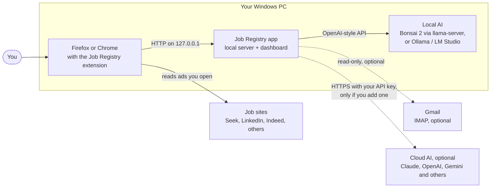

- **You** use the dashboard (a browser tab) and the extension.
- **The extension** reads only the job pages you open. It never crawls sites in the background.
- **The app** stores everything and owns all the logic.
- **The local AI** is a separate program the app talks to over HTTP. The app can start and stop it.
- **A cloud AI** is optional (Phase 8). You can save several AIs, and the app uses one at a time. It sends your data to a cloud AI only while it's the AI in use, with the key you saved for it. Test connection and the model list can reach any AI you're setting up, but they send none of your data.
- **Gmail** is optional and read-only (Phase 5).

---

## 3. Containers

A "container" here means a separately running or separately stored part. It's not Docker.

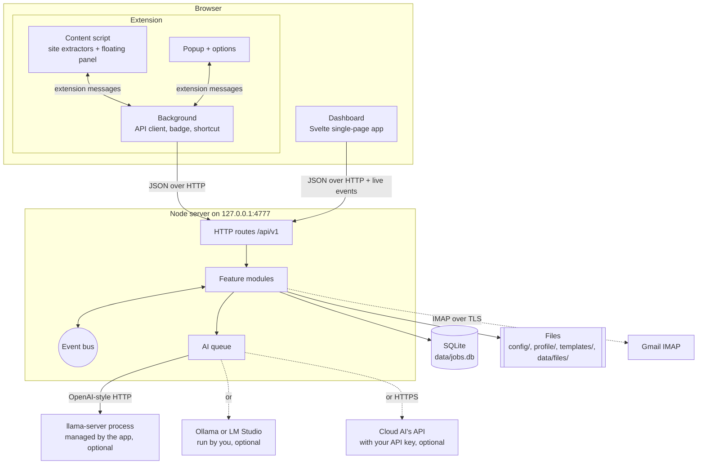

| Container | Technology | What it does | Talks to |
|-----------|-----------|--------------|----------|
| Node server | Node.js LTS, TypeScript (run directly, no build), Fastify | API, business logic, serves the dashboard, manages the AI process | SQLite, files, the AI in use (a local server or a cloud AI's API), IMAP |
| Dashboard | Svelte 5 + Vite, built to static files | Search, call sheet, job details, document editor, settings, inbox | Server API, plus a live event stream (SSE) |
| Extension | TypeScript + Svelte, built with esbuild, two manifests (Firefox, Chrome) | Reads job pages, shows the save and rating panel, toolbar popup | Server API, **from the background script only** |
| SQLite database | `better-sqlite3`, WAL mode, FTS5 | Jobs, ads, contacts, notes, documents, search index | — |
| Files | Plain text and CSS on disk | Settings, secrets, profile, templates, attachments, backups, logs | — |
| llama-server | PrismML's build of llama.cpp | Runs Bonsai 2 on the GPU. Started on demand, and stopped when idle if you turn that on | — |

Content scripts run inside the job site's page, so the browser's cross-site rules (CORS) apply to them. The background script has host permission for `127.0.0.1` (any port), so it can call the server freely. That's why every server call goes through the background, and why the server sends no CORS headers at all (§13).

---

## 4. Server modules

### 4.1 Module map

The server is split **by feature**. Each module owns its own data. No other module touches that data directly.

| Module | Owns | Public functions (examples) | Depends on |
|--------|------|-----------------------------|------------|
| `system` | backups, health check, shutdown, logs | `health()`, `backupNow()`, `shutdown()` | — |
| `settings` | `config/settings.json`, `config/secrets.json` | `get()`, `update(patch)`, `useAi(id)` (switch the AI in use), `statuses()`, `secrets()` (only whether the password is set, and which AIs have a key), `emailPassword()`, `aiKey(id)`, `updateSecrets()` | — |
| `profile` | `profile/*.md`, `templates/*.css` | `read(name)`, `file(name)`, `write(name, text)`, `hash()`, `installStarters()` | — |
| `capture` | nothing (stateless) | `fromUrl(url)`, `fromText(text)` | — |
| `ai` | AI process and queue (no tables) | `parseJob()`, `rateJob()` and `rateCard()` (each returns `{ rating, model }`: the rating, and the identity of the model that made it), `writeDocument()` (streamed), `classifyEmail()`, `status()`, `test()` (the AI in use), `check()` (any AI, saved or not), `models()` (any AI's model list), `modelIdentity(task)`, `stop()` | — |
| `jobs` | `jobs`, `postings`, `status_history` | `save()`, `check()`, `checkMany()`, `get()`, `list()`, `update()`, `changeStatus()`, `addPosting()`, `applyParsed()`, `setParseState()`, `setRating()`, `listIdsByParseState()`, `setFollowUp()`, `listFollowUps()` | — |
| `contacts` | `contacts`, `job_contacts`, `interactions` | `create()`, `update()`, `linkToJob()`, `logInteraction()`, `listForJob()`, `findByPhoneDigits()` | — |
| `notes` | `notes` | `add()`, `update()`, `remove()`, `listForJob()` | — |
| `ratings` | `rating_cache`, `card_rating_cache` | `rate(input, { signal, key })`, `rateCard(card, { signal, key })`, `lookupCards(cards)` | `ai`, `profile` |
| `enrich` | nothing | listens for new ads, then parses and rates them; `reparse(jobId)`, `sweep()` (jobs still waiting) | `jobs`, `ai`, `ratings` |
| `documents` | `documents`, `attachments`, `data/files/` | `list()`, `listAll()`, `get()`, `saveVersion()`, `copyFrom()`, `markSent()`, `latestSent()`, `render()`, `exporters()`, `export()`, `generate()`, `attach()`, `listAttachments()`, `attachmentFile()` | `ai`, `profile`, `jobs` |
| `search` | `search_index` | `query(q)`, `reindexJob(id)`, `rebuild()` | `jobs`, `contacts`, `notes` |
| `callsheet` | nothing (read-only view) | `get(jobId)`: everything for the one-screen view | `jobs`, `contacts`, `notes`, `documents` |
| `email` | `email_suggestions`, `email_state` | `checkNow()`, `status()`, `test()`, `listSuggestions()`, `confirm()`, `dismiss()`, `start()` / `stop()` (the timer) | `ai`, `jobs`, `contacts`, `notes` |
| `live` | open dashboard connections | forwards chosen events to the dashboard | — |

Every module also uses `core` (config, database connection, events, errors, logger) and `shared` (contracts and pure helpers).

**Modules get their settings as plain functions.** For example, `ai` receives `getConfig()` (the AI in use), `getAll()` (every saved AI), `getKey(id)` and `providerFor(ai, key)` from `app.ts`. It never imports the `settings` module. So only `app.ts` knows where settings and keys come from.

### 4.2 Allowed dependencies

An arrow means "may call". There are no cycles. A module may only call modules shown below it.

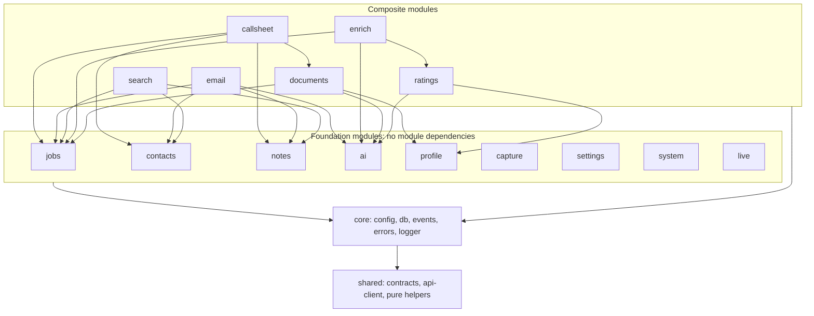

Why it's shaped like this:
- **`jobs` doesn't depend on `ai`.** The `enrich` module does the AI work after a save. So saving can't wait for the AI, by design and not just by care.
- **`ai` knows nothing about jobs.** It takes text in and gives typed results back. It can be tested with plain strings.
- **`search` reads through services, not tables.** It rebuilds a job's index entry by asking `jobs`, `contacts` and `notes` for the current data.
- **`callsheet` is a read-only view.** It joins data from four modules for one screen, so the dashboard makes one request instead of six.

### 4.3 Inside a module

```
server/modules/jobs/
  index.ts       public surface: createJobsModule(deps) → { service, routes } and exported types
  service.ts     the logic. Plain inputs, plain outputs. No Fastify, no SQL.
  repo.ts        all SQL for this module's tables. Nothing else in the app writes these tables.
  routes.ts      Fastify routes. Checks input with shared contracts, calls the service, returns DTOs.
  match.ts       pure helper (finding duplicates), used by service.ts
  *.test.ts      tests sit next to the code
```

- **Other modules import only `index.ts`.** Everything else in the folder is private.
- A service receives what it needs as arguments: its repo, the event bus, other modules' services and config functions. It never builds these itself.

### 4.4 Composition root

`server/app.ts` is the only place that creates and connects things. It's plain code, with no dependency-injection framework.

```ts
export function buildApp(opts: AppOptions, fakes: Partial<Fakes> = {}) {
  const db = openDb(opts.paths.db);               // runs migrations, WAL mode, foreign keys on
  const bus = createEventBus(logger);
  const settings = createSettingsModule({ paths: opts.paths, bus });
  const profile = createProfileModule({ dir: opts.paths.profile });  // profile.changed comes with the Phase 4 editors

  // The AIs. Each saved AI gets its own provider, with its key and its preset's dialect.
  const aiConfig = () => activeAi(settings.get().ai);           // the AI in use
  const providerFor = (one: SavedAi, key: string | null) => fakes.ai ??
    (AI_PRESETS[one.preset].dialect.connector === 'anthropic' ? createAnthropicProvider : createOpenAiCompatibleProvider)(
      () => ({ name: one.name, preset: one.preset, baseUrl: one.baseUrl, model: one.model, timeoutSec: one.timeoutSec,
               apiKey: key, dialect: AI_PRESETS[one.preset].dialect }));   // the AI in use's is kept (below)
  const getKey = (id: string) => /* only for a preset that takes a key */ settings.aiKey(id);
  const ai = createAiModule({
    providerFor, getKey, getAll: () => settings.get().ai.saved, getConfig: aiConfig,
    // Chosen before each task: CloudRuntime, LlamaServerRuntime (the app starts it) or NoopRuntime (you run it).
    runtime: () => fakes.runtime ?? pickRuntime(aiConfig()),
    bus,
  });

  const jobs = createJobsModule({ db, bus, statuses: () => settings.statuses() });
  const contacts = createContactsModule({ db, bus });
  const notes = createNotesModule({ db, bus });
  const ratings = createRatingsModule({ db, ai: ai.service, profile: profile.service });
  createEnrichModule({ bus, jobs: jobs.service, ai: ai.service, ratings: ratings.service });
  const documents = createDocumentsModule({ db, bus, ai: ai.service, profile: profile.service,
                                            jobs: jobs.service, filesDir: opts.paths.files,
                                            exporters: [printHtmlExporter, docxExporter] });
  const search = createSearchModule({ db, bus, jobs: jobs.service, contacts: contacts.service, notes: notes.service });
  const callsheet = createCallsheetModule({ jobs: jobs.service, contacts: contacts.service,
                                            notes: notes.service, documents: documents.service });
  const mail = fakes.mail ?? createImapMailSource(() => ({ ...settings.get().email, password: settings.emailPassword() }));
  const email = createEmailModule({ db, bus, mail, ai: ai.service, jobs: jobs.service, contacts: contacts.service,
                                    notes: notes.service, statuses: () => settings.statuses(),
                                    getConfig: () => settings.get().email, password: () => settings.emailPassword() });
  const live = createLiveModule({ bus });

  const http = Fastify({ logger });
  registerSecurity(http, opts.server);            // Host and Origin checks, JSON-only writes
  registerErrorHandler(http);                     // AppError → HTTP status
  for (const m of [settings, profile, capture, ai, jobs, contacts, notes, ratings,
                   documents, search, callsheet, email, live, system]) {
    http.register(m.routes, { prefix: '/api/v1' });
  }
  serveDashboard(http, opts.paths.webDist);
  return { http, db, bus, close };
}
```

Tests call the same `buildApp` with fakes, such as `FakeAiProvider`, `FakeRuntime`, `FakeMailSource` and an in-memory database. So tests run the real wiring.

**The AI's wiring, in more detail:**
- **A provider per AI.** `providerFor` picks the adapter by the preset's `dialect.connector`: Claude's own connector for `anthropic`, the OpenAI-style one for every other preset (§6.1). So the service can test, or list the models of, any AI, not only the one in use.
- **One kept provider.** Only the AI in use's provider is kept, while its settings and key stay the same, so a connector keeps what it learnt (Claude's model limits). It's kept only for the saved object itself, never for a form's copy, so a test with a typed key leaves nothing behind. Any `settings.changed` with `ai` drops it, so a deleted AI's key leaves memory too.
- **Three runtimes,** made once: a cloud AI gets `CloudRuntime`, a llama-server the app starts gets `LlamaServerRuntime`, and anything you run yourself gets `NoopRuntime`, which checks the AI in use's provider (§6.2).
- **Keys** come from `settings.aiKey(id)`, read fresh each time. An AI whose preset takes no key never reads `secrets.json`, so a broken file can't stop Bonsai 2.

---

## 5. Events

Events let modules react to each other without calling each other. All event names and payloads are defined in one typed map, in `server/core/events.ts`. That map is the contract between modules.

| Event | Payload | Sent by | Heard by |
|-------|---------|---------|----------|
| `job.saved` | `{ jobId }` | jobs | search, live |
| `job.updated` | `{ jobId, fields }` | jobs | search, live |
| `job.statusChanged` | `{ jobId, from, to, source }` | jobs | search, live |
| `posting.added` | `{ jobId, postingId }` | jobs | enrich, search |
| `note.added` / `note.updated` / `note.removed` | `{ jobId, noteId }` | notes | search, live |
| `contact.saved` | `{ contactId, jobIds }` | contacts | search, live |
| `contact.linked` / `contact.unlinked` | `{ contactId, jobId }` | contacts | search, live |
| `interaction.logged` | `{ interactionId, contactId, jobId }` | contacts | search, live |
| `document.saved` / `document.sent` | `{ jobId, documentId }` | documents | live |
| `attachment.added` | `{ jobId, attachmentId }` | documents | live |
| `profile.changed` | `{ name }` | profile, when a file is saved in Settings | live. Ratings don't need it: they work out the profile hash from the files each time, so a hand edit counts at once |
| `settings.changed` | `{ keys }`: the sections that changed. `ai` for any change to your AIs, a switch included. `secrets` only when the Gmail app password changes, never its value. `aiKeys` only when an AI's API key is saved, replaced or removed, never the key (one request that changes both says `["secrets", "aiKeys"]`). The AI still reads its key each time | settings | ai (a new AI in use: switch, §12.5; an edit to the AI in use: the runtime follows, the old one stops if it changed, and the pill's problem clears if the AI in use changed; on `aiKeys`, a new key for the AI in use clears the pill's problem), `app.ts` (on `ai`, drops the provider it kept), email (on `email` or `secrets`, never `aiKeys`: check at once when email was just turned on, otherwise restart the timer), live (the dashboard reloads the settings, and the AI pill which AIs have a key) |
| `ai.stateChanged` | `{ state, detail, id, name }`: the state of the AI in use, and which AI that is | ai, when the state changes, and when the AI in use changes even if the state doesn't (a switch, a rename) | live (the AI pill); enrich (on `ready`, reads jobs that were waiting for the AI) |
| `enrich.done` / `enrich.failed` | `{ jobId, step, error? }` | enrich | live |
| `email.suggestionsAdded` | `{ count }` | email, at the end of a check that added cards | live (the Inbox and the header's count) |
| `email.suggestionHandled` | `{ suggestionId, state }` (`confirmed` or `dismissed`) | email | live |
| `email.checked` | `{ ok, error }` | email, after every check | live |

**Delivery rules**

1. Events are sent **after** the database transaction commits. A listener never sees data that might still roll back.
2. Payloads are **small**: IDs plus what changed. Listeners read the current data through services, so they never act on a stale copy.
3. Listeners run straight away, one after another. Each runs inside its own try/catch. A failing listener is logged and **never** breaks the action that sent the event. For example, a search-index failure can't stop a save.
4. Slow work, like anything involving the AI, goes onto the AI queue. It never runs inside the listener.
5. If the search index ever drifts, **Settings → Rebuild search index** rebuilds it from scratch.

---

## 6. Ports and adapters

Every outside system sits behind a small interface, called a **port**. The code behind it, the **adapter**, can be swapped without touching the rest of the app. The interfaces below are the contract. Field names may change a little during the build.

### 6.1 `AiProvider` — talking to any AI server

```ts
interface AiProvider {
  chat(req: ChatRequest, opts?: { signal?: AbortSignal }): Promise<ChatResult>;
  chatStream(req: ChatRequest, opts?: { signal?: AbortSignal }): AsyncIterable<ChatChunk>;
  health(): Promise<{ ok: boolean; models: string[]; detail: string | null }>;  // the model list
}

type ChatRequest = {
  messages: { role: 'system' | 'user' | 'assistant'; content: string }[];
  model?: string;
  temperature?: number;
  maxTokens?: number;                               // the answer; thinking's limit comes on top
  jsonSchema?: { name: string; schema: object };   // constrained JSON output
  thinking?: boolean;                               // off, or on at thinkingEffort
  thinkingEffort?: 'low' | 'medium' | 'high' | 'max'; // when thinking is on (default medium); max: no limits
  extra?: Record<string, unknown>;                  // added to the body last, from settings; null removes a field
};
type ChatResult = { text: string; thinking: string };
type ChatChunk = { kind: 'text' | 'thinking'; text: string };

// What an adapter is built with: one saved AI, its key and its preset's dialect.
type ProviderConfig = { name: string; preset: AiPresetId; baseUrl: string; model: string; timeoutSec: number;
                        apiKey: string | null; dialect: AiDialect };
```

**Dialects.** Providers differ in small ways that break a plain request. Each preset in the catalogue (`shared/contracts/ai-presets.ts`, §12.5) carries a dialect that says how that provider wants to be asked:

```ts
type AiDialect = {
  connector: 'openai' | 'anthropic';                 // which adapter (app.ts picks it)
  json: 'schema' | 'object';                         // response_format json_schema, or json_object with the schema as text
  thinking: 'llama' | Record<'off' | 'low' | 'medium' | 'high' | 'max', object | null>;
                                                     // llama-server's own fields, or the body fields each level adds
  maxTokens: 'max_tokens' | 'max_completion_tokens'; // the name of the token-limit field
  temperature: boolean;                              // false: never sent (the provider refuses it)
  listModels: boolean;                               // false: no model list to ask (Z.ai, Qwen)
};
```

The four local presets share one dialect (`'llama'`, `json_schema`, `max_tokens`, temperature, a model list), so Bonsai 2's requests are exactly as they were before Phase 8. Many cloud models can't stop thinking, so a cloud dialect's "off" asks for the least thinking that provider takes (for example `reasoning_effort: "low"`, or `"minimal"` on Gemini), and gets Medium's room (2,048 tokens) on top of the longest answer, so that little thinking can't cut the answer short. A task's `extra` can change any of it.

| Adapter | Covers | Notes |
|---------|--------|-------|
| `OpenAiCompatibleProvider` | llama-server, Ollama, LM Studio, vLLM, any `/chat/completions` server, and the cloud providers that speak the same way: OpenAI, Google Gemini (its OpenAI-style address), DeepSeek, Kimi, Z.ai, Qwen, Mistral, xAI, Groq and OpenRouter | **Keys:** an AI with a key (every cloud one, and "Another OpenAI-style server" if you give it one) sends it as `Authorization: Bearer <key>`, and only to its own address. **The `'llama'` dialect (the local presets):** `thinking: false` is sent as `reasoning_effort: "none"`, which both PrismML's llama-server (Bonsai 2) and Ollama honour. Thinking on: `low` and `medium` are sent as they are, and `high` as `"xhigh"` (Bonsai 2's template takes only `low`, `medium` and `xhigh`, and gives HTTP 500 for `"high"`). Each also sends `thinking_budget_tokens` (512, 2,048 or 8,192, `THINKING_TOKENS`, the steps of PrismML's own chat page): llama-server closes the thinking there and the answer follows. Thinking counts towards `max_tokens`, so the request's `max_tokens` is the task's longest answer plus that limit. `max` sends no `reasoning_effort`, no `thinking_budget_tokens` and no `max_tokens`, so the AI uses its own default: Bonsai 2 thinks at `"xhigh"` for as long as it likes. A task's `extra: { "reasoning_effort": null }` removes the field for a server that refuses it. An answer that ends with `finish_reason: "length"` (out of room, often still thinking) fails with a sentence saying so, and isn't retried. Time limit (the AI's `timeoutSec`, 300 seconds by default; both adapters): a plain answer must come within it; a stream may run longer while it keeps sending, and fails only after that long with nothing new (thinking counts). Thinking comes back from `reasoning_content` (llama-server, DeepSeek and others), `reasoning` (Ollama, OpenRouter), Mistral's `thinking` content parts, or `<think>…</think>` blocks, as `kind: 'thinking'`, and is never put into a parsed field or a document. **The cloud dialects:** the level's fields come from the dialect's map. The token limit uses the dialect's field name, with `THINKING_TOKENS` on top at Low, Medium and High, Medium's 2,048 at Off (many cloud models still think a little there), and none at all for No limit. Temperature is left out where the provider refuses it, and capped at 1 for Z.ai. `json: 'object'` (DeepSeek, Z.ai, Qwen) sends `response_format: { type: "json_object" }` and adds "Reply in json: one object that matches this JSON Schema:" and the schema to the end of the system message. Mistral's answer can be a list of parts, and is read as text and thinking. Comment lines in a stream (OpenRouter's `: OPENROUTER PROCESSING`) are skipped, but still count as the AI being alive. An error that comes with HTTP 200 (OpenRouter's `finish_reason: "error"`) fails with its own message, and a draft keeps its text so far. With `listModels: false`, `health()` answers `ok` with no models and asks nothing. |
| `AnthropicProvider` | Claude, through Anthropic's own Messages API. (Claude's OpenAI-style address ignores `response_format`, which every task relies on.) | Plain `fetch`, no SDK, `anthropic-version: 2023-06-01`. The key goes as `x-api-key` (not a Bearer token). `POST /messages`: the system message becomes a top-level block marked `cache_control: { type: "ephemeral" }`, so Claude caches the fixed start of each prompt (the profile comes first, §12.1). JSON uses Claude's structured outputs (`output_config.format`, type `json_schema`). The schema is copied with every object closed (`additionalProperties: false`) and without the limits Claude refuses (`minimum`, `maxLength`, `pattern` and the like); zod still checks every answer against the full schema. Thinking is always `{ type: "adaptive", display: "summarized" }` with `output_config.effort` (Off and Low `low`, Medium `medium`, High `high`, No limit `max`), never `disabled`, which current models refuse. `max_tokens` is required: the task's longest answer plus `THINKING_TOKENS` (Off and Low get Medium's 2,048, because adaptive thinking may run past 512), or for No limit the model's own maximum from `GET /models` (asked once, then remembered), else 64,000. It never sends temperature, and never a field outside the Messages API. A task's `extra` is merged into nested fields too, so `output_config.effort` can change without losing the JSON format. A stream reads `text_delta` and `thinking_delta`, and ends at `message_stop` (there's no `[DONE]`); one that closes without it fails with "{name} stopped sending before it finished. Try again." Stop reasons: `max_tokens` gives the cut-off sentence, a full context and a `refusal` each get their own. `health()` lists `GET /models`. |
| `FakeAiProvider` | tests | Returns scripted replies and can simulate slowness, errors and cancelling. |

**Plain errors** (`adapters/http-errors.ts`, used by both adapters). Every failure becomes a sentence that names the AI, as you named it:
- No key saved for a preset that needs one: "{name} needs an API key. Add it in Settings → AI." Nothing is sent.
- A usage limit: HTTP 402 or 429, or any 4xx whose own message, code or type mentions a quota, billing, balance, credit, arrears (Qwen's `Arrearage`), a spend limit or a usage limit. Providers use different codes for this (402, 429, 400, even 403), so the words count first. "{name} says you've reached a usage limit. Wait a while, or switch to another AI from the AI pill at the top."
- Busy: 503, 529, or an "overloaded" error. "{name} is busy right now. Try again in a minute."
- A refused key: 401, 403 (but not a 403 about moderation), or a 400 that mentions an API key (xAI and Gemini answer a wrong key that way). "{name} refused its API key. Check the key in Settings → AI."
- Can't connect: "Can't reach {name} at {address}. Check that it's running, or pick another AI in Settings." Anything else quotes the provider's own message, after "{name} at {address} answered with an error ({status}):".
- The words are looked for only in the error's own message, code and type, never the rest of the body, because a moderation refusal can quote the job ad, and an ad can easily say "credit". Any copy of the key in the provider's text is replaced with `[key hidden]` before it goes anywhere, and the sentence is checked again once the JSON is read (JSON can write the key as `\/` or `\u0061`).
- **Two kinds of error.** No key, a refused key, a usage limit and busy are about the AI as a whole: every request would fail the same way. They're an `AiAccountError`, so a job or an email waits for the AI (§7.1, §7.5). Every other HTTP error, a moderation refusal and a timeout are about this one request: an `AiRefusedError`. Both extend `AiUnavailableError`, so the pill shows either.
- A refused key or a usage limit isn't retried, and never switches to another AI. It shows in the pill as a problem, with its sentence, until a task works again, you change the AI in use's settings, or you save a new key for it.
- A cloud AI's cut-off sentence leaves out llama-server's `-c` advice: its context isn't yours to change.

### 6.2 `ModelRuntime` — starting and stopping the AI program

```ts
interface ModelRuntime {
  ensureRunning(signal?: AbortSignal, opts?: { background?: boolean }): Promise<void>;  // starts the process if needed, waits for /health
  touch(): void;                                        // resets the idle timer
  stop(): Promise<void>;
  stopNow(): void;                                      // at once, for a crash or the app exiting
  state(): 'off' | 'starting' | 'ready' | 'error';     // "busy" is added by the AI service while a task runs
  detail(): string | null;                              // why it's "error", in a sentence
  onStateChange(fn: (state) => void): () => void;
}
```

| Adapter | Used when |
|---------|-----------|
| `LlamaServerRuntime` | The AI in use is "Bonsai 2 (llama-server)" with "Start it for me when it isn't running" ticked (`managed.enabled`). It spawns `llama-server.exe` with no console window and sends its logs to `data/logs/llama.log`. If something is already answering on the port, it uses that and won't kill a process it didn't start. On Windows the server can't outlive the app: Node puts child processes in a job object that ends them with it. On macOS and Linux, the app keeps the running server's pid and launch settings in `data/llama-server.pid`, so after a crash the next start knows the server is its own and stops it as usual. Windows ignores that file, so a reused pid can never point it at another program. A stop cancels a start in progress. A change to the program, arguments or address restarts it at the next task. The program can also be a `.bat` or `.cmd` file, such as your own `start_bonsai.bat` (§12.4). |
| `NoopRuntime` | Ollama, LM Studio, a custom server, or a llama-server you start yourself. `ensureRunning` only checks that the AI in use's server answers (its provider's `health()`). |
| `CloudRuntime` | A cloud AI. There's no program to start, stop or check, so it's always `ready`, and Z.ai and Qwen (no model list) still work. A task that fails (a refused key, a usage limit) shows as `error` through the AI service, the same way a failed task on any AI does. |

`app.ts` picks the runtime for the AI in use before each task. When it changes, for example on a switch from Bonsai 2 to Claude, the old one is stopped, so a llama-server the app started stops holding GPU memory. A switch between two AIs on the same runtime stops it too, which cancels a start in progress and makes a server you run yourself be checked again. The one exception: two llama-servers the app starts share one runtime, and a ready one is left alone (a change to the program, arguments or address still restarts it). A switch to an AI the app starts starts it at once (§12.5).

### 6.3 `MailSource` — reading email

```ts
interface MailSource {
  // Oldest first. With no cursor, or one from another UIDVALIDITY, it reads by date.
  fetchSince(cursor: MailCursor | null, opts: { maxMessages: number; sinceDays: number; now: Date; signal?: AbortSignal }):
    Promise<{ messages: MailMessage[]; cursor: MailCursor; more: boolean }>;
  test(): Promise<void>;   // logs in and opens the mailbox; throws a sentence to show
}
type MailCursor = { uidValidity: string; lastUid: number };
type MailMessage = { id: string; from: string; fromName: string | null; to: string; subject: string;
                     receivedAt: string; text: string; after: MailCursor };   // after: the cursor just past this email
```

Adapters: `ImapMailSource` (`email/adapters/imap.ts`, Gmail over IMAP with an app password, using imapflow), `FakeMailSource` (tests), and later, if needed, `GmailApiMailSource`.

`ImapMailSource`:
- **Read-only.** It opens the mailbox with EXAMINE (`readOnly: true`), so nothing is marked read, moved, flagged or deleted. imapflow's own logging is off.
- **One login per round.** It logs in, reads at most `maxMessages` emails (oldest first), and logs out. `more` says there are newer ones.
- **The cursor** is the mailbox's UIDVALIDITY (a string, because imapflow gives a BigInt) and the last UID read. With the same UIDVALIDITY, it reads `UID last+1:*` and drops UIDs it already had (a `*` range always includes the newest). Otherwise it searches by date (`SINCE` today − `sinceDays`). A round with no more mail ends at UIDNEXT − 1.
- **Text:** the first plain-text part that isn't an attachment, else the first HTML part as text (`core/html-text.ts`), at most 64 KB. It reads every header first, then downloads each text part, because imapflow can't run a command inside a fetch.
- **One bad email never blocks the rest.** A text that won't download gives empty text; a batch Gmail won't fetch is asked for one email at a time, and an email that still fails is left out; a broken date becomes the time it was read. The cursor still moves past them.
- **A refused search** (imapflow answers `false`) fails the round, so the cursor never moves past mail it didn't read.
- **Errors are sentences:** a wrong password (AUTHENTICATIONFAILED, or Gmail's "Invalid credentials" and "Application-specific password required"); any other refused login, with Gmail's words; can't connect; a certificate swapped by antivirus email scanning; no such mailbox; anything else as "Gmail said: …".

### 6.4 `DocumentExporter` — turning a document into a file

```ts
interface DocumentExporter {
  id: 'print-html' | 'docx' | string;
  label: string;                                   // shown on the button
  export(doc: { title: string; markdown: string; css: string }):
    Promise<{ contentType: string; fileName: string; body: Buffer | string }>;
}
```

Adapters, in `server/modules/documents/exporters/` (the port is `documents/exporter.ts`, and `app.ts` wires the list):
- `PrintHtmlExporter`, "Save as HTML": the same A4 page as the print view (`shared/document-page.ts`), as a file.
- `DocxExporter`, "Export .docx": built with the `docx` library from `lexMarkdown`'s tokens. Word can't read CSS, so it gets a fixed, plain layout (Calibri 11, A4, real Word bullets and numbering). Raw HTML becomes plain text.

The dashboard asks the server which exporters exist (`GET /documents/exporters`), and shows one button per exporter. Printing to PDF isn't an exporter: **Print / PDF** opens the print view (`GET /documents/:id/render`) and you use the browser's Save to PDF.

### 6.5 `SiteExtractor` — reading a job site (in the extension)

```ts
interface SiteExtractor {
  id: 'seek' | 'linkedin' | 'indeed' | 'generic' | string;
  matches(url: URL): boolean;
  currentJobId(url: URL, doc: Document): string | null;  // handles split-pane search pages
  extract(doc: Document, url: URL, now: Date): Capture | null;  // null until the ad's text is there; the watcher waits
  readCards(doc: Document, url: URL): FoundCard[];  // the job cards in a search list, in page order; [] for generic
}
type FoundCard = { element: Element; anchor: Element; card: JobCard };  // the card, where its mark goes (after anchor), what it says
```

Adapters: one file each in `extension/src/sites/`. The registry tries them in order, and `generic` comes last. Generic uses the text you selected first (if it's over 200 characters), then the page's schema.org `JobPosting` data, then Mozilla Readability.

`readCards` skips a card with no job link it can read (an advert, a "jobs you may like" banner), and reads each job once even when the site draws it twice. A card's `text` is everything else it shows, as plain text: salary, work type, the teaser and its bullet points. It leaves out when the job was listed ("Posted 3d ago", "2 days ago"), because that changes every day and would make the card look new to the cache. LinkedIn's cards have no teaser, so its marks come from the title, company, location and salary alone.

### 6.6 Shared types used by the ports

```ts
type Capture = {                // what the extension or capture module produces
  sourceUrl: string; canonicalUrl: string; sourceSite: string; externalId?: string;
  title?: string; company?: string; location?: string;
  jdText: string; structured?: Partial<ParsedJob>; capturedAt: string;
};
type ParsedJob = {
  title: string; company: string | null; agency: string | null; location: string | null;
  workMode: 'onsite' | 'hybrid' | 'remote' | 'unknown';
  employmentType: 'full-time' | 'part-time' | 'contract' | 'temporary' | 'casual' | 'unknown';
  salary: { min: number | null; max: number | null; currency: string | null;
            period: 'year' | 'day' | 'hour' | null; text: string | null };
  closingDate: string | null; summary: string;
  requirements: string[]; niceToHave: string[]; responsibilities: string[];
  adContact: { name: string | null; email: string | null; phone: string | null } | null;
};
type Rating = {
  why: string[]; whyNot: string[]; dealBreakers: string[]; salaryNote: string | null;
  verdict: 'strong' | 'good' | 'stretch' | 'weak'; score: number;  // 0–100
};
```

The AI writes a rating's fields in this order, so the reasons come before the verdict and score (and a card rating's reason before its verdict and score). A small model asked for the score first picks it before weighing anything, and tends to give every job the same score.

All of these are zod schemas in `shared/contracts/`. The TypeScript types are derived from those schemas, so there's one source of truth.

---

## 7. Key flows

### 7.1 Save a job from the extension, with the "Same job?" check

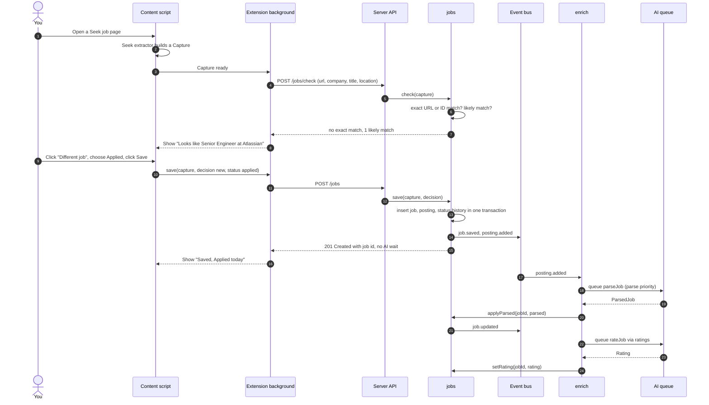

Notes:
- **Fields you've edited by hand are never overwritten.** `applyParsed` only fills empty fields, or fields that still hold an earlier AI value. Each field remembers whether it came from you, the ad's structured data or the AI.
- **If the AI can't be reached** (not running, not installed, didn't start), the job stays saved and waits: `parse_state = pending`, with the reason in `parse_error`. It's read the next time an AI task works (a task finishing moves the AI from `busy` to `ready`, which starts a sweep), and at the next start. The job page says why and offers **Read again**.
- **If the AI itself has a problem** (`AiAccountError`: no API key, a refused key, a usage limit, busy), the job waits just as when the AI can't be reached: `pending`, with the sentence. It's read the next time an AI task works, on this AI or another you switch to. A sweep stops at the first one, so it asks the AI once, not once per waiting job.
- **If the server refuses this ad, or doesn't answer it in time** (`AiRefusedError`: any other HTTP error, a moderation refusal or a timeout), the job is `failed` with the server's message, and shows **Read again**. Other jobs carry on.
- **If the AI's answer never fits** (even after one retry, `AiAnswerError`), the job is `failed` with the reason, and shows **Read again**.
- **The sweep** reads waiting jobs one at a time at background priority, so a job you save meanwhile goes first. It stops at the first "can't reach the AI", and every job left in that round gets the same reason. A refused ad is marked failed and the round carries on, but two refusals in a row with the same message mean the server refuses everything (a wrong model, say), so the round stops and those jobs wait too.

### 7.2 Recruiter calls: search, then the call sheet

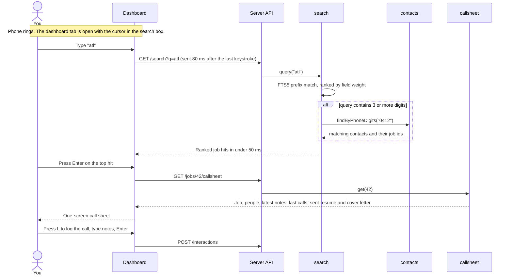

Order of results:

1. Phone-number matches come first.
2. Then open jobs come before closed ones.
3. Within each group, the best text match comes first. The company, agency and title count most (weight 10), then people: names, emails and phones (5). Then notes, calls and location (2), and the ad text last (1).
4. If two results tie, the most recently updated comes first.

Archived jobs are left out. A person shows as their own result only when they aren't linked to any job, because otherwise their jobs already show.

### 7.3 Match rating, with stale requests cancelled

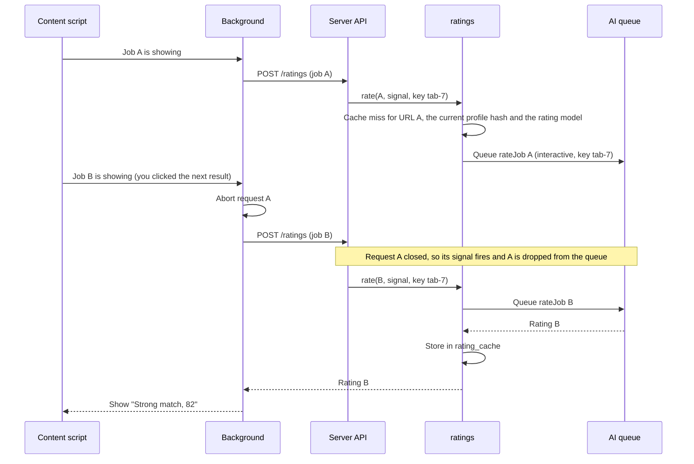

The queue also enforces "latest wins" per key. A new task with the same key cancels the older one, even if the browser didn't abort it.

### 7.4 Generate a resume, check it, send it

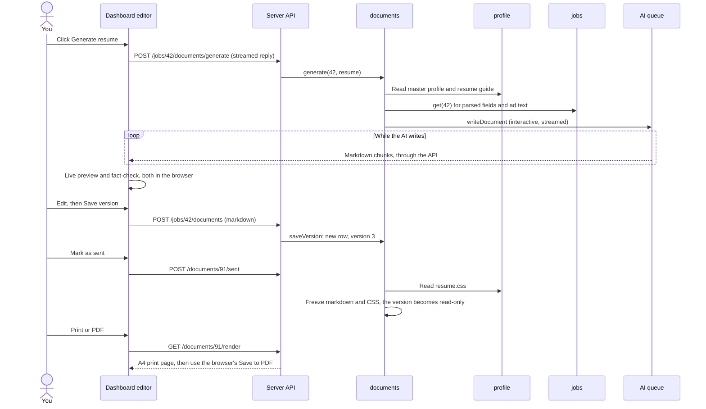

The fact-check is plain code in `shared/fact-check.ts`. The browser runs it 300 ms after you stop typing. It needs the master profile text, which the editor loads once.
- **What it looks for:** numbers, percentages, money, years, date ranges and capitalised names (runs of capitalised words, or words like `AWS` and `ISO27001`). It flags the ones the profile doesn't have.
- **What counts as the same fact:** numbers compare by value ($150k is $150,000, "30 %" is 30%, and the profile's "eight" counts as 8). Phone numbers compare as digits.
- **Numbers written as words** ("ten years", from two to twenty) are checked like digits.
- **What it ignores:** resume headings and letter words ("Professional Summary", "Referees", "Dear Hiring Manager"), months, days and states, a letter's own date, and the job's title, company and agency.
- **A capitalised word that just starts a sentence** is ignored when it reads as an ordinary word: a common verb or small word ("Led", "The"), or a word the draft or profile also has in lower case.
- **Words it never ignores, even at a sentence start:**
  - words on a heading line
  - seniority words ("Lead", "Principal")
  - acronyms
  - a label ("Deloitte:", "Telstra |"), one of a list ("Python, Go") or a line of its own ("- Kubernetes").
- **Flags are the draft's own text**, so the preview can highlight them. Only whole words and numbers are highlighted.

Generating streams NDJSON: one `GenerateChunk` per line (`text`, then `done`, or `error` with a sentence to show). So the editor can tell a finished draft from a cut-off one. Pressing **Stop** or closing the tab ends the request, which cancels the AI task. Nothing is saved until you press **Save version**. Text you haven't saved is kept in the browser's `localStorage` (`jr-draft:<jobId>:<kind>`) until you save or discard it.

### 7.5 Email suggestion, then you confirm

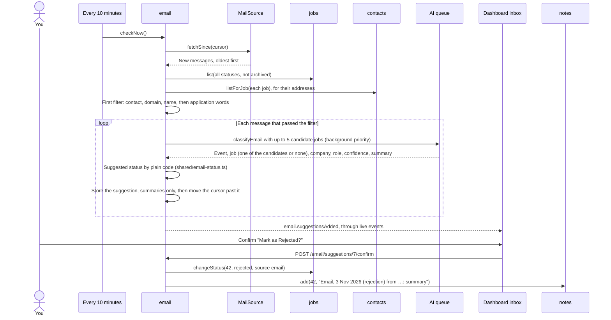

The rules:
- **Nothing changes without your OK.** A check, the timer and the AI only add suggestion rows. Only **Confirm** changes a status (source `email`) or adds a note. All `/email` writes are dashboard-only.
- **The first filter** (`email/filter.ts`, plain code), first rule that applies:
  1. never your own address
  2. a contact's address
  3. the company's, agency's or a contact's own domain (never free mail like gmail.com)
  4. a company or agency named in the subject, or in the text next to a job word
  5. an application phrase ("thank you for applying", "not progressing", "invitation to interview" …) from anyone, with no job.
- **The AI only reads.** It may pick a job only from the candidates it was shown, or none. The suggested status is worked out by `suggestStatus`: received → Applied, rejected → Rejected, interview → the next interview stage, assessment → Screening, offer → Offer. It only moves forward, never repeats the status the job has, and a closed job reopens only for an interview or an offer. It's worked out again from the job's status when the card is shown and when you confirm, so a card that waited never moves a job backwards.
- **Not about a job:** an answer of "other" with no job, or one that isn't sure (under 0.6), keeps only the message id and date (`ignored`), so it isn't read again.
- **The AI can't be reached, or has a problem of its own** (no API key, a refused key, a usage limit, busy: `AiAccountError`): the check stops, the cursor stays before that email, and the Inbox says "Waiting for the AI: …". The next check carries on from there. No card is made, however many checks it takes you to fix the key.
- **The AI server refuses an email** (any other HTTP error, or a timeout): the email is held back. If a later email in the same check is read, the refusal was about that one email, so it gets a card: "The AI couldn't read this email. Open Gmail to read it." If none is, the server refuses everything (a wrong model, say): the check stops before the first held email, with "Waiting for the AI: …". An email refused on three checks in a row gets the card anyway, so it never holds up the inbox. The count lives in `email_state` (`refused:<message id>`). An answer that never fits makes that card at once. Its note uses the email's subject.
- **The cursor** is saved after each email, with the address and mailbox it belongs to. A new address or mailbox starts again by date. A check reads up to 10 rounds of `maxPerCheck` emails. The first check goes back `firstCheckDays` (14).
- **Only summaries are kept:** sender, subject (300 characters at most), date, event, summary (200), company and role (120 each). Never the email. The body is in memory for one AI call. A check logs one line with counts, or the reason it stopped.
- **One check at a time.** A second **Check now** joins the one running. Closing the app cancels a check, and the next one starts where it stopped.
- **The timer** starts a minute after the app, then every `pollMinutes` (5 to 1,440), only while email is on, set up, and has an app password.

### 7.6 AI process states

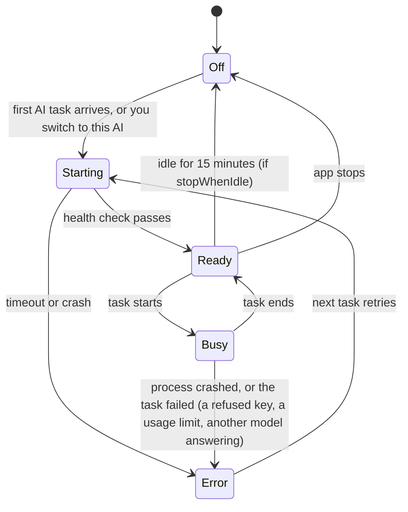

The dashboard shows this state in the AI pill in the header, with the name of the AI in use ("● Bonsai 2 · ready ▾"), and it updates live (§10).
- **The states are for the AI in use.** A switch tells the dashboard at once, even when the new AI is in the same state as the old one. A task that ran on the AI before a switch never sets the new AI's state.
- **"Starting" after a switch** happens only for an AI the app starts (Bonsai 2's llama-server, or your .bat file). You switched, so a window it opens is expected. Background work still never opens one.
- **A cloud AI** has no program, so it's Ready from the start (`CloudRuntime`), Busy while a task runs, and Error after a task fails, with the sentence (§6.1), until a task works again, you change its settings, or you save a new key for it.

### 7.7 Quick marks on a search list

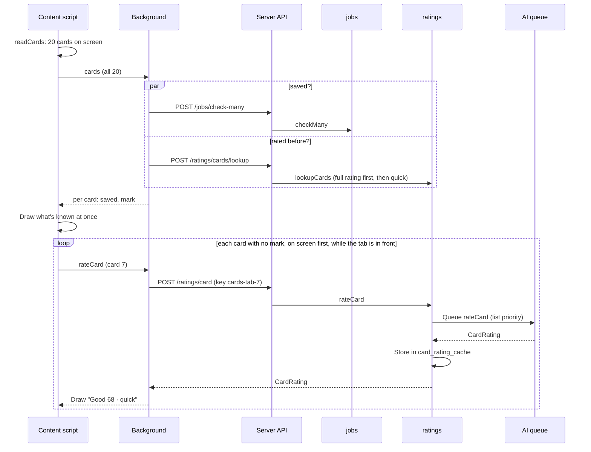

- **Only the cards.** A quick mark reads only what the card shows. It never opens the ad, so the sites see nothing but your own browsing. Opening a job still gets the full rating (§7.3), and its card's mark becomes the full one.
- **Which lists.** Search results on Seek, LinkedIn and Indeed, and the Recommended list on Seek's home page when you're signed in (its cards keep the work type, place and salary in plain text under the title, below any badges such as "Expiring soon").
- **One card at a time per tab**, so a job you open never waits behind a whole page of cards: the queue runs `interactive` before `list`, and only one card from each tab is ever waiting.
- **Known marks first.** A card for a job you've saved shows "Saved · Applied 12 Oct" (no AI). A card for a job you've opened before shows that full rating (the newest `rating_cache` row for its link, your current profile and the model that does full ratings now). A card rated before by the model that does quick marks now shows its quick mark. Only the rest go to the AI.
- **The tab in front only.** Rating pauses while the tab is hidden and carries on when you come back. A new search (the list changes) or leaving the page stops the loop; a card already with the AI finishes and is kept. Its mark goes only on a card for the same job, never on whatever card is now in that spot. Opening a job in the split view isn't a new search: the open job's id (Seek's `jobId` and `type`, LinkedIn's `currentJobId`, Indeed's `vjk`) is left out when the address is compared.
- **It stops when something goes wrong.** An `offline` reply, or any error other than `cancelled`, stops the loop for that list. That's true for a card's rating and for the lookup, so a stopped app or AI isn't asked again and again. The cards that already have marks keep them. The loop starts again when you come back to the tab (after it was hidden), or when a new list starts.
- **A card that fails is skipped.** A card whose rating fails with an error (not `offline`, not `cancelled`) isn't sent to the AI again on that page, even on a new list, so one card the AI can't rate never blocks the rest. Reloading the page clears this.
- **Saving updates the card.** When you save a job from the panel, its card's mark turns to "Saved" at once (or "Saved · Applied 12 Oct" if you saved it as Applied). Any rating it had moves into the tooltip.
- **Off switch:** the extension's options, "Rate the jobs in search results". With no master profile, no card gets a mark (the panel already says why). Coming back to the tab looks the cards up again, so a profile you've added meanwhile counts.
- **After the extension is updated or reloaded,** the old copy on an open page can't reach the browser any more. Its card watcher stops for good; reloading the page starts the new copy.

---

## 8. Data model

```mermaid
erDiagram
  JOBS ||--|{ POSTINGS : "has ads"
  JOBS ||--o{ STATUS_HISTORY : "status changes"
  JOBS ||--o{ NOTES : has
  JOBS ||--o{ JOB_CONTACTS : involves
  CONTACTS ||--o{ JOB_CONTACTS : "works on"
  CONTACTS |o--o{ INTERACTIONS : "took part in"
  JOBS |o--o{ INTERACTIONS : about
  JOBS ||--o{ DOCUMENTS : has
  JOBS ||--o{ ATTACHMENTS : has
  JOBS |o--o{ EMAIL_SUGGESTIONS : "suggested for"

  JOBS {
    integer id PK
    text title
    text company
    text agency
    text location
    text work_mode
    text employment_type
    integer salary_min
    integer salary_max
    text salary_currency
    text salary_period
    text salary_text
    text closing_date "YYYY-MM-DD"
    text status "status id from settings"
    text date_applied "YYYY-MM-DD"
    text summary
    text requirements "JSON list"
    text nice_to_have "JSON list"
    text responsibilities "JSON list"
    text ad_contact "JSON"
    text field_sources "JSON: field to user, ad or ai"
    text parse_state "pending, done or failed"
    text parse_error
    text match_verdict
    integer match_score
    text match_json
    integer archived
    text follow_up_on "YYYY-MM-DD, a follow-up reminder"
    text follow_up_note "why, 200 characters at most"
    text created_at
    text updated_at
  }
  POSTINGS {
    integer id PK
    integer job_id FK
    text canonical_url UK
    text source_site
    text external_id
    text source_url
    text jd_text "snapshot of the ad"
    text structured_json "JobPosting data, if any"
    text captured_at
  }
  STATUS_HISTORY {
    integer id PK
    integer job_id FK
    text from_status
    text to_status
    text source "manual, extension or email"
    text changed_at
  }
  NOTES {
    integer id PK
    integer job_id FK
    text body
    text created_at
    text updated_at
  }
  CONTACTS {
    integer id PK
    text name
    text role
    text organisation
    text email
    text phone
    text phone_digits "normalised, for search"
    text linkedin_url
    text notes
    text created_at
    text updated_at
  }
  JOB_CONTACTS {
    integer job_id PK, FK
    integer contact_id PK, FK
    text relation "recruiter, hiring manager, referrer, other"
  }
  INTERACTIONS {
    integer id PK
    integer contact_id FK "optional"
    integer job_id FK "optional"
    text kind "call, email, meeting, message"
    text happened_at
    text notes
  }
  DOCUMENTS {
    integer id PK
    integer job_id FK
    text kind "resume or cover_letter"
    integer version
    text markdown
    text origin "generated, edited or copied"
    integer copied_from_id
    integer is_sent
    text sent_at
    text sent_css "template frozen when sent"
    text created_at
  }
  ATTACHMENTS {
    integer id PK
    integer job_id FK
    text kind "resume, cover_letter, other"
    text file_name
    text stored_path
    integer size_bytes
    text created_at
  }
  RATING_CACHE {
    text ad_key PK "canonical URL + # + 16 hex of the ad text's SHA-256; text: + SHA-256 for a pasted ad"
    text profile_hash PK "16 hex of the SHA-256 of the master profile and preferences, then : and 16 hex of the SHA-256 of the rating model's identity (AiService.modelIdentity)"
    text rating_json
    text created_at
  }
  CARD_RATING_CACHE {
    text card_key PK "canonical URL + # + 16 hex of the SHA-256 of the card's title, company, location and text"
    text profile_hash PK "16 hex of the SHA-256 of the master profile and preferences, then : and 16 hex of the SHA-256 of the rating model's identity (AiService.modelIdentity)"
    text rating_json "CardRating"
    text created_at
  }
  EMAIL_SUGGESTIONS {
    integer id PK
    text message_id UK "Message-ID header, or uid:<uidvalidity>:<uid>"
    integer job_id FK "optional"
    text from_addr
    text subject
    text received_at
    text event "received, rejected, interview, assessment, offer, other"
    text suggested_status "at check time; worked out again when shown"
    real confidence
    text summary "one sentence, 200 characters at most"
    text company
    text role
    text state "pending, confirmed, dismissed, ignored"
    text applied_status "what Confirm set, or null"
    text created_at
    text handled_at
  }
  EMAIL_STATE {
    text key PK "cursor, lastCheckAt, lastError, lastAdded, refused:<message id>"
    text value
  }
  SEARCH_INDEX {
    text kind "job or contact"
    integer ref_id
    text title
    text people
    text notes
    text ad
  }
```

**Conventions**
- **IDs and keys:** IDs are whole numbers. Foreign keys are switched on. The database uses WAL mode, so reads never block writes.
- **Time:** timestamps are ISO 8601 in UTC (`2026-10-28T03:15:00Z`). Plain dates like `closing_date` and `date_applied` are local dates (`YYYY-MM-DD`). The dashboard shows dates in Australian format ("28 Oct 2026").
- **JSON columns:** the module's repo checks them with zod on every read and write.
- **Statuses** are stored by a stable **id**, such as `interview_1`, not by label. Renaming "Interview 1" to "First interview" in settings doesn't break history.
- **Documents are append-only.** Each save adds a version. A sent version can't be changed. The repo has no update except marking a version as sent, once. Two triggers in `003_documents.sql` also make the database itself refuse to change a version's text, or a sent version at all.
- **Attachments** are stored as `data/files/<jobId>/<8 hex>-<clean name>`, with `stored_path` relative to `data/files/`, so a moved data folder still works.
- **Rating caches** (`rating_cache`, `card_rating_cache`) are keyed by the ad or the card, and by `profile_hash`. That column holds two short hashes: one of your master profile and preferences together (`profile.hash()`), then `:` and one of the model identity (`AiService.modelIdentity`, §12.5). So a change to either file, or a switch to another model, rates afresh, and a model you used before finds its own ratings again. Rows from before Phase 8 have no model part, so they're never matched: each job is rated once more the first time you see it. There's no migration.
- **Follow-ups** are one date and an optional reason per job, set only through `PUT /jobs/:id/follow-up`. Nothing else changes them: not a status change, an edit, the AI or archiving (archived jobs are just left out of the list).
- **Jobs are archived, never deleted**, so history and links stay whole. Deleting for real is a separate, deliberate action in settings.
- **Unique keys:**
  - `postings.canonical_url` is unique.
  - So is `(source_site, external_id)` when `external_id` is set.
  - So is `(job_id, kind, version)` for documents.
- **`SEARCH_INDEX`** is an FTS5 virtual table using the `unicode61` tokeniser, with prefix indexes for 2 and 3 characters. Phone numbers are searched separately, through `contacts.phone_digits`, so a search matches any part of the number.
- **Migrations:** numbered SQL files in `server/core/db/migrations/` (`001_init.sql`, …). The runner applies new ones in order, inside a transaction, and records the version in `PRAGMA user_version`. It backs up the database before each migration.

---

## 9. API contract

- **Where it lives:** all endpoints sit under `/api/v1`. Every request and response body is a zod schema in `shared/contracts/<module>.ts`.
- **Who uses it:** the server validates with those schemas, and the dashboard and extension import the same schemas and types. `shared/api-client.ts` is a thin typed wrapper around `fetch`, used by both clients.
- **Change-safe:** if an endpoint's shape changes, the TypeScript build of the dashboard and extension fails straight away.

**Errors** always look like `{ "error": { "code": "not_found", "message": "Job 42 not found" } }`.

| Code | HTTP status | Meaning |
|------|-------------|---------|
| `validation` | 400 | Also used for a 415 (a body that isn't JSON). |
| `forbidden` | 403 | The Host or Origin check failed (§13). |
| `not_found` | 404 | |
| `conflict` | 409 | An ad that is already saved on another job, or an edit to a sent document. Possible duplicates are not errors: see `POST /jobs`. |
| `ai_unavailable` | 503 | |
| `internal` | 500 | |

**Endpoints**

| Area | Method and path | Purpose |
|------|-----------------|---------|
| System | `GET /health` · `POST /system/shutdown` · `POST /system/backup` | Health check for `start.bat` · Used by `stop.bat` · Back up now |
| Live | `GET /events` | Server-sent events stream for the dashboard |
| Capture | `POST /captures/preview` `{ url }` or `{ text }` | Build a Capture from a pasted URL or text |
| Jobs | `POST /jobs/check` | Exact or likely duplicates for a Capture |
| | `POST /jobs` `{ capture, fields?, status?, decision?, source? }` | Save. Replies `{ result }`: `created` (201), `linked`, `exists` or `needs_decision` (with candidates; resend with `decision` = `new` or `{ linkTo: jobId }`). `fields` are what you typed, and win over the ad. A note typed at save time is a second call, `POST /jobs/:id/notes`, so `jobs` never depends on `notes` |
| | `GET /jobs?status=&archived=&sort=` · `GET /jobs/:id` · `PATCH /jobs/:id` | List · get · edit (a follow-up can't be set here) |
| | `PUT /jobs/:id/follow-up` `{ on, note? }` · `GET /jobs/follow-ups` | Set a follow-up (`on: null` clears it and its reason; a `note` left out or blank means no reason) · `{ today, due, soon }`: due is today or late (oldest first), soon is the next 7 days, both by the server's local date, archived jobs left out |
| | `POST /jobs/:id/status` `{ status }` | Change status, which logs history |
| | `POST /jobs/:id/postings` `{ capture }` | Link another ad to this job |
| | `GET /postings/lookup?url=` | Fast "already saved?" check for the extension badge |
| | `POST /jobs/check-many` `{ items: [{ canonicalUrl, sourceSite, externalId }] }` (1–100) | `{ results: (ExactMatch \| null)[] }`, in the same order: the saved job for each link or site id. No "likely" matches |
| | `POST /jobs/:id/reparse` | Run AI parsing again (202). Served by `enrich`, so `jobs` never knows about the AI |
| Call sheet | `GET /jobs/:id/callsheet` | Everything for the one-screen view |
| Search | `GET /search?q=` | Ranked hits |
| Notes | `GET /jobs/:id/notes` · `POST /jobs/:id/notes` · `PATCH /notes/:id` · `DELETE /notes/:id` | |
| Contacts | `GET /contacts?q=` · `POST /contacts` · `PATCH /contacts/:id` | |
| | `POST /jobs/:id/contacts` · `DELETE /jobs/:id/contacts/:contactId` | Link or unlink a contact |
| | `POST /interactions` · `GET /jobs/:id/interactions` | Call log |
| Ratings | `POST /ratings` `{ capture, key? }` · `GET /ratings/status` | Rating, from cache or the AI, as `{ rating, cached, reason }` (`rating` is null with a `reason` when there's no master profile). `key` is "latest wins", one per browser tab. Closing the request cancels the rating · whether ratings can run |
| | `POST /ratings/card` `{ card, key? }` · `POST /ratings/cards/lookup` `{ cards }` (1–100) | A quick mark for one job card, from cache or the AI, as `{ rating, cached, reason }` (`rating` is a `CardRating`, null with a `reason` when there's no master profile). Closing the request cancels it · what's known without the AI: `{ results: (CardMark \| null)[], reason }`, where a `CardMark` is `{ kind: "full" \| "quick", verdict, score, reason }` |
| Documents | `GET /jobs/:id/documents` · `POST /jobs/:id/documents` `{ kind, markdown, origin }` or `{ fromDocumentId }` | List · save a version (201) or copy one |
| | `GET /documents?kind=` · `GET /documents/:id` | Every job's versions of one kind, with the job's title and company, for "Start from another job's version" · one version, with its Markdown |
| | `POST /jobs/:id/documents/generate` `{ kind }` | Streamed Markdown as NDJSON (`application/x-ndjson`): `{kind:"text",text}` lines, then `{kind:"done"}` or `{kind:"error",message}`. A missing job (404) or master profile (400) is refused before the stream starts. Nothing is saved |
| | `POST /documents/:id/sent` · `GET /documents/:id/render` · `GET /documents/:id/export?format=` | Freeze · print view, with a strict Content Security Policy · download (`Content-Disposition: attachment`) |
| | `GET /documents/exporters` | Which export buttons to show |
| Attachments | `POST /jobs/:id/attachments?kind=resume\|cover_letter\|other` (multipart, one `file`) · `GET /attachments/:id` | Attach (201): up to 15 MB, PDF, Word, RTF, text or OpenDocument only · download |
| Profile | `GET /profile/:name` · `PUT /profile/:name` `{ text }` | `master-profile`, `preferences`, `resume-guide`, `cover-letter-guide` (Markdown in `profile/`) and `resume`, `cover-letter` (CSS in `templates/`), as `{ name, text, updatedAt }`. `PUT` is dashboard-only |
| Settings | `GET /settings` · `PATCH /settings` · `PUT /settings/ai/active` `{ id }` · `GET /settings/secrets` · `PUT /settings/secrets` `{ emailPassword?, aiKeys? }` | Secrets are never returned: `/settings/secrets` answers `{ emailPassword: true \| false, aiKeys: [the ids of the saved AIs that have a key] }`. A `PATCH` replaces each section it holds. Its `ai` must be the whole `{ active, saved }`: the older one-AI shape is refused, so it can't replace every saved AI with one. A `PATCH` that deletes an AI, or changes its provider, deletes that AI's key in the same save · `PUT /settings/ai/active` switches the AI in use, and answers with the settings · In `PUT /settings/secrets`, a secret left out stays as it is, and null or blank removes it. `aiKeys` is `{ "<AI id>": key or null }`, for saved AIs only. Spaces and line breaks in a pasted key are dropped. A refusal never quotes what was sent, since it may be a key. Every write here is dashboard-only, not from extensions (§13) |
| AI | `GET /ai/status` · `POST /ai/test` · `POST /ai/check` `{ ai, key? }` · `POST /ai/models` `{ ai, key? }` | `{ state, detail, id, name, preset, baseUrl }` for the AI in use · tests the AI in use, as saved: `{ ok, detail, models, replyMs }`, sent the way reading an ad is (the parse task's model, thinking and extra fields, and a small JSON schema); never an HTTP error. A failed test also shows in the pill · tests any AI, saved or not (Settings → AI's form), with the key typed or else that AI's saved key; the same answer as `/ai/test`. Nothing is saved. The pill changes only when the form is the AI in use exactly as saved, with no key typed: then it's the same test as `/ai/test`. Only the AI in use waits in the queue and may start its program · that AI's model list, as `{ ok, models, detail }`. `check` and `models` are dashboard-only, and a key sent in never comes back |
| Email | `GET /email/status` · `POST /email/check` · `POST /email/test` · `GET /email/suggestions` · `POST /email/suggestions/:id/confirm` `{ jobId?, status? }` · `POST /email/suggestions/:id/dismiss` | `{ enabled, configured, checking, lastCheckAt, lastError, lastAdded, pending }` · check now (400 "Connect Gmail first: Settings → Email." until it's set up), then the status · `{ ok, detail }`, never an HTTP error · the pending cards, newest first · confirm: `jobId` picks another job, `status` null only adds the note; left out, both follow the card (409 when already handled) · dismiss. Every POST is dashboard-only |

---

## 10. Dashboard

**Pages**

| Path | Page |
|------|------|
| `/` | Search box (focused on load), a **Follow up** section ("Due" with how late, "Coming up" for the next 7 days, a **Done** per job; shown only when there's something in it) + job list with status filter chips |
| `/board` | Board: a column per status in your order (closed ones with **Show closed statuses**, remembered in `localStorage`), plus an "Other" column for a status your settings no longer have. Each card shows the role, company, date applied and any follow-up, and has a **Move to** menu with a **Move** button. Choosing in the menu never moves the card by itself (on Windows an arrow key changes a closed menu, and a typed letter does everywhere); **Move** does. Drag a card to another column (a drag carries its own data type, so dragged text never moves a job; nothing can be dropped on Other), or use **Move**: the card moves at once, the status change is sent (`POST /jobs/:id/status`, so it's in the history), the move is announced and the focus stays on the card's menu (or goes to the Board heading when its new column is hidden). A refused move puts the card back, says why, and keeps the focus on it |
| `/jobs/:id` | Call sheet at the top. Then the full ad, documents, attachments and a timeline |
| `/jobs/:id/documents/:docId` · `/jobs/:id/documents/new?kind=resume\|cover_letter` | Editor: text on the left, live A4 preview on the right, fact-check list, version picker, Generate and Stop, Save version, Mark as sent, Print / PDF, one button per exporter, Start from another job's version |
| `/settings` | A menu down the side, and one section at a time beside it: Profile, AI, Email, Statuses, Templates, Display, Your data. Each section has its own address (`/settings#ai`), so links, reload and Back land on it, and moving to one puts the focus on its heading. Every section stays on the page while it's hidden, so moving between them never loses what you typed (and never asks); the menu marks a section with unsaved changes "Not saved", Email "On" or "Off", and AI "Problem" when it has one. Leaving Settings with unsaved profile files still asks. On a narrow screen the menu runs along the top. The sections: Statuses, AI (see **Settings → AI** below), Email (on or off, Gmail address, the app password with **Save password**, **Replace** and **Remove**, minutes between checks; **Save email settings** and **Test connection** save a typed password too), Profile (master profile, preferences, the two guides), Templates (the two CSS files), Display (the theme: Match this computer, Light or Dark; it changes at once and this browser remembers it), backups |
| `/inbox` | Inbox: the last check ("Last checked 5 min ago · 2 new emails", or why it failed), **Check now**, and one card per email: what it is ("Rejection", "Not sure" when the AI wasn't), sender and date, subject, summary, the job ("Senior Engineer at Atlassian · now Applied") or "No job matched", the question ("Mark as Rejected?"), a status picker with "Don't change the status", **Confirm** (**Add note** when the status won't change), **Pick another job** ("Pick a job" when none matched; a search that Escape closes) and **Dismiss**. The last-check line is announced when a check ends, and the focus moves to the next card after Confirm or Dismiss, and to the status after a pick. Nothing changes until you confirm. The header's **Inbox** link shows how many wait |

**The AI pill** (`AiSwitcher`, in the header on every page)
- It shows the AI in use by name, a dot and its state: off, starting…, ready, working… or problem ("● Bonsai 2 · ready ▾"). Its accessible name starts with what it shows: "{name}, {state}, AI in use". Its title is the state's sentence. The name comes from `GET /ai/status` and every `ai.stateChanged` event (which carries `id` and `name`). Until one of those or the settings has loaded, it says only "AI", so nobody sees the built-in Bonsai 2 for a moment.
- One click opens a menu of your saved AIs in two groups, **On this computer** then **Cloud**, each AI with its provider and model and a ✓ on the AI in use. An AI that needs a key and has none says "No API key yet" (the pill learns which AIs have a key from `GET /settings/secrets`, at the start, on each `settings.changed`, and when the menu opens). The last item is **Manage AIs…** (Settings → AI). When the AI has a problem, its sentence sits at the top of the menu, so the way out is beside it.
- Picking an AI switches the whole app at once (`PUT /settings/ai/active`, no Save button). The toast says "Now using {name}.", plus "{old} may still be running on {host}. Close its window if it is." when the old AI may still answer on the same address, plus "No API key yet: add one in Settings → AI." when the new AI has none. The cursor stays on the pill. Adding, saving or testing an AI never switches to it.
- Keyboard: it's a menu button. Enter, Space or ↓ opens the menu with the cursor on the AI in use (↑ opens it on the last item). ↑ and ↓ move (they wrap), Home and End jump, a letter moves to the next AI whose name starts with it, and Enter or Space picks. Escape closes it and puts the cursor back on the pill. Keys the menu uses never reach the page, so Esc doesn't go back, and N and / don't open a new job or jump to search while it's open. Tab, a click outside, or the focus moving anywhere outside it closes it.
- The menu is drawn in the page's colours, not the band's (`.off-band` in `app.css`).

**Settings → AI**
- **My AIs:** one line per saved AI, with its name, provider and model ("Claude (Anthropic API) · claude-sonnet-5-5"; for Bonsai 2, the model file it runs), and **In use** or **Use this**, **Duplicate** and **Delete**. A cloud AI with no key says "No API key yet". Pressing an AI opens it in the form under the list, and that line carries the accent down its edge. The AI in use opens first.
  - **Use this** switches at once, as the pill does.
  - **Duplicate** saves "{name} (copy)" straight after the original ("(copy 2)", "(copy 3)" … when that name is taken), with every setting but never the key. It opens the copy with its name selected.
  - **Delete** asks first, and deletes the AI's key too. It can't be used on the AI in use ("Switch to another AI first.") or on the last AI ("You need at least one AI."). It stays in the tab order, its reason is read out when the cursor reaches it (`aria-describedby`), and it says why when pressed.
  - Opening another AI, adding one or duplicating, while the form has unsaved changes, asks first.
- **Add an AI** opens an empty form with **Provider** in focus. The list is grouped Cloud, then On this computer. Picking one fills in its address and first suggested model, and the provider's short name ("Claude", or "Claude (2)" if you have one), until you type your own name. A new AI's id is made from its name when it's first saved. Cancel goes back to the AI in use.
- **The form** has Provider, Name, and the provider's note (for a cloud AI, what it sees and that each request is billed to the key). Then:
  - **Server address.**
  - **API key**, for a provider that takes one: a password field with **Get a key** (the provider's page, in a new tab). Once a key is saved, it shows "Key saved" with **Replace** and **Remove** (Remove works at once). A key never comes back to the page. A key only ever goes to the provider it was saved for: when a save changes an AI's provider, the server deletes that AI's key (`settings.update`), whatever the page knew. The form warns "The key saved for {provider} is removed when you save." as soon as you pick another provider, even one that takes no key.
  - **Model:** a box you can type in, with a list. Our suggestions come first, with their tags ("Best value"), then the provider's own list (`POST /ai/models`, with the key you typed or the saved one), asked for the first time you open the list. Typing narrows the list. A provider that needs a model (every one but Bonsai 2's llama-server) can't be saved without one: "Model: pick one from the list, or type its name." Test connection can go without, and then names the first ten models the server has ("…, and 390 more").
  - For llama-server: "Start it for me when it isn't running" with the program or .bat file. For a program, its options and "Stop it when it's idle" (off by default) with the minutes. For a .bat file or a server you start yourself, an optional **Model file**, so the app can tell when another model answers on that address.
  - "How the AI works on each task": one row per task (reading ads, rating a job, quick marks on search lists, writing resumes and cover letters, reading emails). Each row has Thinking (Off, Low, Medium, High, No limit), Longest answer (tokens; off with No limit, when it keeps its saved number), Temperature and Model (blank uses the one above). Each task's `extra` fields stay as they are, until the AI's provider changes: then each task's own model and `extra` fields were for the old provider (Bonsai 2's `top_k` makes Claude refuse every request), so the Model boxes empty, the form says "Each task's own model and extra settings are reset for the new provider.", and saving drops them. Going back to the saved provider before you save brings the models back.
- **Test connection** tests what's in the form, with the key you typed or else the saved one (`POST /ai/check`). It never saves. It changes the AI pill only when the form is the AI in use exactly as saved, with its saved key, so once a usage limit has passed, a good test clears the problem and the jobs waiting for the AI are read. Its result goes away when you change the provider, address, key or model, so it never describes something else. For the AI in use it waits its turn and may start its program. Any other AI is tested at once, and its program is never started.
- **Save AI settings** reloads the settings and checks the form against them (so a name or id another tab has just taken is caught), then saves the whole AI section (`{ active, saved }`, never the older single-AI shape), then the key you typed, then reloads which AIs have a key. The toast says "AI settings saved.", or "Added {name}." for a new AI. A problem shows as a sentence beside the buttons.
- The "Right now" line stays above the list, and the menu's "Problem" mark stays on the AI section.

**Structure**
- **Folders:** `web/src/pages/` holds one component per page (`DocEditorPage` is the editor). `web/src/components/` holds shared pieces: `SearchBox`, `JobList`, `CallSheet`, `Timeline`, `LogCallDialog`, `NewJobDialog`, `SamePrompt`, `DocumentsPanel`, `DocPreview`, `FactCheckList`, `CopyFromDialog`, `ProfileFilesSection`, `AiSwitcher` (the AI pill), `AiSettingsSection` with `AiList` and `AiForm` (Settings → AI), `ModelPicker`, `EmailSettingsSection`, `SuggestionCard`, `JobPicker`, `FollowUps`, `FollowUpDialog`, `BoardCard`. `InboxPage` is the Inbox and `BoardPage` the board.
- **The preview** is an iframe with `sandbox=""` whose `srcdoc` is `documentPage(...)` from `shared/document-page.ts`, the same page the print view serves. It's redrawn 300 ms after you stop typing. A sent version uses its frozen CSS. Fact-check flags are `<mark>`ed in the preview only, never in print.
- **API calls:** `web/src/lib/api.ts` creates the shared typed API client. Pages load data when they open.
- **Light and dark:** every colour in `web/src/app.css` is a `light-dark()` pair, so one list of tokens covers both themes. With no choice made, the browser follows the computer. Settings → Display sets `data-theme` on `<html>` (`web/src/lib/theme.ts`, kept in `localStorage`), and a small script in `index.html` applies it before the page first draws. The header is a band of ink in both themes; the extension keeps its own colours.
- **Live updates:** `web/src/lib/live.svelte.ts` listens to `GET /events`. A page reloads its data only when an event is about what's on screen, such as `job.updated` for the open job. There's no global state library.
- **Markdown:** rendered by `shared/markdown.ts` (`marked`, GFM, line breaks kept). It escapes any raw HTML, turns links other than `http:`, `https:` and `mailto:` into plain text, and shows images as their alt text. The page shell carries a Content Security Policy (`default-src 'none'; style-src 'unsafe-inline'; img-src data:; base-uri 'none'; form-action 'none'`) as a meta tag, and the print view sends it as a header too. Every `<` in template CSS becomes the CSS escape `\3c`, so a template can't end its own `<style>`.

**Keyboard**

| Key | Action |
|-----|--------|
| `/` or `Ctrl+K` | Jump to search |
| `↑` `↓` `Enter` | Move through and open results |
| `Esc` | Clear search, or go back |
| `N` | New job |
| `Ctrl+V` (when not typing in a field) | New job from the clipboard |
| `L` | Log a call (on a job page) |
| `S` | Change status (on a job page) |
| `E` | Edit fields (on a job page) |
| `F` | Follow up: set, change or clear the job's follow-up (on a job page) |

---

## 11. Browser extension

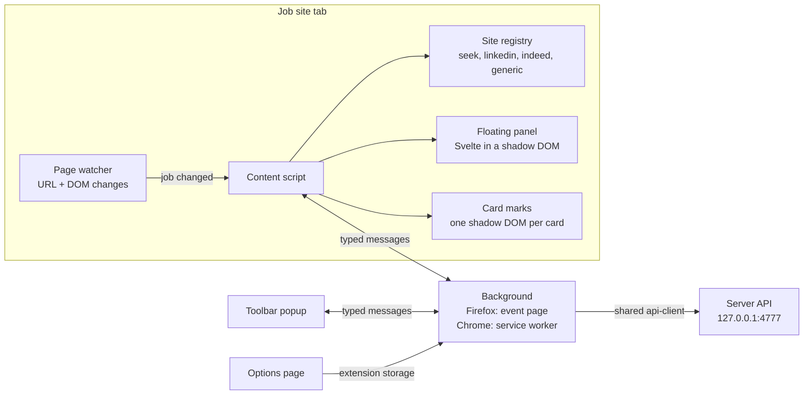

- **Content scripts** run only on Seek, LinkedIn and Indeed (`matches` in the manifest: `au.seek.com`, `nz.seek.com`, the older `www.seek.com.au` and `www.seek.co.nz`, `*.linkedin.com`, `*.indeed.com`). A Seek job from any of these addresses gets the same stable link, `www.seek.com.au/job/<id>` (or `www.seek.co.nz`), so it's the same job. On any other site, the popup's **Save this page** injects the generic reader (`generic.js`) once, using `activeTab` and `scripting`, so the extension doesn't need permission to read every website.
- **Readers** (`extension/src/sites/`): each site's selectors first, then the page's own JobPosting data (only when its title matches the title on screen), then nothing. On the three job sites, the ad's header facts (title, company, location, work type, salary) go above the description in the saved ad text, because the salary is often only in the header. A reader returns `null` until the ad's text is there, and when a split pane's own job link names another job. The generic reader uses your selection (over 200 characters), then the JobPosting data, then Readability. `npm run ext:check -- page.html URL` runs a reader on a page you saved.
- **Single-page sites:** Seek, LinkedIn and Indeed change the job without reloading the page. The page watcher (`watcher.ts`) checks the URL and the job id every 500 ms, and on page changes. On Seek's home page the address never changes: a Recommended card opens the job in a pop-over (`#homepageDrawer`), and the job id comes from the pop-over's own links. Closing it leaves the job. When the id changes, it waits up to 5 seconds for that job's details, ignoring a pane that still shows the last job, reports the job, and reports again if more of it arrives in that time. If nothing arrives, the panel says it couldn't read the job and offers **Save selection** and **Save page**.
- **The panel** is a Svelte component in a shadow root (closed, so the site's scripts can't read your saved status or rating; the test build opens it). The site's CSS can't break it, and it can't break the site. It shows which job it's about, then one of: checking; already saved ("Saved · Applied 12 Oct", **Open in Job Registry**); likely the same as another job (**Same job** / **Different job**); new (**Save**, with Saved or Applied and an optional note); couldn't read; the app isn't running (**Try again**). The rating shows below. **Hide** (or Esc) tucks it away, and it stays tucked away. It starts in the bottom-right corner. You drag it by its top bar, and resize it from any edge or corner. It keeps that place and size on every page (`panelPlace` in the extension's storage, as distances from the right and bottom of the window, so it stays in its corner when the window changes size), and always stays inside the window. A double-click on the bar puts it back in the corner at its usual size. The bar stays in view while the rest scrolls. A site's pop-over can hold the focus inside itself and stop the mouse wheel elsewhere (Seek's home page does, with react-focus-lock and react-remove-scroll). So the panel's host carries `data-no-focus-lock`, which focus-lock leaves alone, and stops wheel and touch moves from reaching the page, so you can still type a note and scroll the panel.
- **Card marks** (`cards.ts`, `marks.ts`): on a search list, each job card gets a small mark after its title: "Strong 84", "Good 68 · quick", "Saved · Applied 12 Oct", or "Rating…" while the AI reads it. The mark itself shows the verdict and score. Its tooltip holds the AI's one-line reason, plus "Quick rating from the card. Open the job for a full rating." for a quick mark. A saved job's tooltip also gives its rating, if it has one. Each mark is a closed shadow root (open in the test build), with its words and its tooltip inside, so the site's CSS can't touch it and the site's scripts can't read your rating. It sits above the card's own click-through link, so its tooltip shows. The card watcher reads the list every second, so cards that load as you scroll (LinkedIn) get marks too, and a mark the site redraws away is put back, never twice. See §7.7.
- **Messages** between the content script, popup and background are one typed union in `extension/src/messages.ts`: `check`, `rate`, `save`, `captureActiveTab`, `openJob`, `health`, `cards` (what's known about a list's cards: both lookups at once) and `rateCard`. The background's work is in `handlers.ts`, behind a small `ChromeLike` port, so it's tested without a browser. Replies are `{ ok, data }` or `{ ok: false, error, offline }`.
- **Ratings:** one per tab at a time. A newer one aborts the older request in the browser, which cancels it on the server too, and the server's "latest wins" key (`tab-<id>`) is a second guard. Replies for a job you've left are dropped. Card ratings are separate: one per tab at a time too, with their own key (`cards-tab-<id>`), so the open job's rating and a card's never cancel each other.
- **Badge:** the toolbar icon shows ✓ on pages you've already saved, from the `check` reply's exact match.
- **Shortcut:** `Alt+Shift+J` opens the popup.
- **Options:** server address (`http://127.0.0.1` or `http://localhost`, any port; default `:4777`), rating jobs automatically on job pages (on or off), and rating the jobs in search results (`rateLists`, on or off; on by default). If you've taken away the extension's permission to reach this computer, the options page says so and offers **Allow access**.
- **Two browsers, one codebase:**
  - `manifest.base.json` holds what both share.
  - `manifest.firefox.json` adds `background.scripts` and `browser_specific_settings.gecko` (id `job-registry@local`, Firefox 140 or later).
  - `manifest.chrome.json` adds `background.service_worker`.
  - `build.mjs` (esbuild + esbuild-svelte) merges them into `extension/dist/firefox` and `extension/dist/chrome`; `--e2e` also builds `chrome-e2e` for the browser tests, which reads copies of the sites at `http://127.0.0.1:4798` and talks to the test server on 4799.
  - The code uses the promise-based `chrome.*` API, which works in both browsers.
- **Permissions:** `storage`, `activeTab`, `scripting`. Host permissions: `http://127.0.0.1/*`, `http://localhost/*` and the three job sites.
- **Signing:** `npm run ext:sign` signs the Firefox build as an unlisted add-on with your addons.mozilla.org keys (`WEB_EXT_API_KEY`, `WEB_EXT_API_SECRET`), so it stays installed in normal Firefox.

---

## 12. AI design

### 12.1 Tasks

| Task | Input | Output | Queue priority | Thinking | Streamed |
|------|-------|--------|----------------|----------|----------|
| `parseJob` | ad text (the page's `JobPosting` fields are already on the job, and the AI never overwrites them) | `ParsedJob` (JSON schema) | parse (background for the start-up sweep) | off | no |
| `rateJob` | master profile, preferences, ad | `Rating` (JSON schema) | interactive | off | no |
| `rateCard` | master profile, preferences, one job card as plain text (title, company, location, then the rest) | `CardRating`: `{ reason, verdict, score }`, the reason one sentence (JSON schema) | list | off (`tasks.card`: temperature 0.2, 512 tokens) | no |
| `writeDocument` | kind, master profile, guide, the job's fields as plain text, its newest ad, today's date (cover letters) | Markdown | interactive, key `doc-<jobId>-<kind>` | on (`tasks.write`: temperature 0.6, effort max, so no limits; its 8192 tokens apply at Low, Medium and High) | yes: it holds the queue until the stream ends, is cancelled, or the reader stops |
| `classifyEmail` | sender, subject, date, the email's new text (quoted history cut, a forward kept, 4,000 characters at most), up to 5 candidate jobs as `[id] Title at Company (Status)` | `{ event, jobId, company, role, confidence, summary }`: a `jobId` that wasn't a candidate becomes null; summary 200 and names 120 characters at most. The suggested status is plain code, not the AI (§7.5) | background | off (`tasks.email`: temperature 0.1, 1024 tokens) | no |

- **Settings per task, per AI:** each saved AI has its own block for each task (`ai.saved[].tasks.parse`, `.rate`, `.card`, `.write`, `.email`), with model, temperature, maxTokens, thinking, thinkingEffort and extra request fields. So you can use the 27B model for documents and a smaller, faster one for ratings, and a "light" copy of an AI can think less. Settings → AI shows all but `extra` (§10). Every task runs on the AI in use, with that AI's settings.
- **Thinking off** is `reasoning_effort: "none"` on the local presets (§6.1). Bonsai 2 thinks at length by default, so tasks that don't need it turn it off. Its `"low"` thinks about as long as `"xhigh"` (PrismML's KNOWN_ISSUES.md), so each level's limit is what keeps Low, Medium and High apart. On a cloud AI, each level is sent the way its dialect says, and "off" asks for the least thinking the provider takes, with Medium's room on top of the longest answer.
- **Prompts are text files** in `server/modules/ai/prompts/*.md`, with `{{placeholders}}`. You can change wording without touching code. Every AI gets the same prompts.
- **Prompt order helps the cache.** The fixed part comes first and the ad comes last. llama-server reuses the cached start of the prompt, so repeat ratings are much faster. The two rating prompts (`rate-job.md` and `rate-card.md`) share one system part, word for word: who you are, your profile and your preferences. Each one's own rules go in the user part, before the ad or card. So moving between a full rating and quick marks keeps the cache (a test checks the two system parts match). Claude's connector marks that system part for Anthropic's prompt caching, which makes repeat requests cheaper. Most other cloud providers cache a repeated start by themselves.
- **Size limits:** ad text over about 12,000 characters is trimmed. The 32K context leaves room for the profile (usually 3–6K tokens), the ad and the answer.

### 12.2 Structured output

1. The request asks for JSON in the shape of the zod contract's schema, the way the provider allows (its dialect, §6.1):
   - `response_format: { type: "json_schema", … }` for llama-server, Ollama, LM Studio and most cloud providers (OpenAI, Gemini, Kimi, Mistral, xAI, Groq, OpenRouter).
   - `response_format: { type: "json_object" }`, with the schema written at the end of the system message, for DeepSeek, Z.ai and Qwen, which take nothing else. The words "json" and "JSON" are both in it, because DeepSeek and Qwen each need one.
   - Claude's structured outputs (`output_config.format`), with every object closed and the limits Claude refuses taken out.
2. The reply is checked with zod, whichever way it was asked for.
3. If the check fails, the request is retried once, with the error message added.
4. If it still fails, the task fails with a clear message. For parsing, the job keeps its raw ad and shows **Read again**.

### 12.3 Queue

- **One task runs at a time**, because there's one GPU.
- **Priority:** `interactive` (you're waiting) > `list` (quick marks on the search list you're looking at) > `parse` > `background`. A waiting task jumps ahead of lower ones, but never stops one that's already running. `list` may start the AI (only `background` never does).
- **Cancelling:** every task takes an `AbortSignal`. Cancelling removes a waiting task, or aborts the HTTP call of a running one.
- **"Latest wins" keys:** a new task with the same key cancels the older one. Ratings use a key per browser tab.
- **Idle timer:** each task calls `runtime.touch()` when it ends, which resets the idle timer. The timer only runs when the AI's `stopWhenIdle` is on (off by default).
- **A switch** (§12.5) never cancels a task on purpose. A task picks the AI and its provider when it starts running, so one already running finishes on the AI it started on. If stopping the old program cuts it short, it fails as a stop does, and a draft keeps its text so far. Tasks still waiting, and every task after, run on the new AI. A task waiting for the old AI's program to start waits for the new AI's instead.

### 12.4 Runtime management (llama-server)

These settings belong to each saved Bonsai 2 AI (`managed`, `stopWhenIdle`, `idleMinutes`). A cloud AI ignores them.

- **Start:** `spawn(exe, args, { windowsHide: true })`. The arguments come from settings, by default `-m ai/models/Ternary-Bonsai-2-27B-PQ2_0.gguf -ngl 99 -fa on -c 32768 --jinja --port 8080`, so a new PrismML release never needs a code change. `download-ai.bat` fetches the pinned build (`prism-b10777-e3de715`, CUDA 12.4) and the model, and checks each file's SHA-256.
- **Health check:** polls `http://127.0.0.1:8080/health` every 500 ms, for up to 120 seconds.
- **Stop:** whenever the app exits, and after the idle timer if you turned on "Stop it when it's idle" (`stopWhenIdle`, off by default since 29 Oct 2026; `idleMinutes`, 15 by default). On Windows it uses `taskkill /T /F`, so no orphaned process is left holding GPU memory. If taskkill doesn't finish in 10 seconds, the process is forced. A crash ends it synchronously on the way out, and the pid file covers anything that still slips through.
- **Already running:** if the port already answers when the app starts, the app uses that server and never stops it.
- **A `.bat` file as the program** (for example the user's own `D:\aitest\Bonsai-demo\start_bonsai.bat`): the app opens it the way a double-click does, with PowerShell's `Start-Process` (minimised, in the file's own folder, the paths passed in environment variables), then polls `/health` as above. The window it opens isn't part of the app (Node's job object doesn't reach a grandchild), so it carries on after the app stops. The app never stops it: no idle timer, no stop on exit, no pid file. Background work (`priority: 'background'`: email checks, the start-up sweep) never opens it; it fails with "The AI isn't running. Job Registry opens start_bonsai.bat when you next save an ad or press Test connection." and the state is "off". So a window never pops up when you didn't do anything, for example after you closed Bonsai 2 to play a game. On macOS and Linux a `.bat` file says it only runs on Windows. Added 29 Oct 2026.

### 12.5 Saved AIs and switching (Phase 8)

You can save any number of AIs and switch the one in use in one click. The whole app uses one AI at a time, for every task. Decision record: [0011](decisions/0011-several-ais-and-cloud-providers.md).

**The settings** (`shared/contracts/ai.ts`)
- `ai` is `{ active, saved }`. Each saved AI has every field the one-AI section had before (`preset`, `baseUrl`, `model`, `timeoutSec`, `stopWhenIdle`, `idleMinutes`, `managed`, `tasks`), plus `id` and `name`. There's always at least one, `active` names one of them, ids are unique, and an unknown field is refused, as everywhere in settings. With no `ai` section, there's one AI: `bonsai-2`, "Bonsai 2", with the defaults.
- `activeAi(settings.ai)` gives the AI in use. The tasks, both local runtimes, `eval:parse` and the handover checks all read it.
- **An id** is made from the name when the AI is first saved (`newAiId`): lower case, a–z, 0–9 and single dashes, at most 40 characters, with accents dropped, and "-2", "-3" … when it's taken ("Claude – wife's" is `claude-wife-s`). It never changes, even on a rename, because the key is stored under it.
- **An older file** (one AI's fields under `ai`) is read as one saved AI, named by its preset: Bonsai 2, Ollama, LM Studio or My AI server, with its id made from that name. Nothing is lost, the `.bat` program and each task's `extra` included. The file keeps its old shape until the next save. An object with `active` or `saved` in it is the new shape, so a typo there is refused, not read as one AI. A change sent to the API must use the new shape (§9).

**The provider catalogue** (`shared/contracts/ai-presets.ts`, checked on the date in `PRESETS_CHECKED`)
- 15 presets, cloud first, then the ones on this computer. The Add an AI list uses this order:
  - Cloud: Claude (Anthropic API), OpenAI, Google Gemini, DeepSeek, Kimi (Moonshot), Z.ai (GLM), Qwen (Alibaba Cloud), Mistral, xAI (Grok), Groq, OpenRouter.
  - On this computer: Bonsai 2 (llama-server), Ollama, LM Studio, Another OpenAI-style server. These four keep their old ids, so old files map across one to one.
- Each preset gives its label and group, address (none for "Another OpenAI-style server": you type it), whether it needs a key (required for every cloud one, optional for "Another", none for the rest) and where to get one, whether it needs a model, whether the app can start it (only llama-server), its dialect (§6.1), its note, and suggested models, each with a tag ("Best", "Recommended", "Best value", "Fast", "Cheapest", "Free tier" or "Small, for a busy PC").
- **Notes:** every cloud preset's note says what the provider sees and that each request is billed to the key, and that quick marks use the most. Claude's adds that a Pro or Max login can't be used (an API key from the Claude Console can). Z.ai's says to use a pay-per-use key, not the GLM Coding Plan, and its address is Z.ai's general API, never the Coding Plan's. Qwen's says to use the workspace address Alibaba Cloud gave you, if it gave you one.
- **A new AI** (`newSavedAi`) takes the preset's address and its first suggested model, and the defaults for everything else. Claude's first suggestion is Sonnet ("Best value"), not Opus as Anthropic suggests, because quick marks rate every card on a page, so cost matters most. A new Bonsai 2 gets no model, because there `model` names the file it expects (below), and you haven't picked one.
- Facts the research couldn't confirm (such as some key pages, Qwen's older address, and whether Z.ai, Qwen and xAI have a model list) are kept, with a comment saying "unverified".

**Keys** live in `config/secrets.json` under `aiKeys`, by AI id (§13). The AI service asks `getKey(id)` for the AI it's about to use. A saved key goes only to the preset it was saved for: it's deleted when its AI is deleted or its provider changes, and the service only uses a saved key for an AI with the same preset as the saved one.

**Switching**
- From the AI pill or Settings → AI (`PUT /settings/ai/active`). It saves at once. `settings.changed` then tells the AI service, which sees that the AI in use has a new id:
  1. Switching again cancels a start in progress, so a quick A → B → A ends on A with one start.
  2. The runtime follows the new AI, and the old one stops as in §6.2.
  3. If the app starts the new AI's program (llama-server with "Start it for me" ticked), it starts at once, and a `.bat` file opens its window. Problems go to the pill, never to the switch itself.
- What happens to tasks is in §12.3. An edit to the AI in use isn't a switch: its runtime follows, but nothing starts.
- Adding, saving or testing an AI never switches to it, and the app never switches by itself, not even when an AI hits its limit.

**Two local AIs on one address.** Two Bonsai 2 AIs can share `127.0.0.1:8080`, for example two `.bat` files for two model files. The app never closes a window it didn't start, so the old one may still be answering after a switch. So:
- **The model file it should run** (`expectedModelFile`): for llama-server only. When the app starts the program (not a `.bat`), it's the file after `-m` or `--model`. Otherwise it's the **Model file** field (the AI's `model`), if that ends in `.gguf`. It's compared in lower case, without its folder.
- **When it's known,** the service compares it with the `.gguf` names in the server's `GET /models`: before each task (once the server answers), at Test connection, and just after a switch starts it. If they differ, the task fails, and the pill shows the problem: "{other} is still running on {host}. Close its window, then try again." (another saved AI runs that file), or "Another model ({file}) is running on {host}, not {name}'s ({expected}). Close it, then try again." A list with no `.gguf` names (a server that reports an alias) or no list at all can't tell models apart, so the task runs. A false stop on every task would be worse than a missed check.
- **When it isn't known,** the switch's toast warns once, when the old AI uses the same address and the app doesn't stop it itself (a `.bat`, or a server you run): "{from} may still be running on {host}. Close its window if it is." (`sameAddressWarning`).

**Ratings per model.** Each model keeps its own ratings (the user's pick), through the cache key (§8). `AiService.modelIdentity(task)` is `preset|model`:
- for llama-server, the model file it runs (it runs one model, whatever a task names)
- otherwise the task's own model (`tasks.rate.model` or `tasks.card.model`), or else the AI's model
- with no model known, `preset|ai:<id>`, so that AI keeps its ratings to itself. (Filling in a Bonsai 2 AI's Model file later changes its identity, so each job is rated once more.)

The task settings (thinking, temperature) don't count, so "Bonsai 27B" and "Bonsai 27B lighter" share ratings when they run the same file, and two Claude keys on the same model share them too. `rateJob` and `rateCard` return the identity of the AI they actually ran on, so a rating that waited through a switch is stored under the new model. A quick-mark lookup of a full rating uses the rating task's identity (§7.7).

**Test connection for any AI** (`AiService.check`, `POST /ai/check`). It tests the AI in the form, saved or not, with the key typed, or else its saved key. It sends what reading an ad sends, and never saves anything.
- The AI in use waits its turn in the queue and may start its program. The pill follows the saved settings only, so the result changes the pill only when the form is the AI in use exactly as saved (the same JSON), with no key typed: then it counts as any task does, both ways. A good test clears the problem (a usage limit that has passed, say), which also reads the jobs waiting for the AI.
- Any other AI is tested at once, and its program is never started or stopped. A local one that isn't running says so.
- A cloud AI's model list is best effort (Z.ai and Qwen have none): the test's short chat decides.
- `models()` (`POST /ai/models`) lists any AI's models the same way, for the form's Model box.

---

## 13. Cross-cutting concerns

**Configuration and secrets**

`config/settings.json` is checked by a zod schema. Missing keys fall back to defaults, so old files keep working after an upgrade. It contains:
- server port
- backup folder
- statuses
- your saved AIs and the one in use (`ai.active`, `ai.saved`: each with its name, preset, address, model, task settings, and for Bonsai 2 its program and whether to stop it when idle; §12.5)
- auto-rate
- email (`enabled`, `address`, `host`, `port`, `mailbox`, `pollMinutes`, `firstCheckDays`, `maxPerCheck`; off by default).

`config/secrets.json` holds the IMAP app password and the AIs' API keys (`{ "emailPassword": "…", "aiKeys": { "<AI id>": "…" } }`). Both files are git-ignored. Paths in settings may be relative to the app folder.
- **Never sent out:** the API only says whether the password is set, and which AIs have a key. Only `app.ts` hands them on, as functions: the password to the email module, and each key (`aiKey(id)`) to the AI module.
- **Each key goes only to its own provider,** in the header that provider expects (`Authorization: Bearer`, or Claude's `x-api-key`). It never goes into `settings.json`, a response, the browser, the extension, a log line, an error message, a backup or the handover's test copy. A provider's error text has the key removed before it goes anywhere (§6.1).
- **One exception, on purpose:** `npm run eval:parse` (with or without `--ai "NAME"`) runs one AI, the one `--ai` names or else the AI in use, from a copy of your settings in a temporary folder (`%TEMP%\jr-eval-…`), and writes the key of the AI it runs, and no other, into the copy's `secrets.json`. The folder is deleted when the run ends, on an error, and on Ctrl+C, a closed window or a kill (SIGINT, SIGHUP, SIGTERM). Only a forced kill, which no program can catch, leaves it behind.
- **A key stays only while its AI does, with the same provider.** Deleting an AI deletes its key. So does changing its provider, so a key saved for Claude can never go to OpenAI. A new AI that gets a deleted AI's id never gets the old key. Duplicating an AI never copies its key. A key can only be saved for an AI that's already saved.
- **Read fresh each time,** so a hand edit counts at once. A broken file gives a fixed sentence that never quotes the file's text, nor an AI id from it (it might be a key pasted in the wrong place). An AI whose preset takes no key never reads the file, so a broken file can't stop Bonsai 2.
- **Spaces are removed,** because Google shows an app password in groups of four, and a pasted API key can bring spaces or a line break with it.
- **Not encrypted.** Keys get the same care as the Gmail password: a git-ignored file that never leaves this PC.
- **Not backed up:** backups copy the database, attachments, profile and templates, never `config/`.

Each status has these settings:
- `id`
- `label`
- `closed` (true or false)
- `order`
- `setsAppliedDate` (true for Applied, so date-applied logic doesn't hard-code a status name).

**Errors**
- `server/core/errors.ts` defines `AppError` and its subclasses: `NotFound`, `Validation`, `Conflict` and `AiUnavailable`.
- One Fastify error handler maps them to the error shape in §9.
- Unknown errors are logged with a stack trace and returned as `internal`, without leaking details.

**Logging:** pino, through Fastify. In development it logs to the console. Otherwise it logs to `data/logs/app-YYYY-MM-DD.log` and keeps 14 days. The AI process logs to `data/logs/llama.log`. Logs never include email bodies or secrets (the app password and API keys): imapflow's logging is off, an email check logs only counts or the reason it stopped, and request bodies aren't logged.

**Security** (local only, by design):
- The server listens on `127.0.0.1` only.
- **Host check:** the `Host` header must be `127.0.0.1:4777` or `localhost:4777`. This blocks DNS-rebinding attacks.
- **Origin check on writes:** every `POST`, `PATCH`, `PUT` and `DELETE` must carry an Origin that is the dashboard itself, `moz-extension://…` or `chrome-extension://…`. Writes must also be JSON or multipart uploads, so a plain HTML form on another website can't submit to the app.
- **CORS:** none, for anyone. Job Registry's extension reaches the server through its host permission, so it doesn't need CORS; with CORS, any other installed extension could read your data. (Changed in Phase 3; the earlier plan allowed CORS for extension origins.)
- **nosniff:** every reply says `X-Content-Type-Options: nosniff`.
- **Dashboard-only writes:** a route can declare `config: dashboardOnly(message)`, and then refuses extension origins too. `PATCH /settings`, `PUT /settings/ai/active` and `PUT /settings/secrets` do: settings choose which program the app runs and where your profile and ads are sent, so no installed extension may change them or switch the AI. So do `POST /ai/check` and `POST /ai/models`, because they take an API key and an address from the request.
- **Markdown:** escaped and sandboxed (see §10).
- **Email:** read-only over IMAP with TLS. Every `/email` write and the secrets endpoint are dashboard-only, so no installed extension can confirm a suggestion or read the password. An email's text is only data: the AI may only pick a candidate job, and the status comes from plain code.
- **Phone access over the home network** was offered in Phase 6 and not chosen, so the server still listens on `127.0.0.1` only. Adding it would need a passcode and a session cookie first.

**Backups**
- On each start, and every 24 hours while running, the app uses SQLite's online backup (safe while the app runs). Copies go to `backupDir`. The newest copy from each of the last 14 days that have one is kept (`backups.keep`). One backup runs at a time, so a second request joins the one already running.
- In the same pass, three folders are copied into the backup folder: `data/files/` (attachments) to `<backupDir>/files/`, plus `profile/` and `templates/` under their own names. Git never keeps the last two, so this is their only copy outside the app folder.
  - Only new and changed files are copied, by size and by time within 2 seconds (FAT and OneDrive keep times to 2 seconds). Nothing in the backup is deleted, so a file removed by mistake is still there.
  - A file that can't be copied is logged and skipped. The rest are still copied, and the database backup still counts.

**Profile, templates and attachments**
- `profile/` (your Markdown files) and `templates/` (the CSS) are git-ignored. The starters in `starters/profile/` and `starters/templates/` (the two guides and the two templates) are copied in at start-up wherever a file is missing, and never over one. There's no starter master profile or preferences file, because one would be rated as if it were yours.
- Attachments: 15 MB at most, and only `.pdf .docx .doc .rtf .txt .odt` files (by extension). The name is cleaned: no path, no characters Windows refuses, no device names like `CON`, and 100 characters at most. Downloads are always `Content-Disposition: attachment`, with `nosniff`.
- Keep the live database out of OneDrive. Pointing the backup folder at OneDrive is fine.

**Locale:** Australian English in the UI, dates shown as "28 Oct 2026", AUD as the default currency for salary display, local timezone for display.

---

## 14. Testing strategy

| Level | What | How | Fakes |
|-------|------|-----|-------|
| Pure functions | `shared/canonical-url`, `shared/phone`, `shared/fact-check`, `capture/jsonld`, `jobs/match`, search query builder | Vitest, table-driven cases | none |
| Services | each module's logic, with its real repo | Vitest, in-memory SQLite (`:memory:`) with real migrations | `FakeAiProvider`, `FakeRuntime`, `FakeMailSource`, fake clock |
| API | routes, validation, error shape, Host and Origin checks | `fastify.inject` on `buildApp()` with fakes | as above |
| Site extractors | Seek, LinkedIn, Indeed, generic: job pages and the cards on search lists; the page watcher; the card watcher and its marks | Vitest + `linkedom`, on HTML fixtures in `tests/fixtures/sites/` (hand-made from each site's structure, plus trimmed real Seek and LinkedIn pages), fake timers for the watchers | — |
| Extension background | check, save, rate and rateCard (each latest wins, kept apart), cards, badge, offline, no permission, time limits | Vitest, `handlers.ts` against a real listening test app | `FakeChrome`, fake AI |
| Extension end to end | the panel on copies of the sites, saving, five quick clicks with one finished rating, the popup, quick marks on a Seek list (a saved job's card, the option off) | Playwright, the real extension (test build) in Chromium; Firefox has no way to load an extension in Playwright, so it's covered by `web-ext lint` and the Windows checklist | fake AI |
| Dashboard | paste, search, status, call log, document edit and preview, print view | Playwright against the built app, started with `JR_FAKE_AI=1` | fake AI wired by `app.ts` |
| AI quality | parsing accuracy per field on 8–10 real ads | `npm run eval:parse` against the real model. A report, not a pass/fail test | none |
| AI connectors and switching | each preset's request body (thinking, JSON, token limit, temperature), keys in headers, the error sentences, keys taken out of errors; the Claude connector against a fake Messages API (schemas, thinking, streaming, stop reasons); switching (a quick A → B → A, a draft during a switch, the model-file check), ratings per model | Vitest with an injected `fetch`, and the AI service with fakes. No real cloud call runs in any test | `tests/fakes/fake-fetch.ts`, `FakeAiProvider`, `FakeRuntime` |
| Architecture | the dependency rules in §15 | `npm run check:deps` | — |
| Email | the first filter, `suggestStatus`, email text; the service (checks, cursor, confirm, the timer); the IMAP adapter | Vitest, table-driven; the service through `buildApp`; the adapter against hoodiecrow-imap (a strict IMAP server for tests, dev only) on a free port, without TLS | `FakeMailSource`, fake AI |
| Windows scripts | `setup.bat`, `start.bat`, `stop.bat`, `download-ai.bat`, shortcuts, llama-server on Windows | The handover checks (`scripts/handover/`, run by Bonsai 2 from `docs/handover/runbook.md`) on a test copy of the app; their logic and HTTP checks are tested on the Mac in `tests/handover.test.ts`, against a fake llama-server | fake llama-server (Mac only) |

**When the site fixtures need refreshing:** if a job site changes its layout, save a new copy of the page into the fixtures. The failing test then shows exactly which field broke.

---

## 15. Dependency rules and how they're enforced

| # | Rule | Enforced by |
|---|------|-------------|
| R1 | No import cycles anywhere. | dependency-cruiser `no-circular` |
| R2 | A module imports another module only through its `index.ts`. | dependency-cruiser path rule |
| R3 | A module may depend only on the modules shown in §4.2. | dependency-cruiser allow-list, one rule per composite module, and "no module imports" for foundation modules |
| R4 | `service.ts` and `repo.ts` never import `fastify`. | dependency-cruiser |
| R5 | Only `repo.ts` files and `core/db` import `better-sqlite3`. | dependency-cruiser |
| R6 | `shared/` imports nothing from `server/`, `web/` or `extension/`. Only `zod` and `marked` are allowed. | dependency-cruiser |
| R7 | `web/` and `extension/` never import from `server/`. | dependency-cruiser |
| R8 | Only `server/app.ts` imports module factories, adapters and the settings module. Another module may import a module's `index.ts` for its types only; the service itself arrives as an argument. `main.ts` reaches modules only through `app.ts`. | dependency-cruiser `only-app-wires-modules` (runtime imports between modules) and `main-uses-app` |
| R9 | TypeScript uses erasable syntax only, so Node can run it directly. That means no `enum` and no constructor parameter properties. | `tsconfig` `erasableSyntaxOnly` + `tsc --noEmit` |
| R10 | `core` never imports from a module. | dependency-cruiser `core-not-modules` |
| R11 | `service.ts` files never use database code from `core/db` (types are fine). SQL helpers such as constraint checks live in `repo.ts`. | dependency-cruiser `no-sql-in-services` |
| R12 | In the extension, only the background script (`background.ts`, `handlers.ts`) uses `shared/api-client.ts`. Content scripts, the panel and the popup ask the background. | dependency-cruiser `only-background-calls-server` |

`adapters-only-from-index` also covers `server/modules/<name>/runtime/` and `exporters/`. Module code uses the ports (`ai/provider.ts`, `ai/runtime.ts`, `documents/exporter.ts`), and only `index.ts` exposes the adapters, runtimes and exporters, for `app.ts` to wire.

`npm test` runs `tsc --noEmit`, then `check:deps`, then Vitest. One test file deliberately breaks a rule, inside a temporary folder, and confirms the check fails, so the rules can't quietly stop working.

---

## 16. How to extend

**Add a job site**
1. Add `extension/src/sites/<site>.ts` that implements `SiteExtractor`.
2. Register it in `extension/src/sites/index.ts`, before `generic`.
3. Add its URL rule to `shared/canonical-url.ts`, with tests.
4. Add the site to `matches` and `host_permissions` in `manifest.base.json`.
5. Save a job page and a search list to `tests/fixtures/sites/`, and add tests for `extract` and `readCards`.

**Add, change or switch an AI:** Settings → AI → **Add an AI** (or open one in My AIs), pick a provider, a name, a key and a model, press **Test connection**, then **Save AI settings**. Switch from the AI pill. No code change.

**Add a provider preset** (one that speaks the OpenAI-style API):
1. Read the provider's own docs: its address, how it takes a key and where you get one, whether it has a model list, how it asks for JSON and for thinking (and whether thinking can be turned off), the name of its token-limit field, whether it takes a temperature, and how it says "out of credit".
2. Add its id to `AiPresetId` in `shared/contracts/ai-presets.ts` (cloud ones before the ones on this computer; the Add an AI list uses this order), and its entry to `AI_PRESETS`: label, group, address, key and key page, `needsModel`, `managed: false`, its dialect, its note (`cloudNote(...)` for a cloud one), and a few suggested models with tags, the default first. Mark what you couldn't confirm "unverified", and set `PRESETS_CHECKED` to the day you checked.
3. Update the tests that list every preset: `ai-presets.test.ts` (the CLOUD or LOCAL list, and the dialect table) and `openai-compatible.test.ts` ("every cloud preset but Claude uses this connector"). The body test for each cloud preset then covers it by itself. If it says "out of credit" with new words, add them to `LIMIT_WORDS` in `server/modules/ai/adapters/http-errors.ts`, with a test.
4. Nothing else changes: Settings → AI, the pill and the scripts all read the catalogue.

**Add a provider that doesn't speak the OpenAI-style API:** write an adapter that implements `AiProvider` and takes a `ProviderConfig`, as `ai/adapters/anthropic.ts` does (use `adapters/http-errors.ts` for its sentences). Add a value to `AiDialect.connector`, export the adapter from `ai/index.ts`, and pick it by that value in `app.ts`'s `providerFor`. Then add its preset as above.

**Read mail another way** (say, the Gmail API): implement `MailSource` in `email/adapters/` and choose it in `app.ts`. The cursor is the adapter's to define.

**Add an export format:** implement `DocumentExporter` and add it to the `exporters` list in `app.ts`. The button appears in the editor by itself.

**Add or rename a status:** Settings → Statuses. History stays valid because it stores status ids.

**Add a new module**
1. Create a folder with `index.ts`, `service.ts`, `repo.ts` and `routes.ts`, plus a migration if it owns tables.
2. Wire it in `app.ts`.
3. Add its events to `core/events.ts`.
4. Add its allowed dependencies to the dependency-cruiser config and to §4.2 of this document.

---

## 17. Risks

| Risk | Impact | What we do about it |
|------|--------|---------------------|
| A job site changes its page layout | Its extractor stops finding fields | One small file per site, fixture tests, a generic fallback, and "save highlighted text" always works |
| A job site changes its search list. Lists change more often than job pages: LinkedIn's differ signed in and signed out, and sites try out new card designs | Cards get no marks, or some cards are missed | `readCards` lives in the same small file per site, with tests on real saved lists. A list it can't read just gets no marks: job pages, the panel and saving still work. `npm run ext:check -- page.html URL` prints the cards it found (`Cards: N`, then one line per card), so a saved page shows what broke |
| Bonsai 2 is slow on a long list | Marks fill in slowly | One card at a time, the cards on screen first, thinking off and a short answer (`tasks.card`), a prompt start shared with full ratings that llama-server keeps cached, and a cache by card, profile and model, so a list you've seen before marks at once. The handover times one card (`ai-smoke`). The extension's options turn quick marks off |
| PrismML changes llama-server flags or file formats | AI won't start | Arguments live in settings, not code. Setup downloads a pinned, known-good release. You can switch to Ollama with another model |
| Small-model quality varies | Wrong fields or weak drafts | JSON-schema output with checks, a per-field eval set, model choice per task, edit-before-save everywhere, fact-check highlights |
| `better-sqlite3` has no prebuilt binary for a very new Node version | `npm ci` fails on Windows | Setup checks for a supported Node LTS version, and `.nvmrc` and `engines` pin it |
| Firefox signing needs an addons.mozilla.org account | Extension disappears after a restart | One-time setup, documented. Temporary loading still works for testing |
| Gmail app passwords might get restricted | Email reading stops | Rechecked on 28 Oct 2026: still offered with 2-Step Verification, no end date (work and school accounts may not offer them). `MailSource` lets us switch to a Gmail API adapter |
| Thinking tokens leaking into documents | Garbage in the resume | Both adapters separate `thinking` chunks: `<think>` tags split across stream chunks, the reasoning fields, Mistral's thinking parts and Claude's thinking blocks. Tests cover this |
| Firefox doesn't grant (or you take away) the extension's permission to reach `127.0.0.1` | The extension can't save or rate | It says so in plain words, and its options page has **Allow access**. If Firefox proves unreliable here, CORS can come back for the extension's own routes only |
| Antivirus software that scans email swaps Gmail's certificate | Email reading stops with a certificate error | The error says so in plain words. Node's `--use-system-ca` would trust the Windows certificate store; it's checked on the PC first (handover) |
| A Chrome service worker may be stopped while a fetch waits more than about 30 seconds | A first rating while the AI loads could be lost | The panel then asks you to reload the page; the Windows checklist checks a first rating with Bonsai in Chrome. If it happens, ratings can move to a long-lived port (`runtime.connect`) |
| A server refuses a request field (for example `reasoning_effort`) | Every AI task fails | The error names the AI and shows its message. A task's `extra` can remove the field, and Test connection sends what reading an ad sends |
| A cloud provider changes its API, its models or its prices. They change often, and some facts in the catalogue couldn't be confirmed | Requests fail with a plain error, or a suggested model goes away | The catalogue is one file, dated (`PRESETS_CHECKED`), with each unconfirmed fact marked "unverified". The Model box lists the provider's own models live, and takes any name you type. A task's `extra` can add or remove any request field. Each preset's request body is tested. The Claude connector pins `anthropic-version: 2023-06-01`, so a new API version can't change how its requests are read; moving up is a one-line change |
| A cloud AI costs money for every request | A large bill, mostly from quick marks, which rate every card on a search page | No cloud AI is set up out of the box: the default is Bonsai 2. Each cloud AI's note says that each request is billed, and that quick marks use the most. The app never switches AI by itself. A usage limit gives a plain sentence that points to the switcher. Quick marks have their own task settings (a cheaper model, Off thinking) and an off switch in the extension. Claude caches the profile at the start of each prompt |
| Thinking can't be turned off on many cloud models | Off still thinks, so it's slower and dearer than expected, and could run out of room | On a cloud AI, "Off" asks for the least thinking the provider takes, and every cloud AI gets Medium's room (2,048 tokens) on top of the longest answer at Off, so a little thinking can't cut the answer short. The limit is only a ceiling: room the AI doesn't use isn't billed. A local AI's Off turns thinking off (`reasoning_effort: "none"`), so it needs no extra room. A task's `extra` can change the fields |
| An API key leaks | Someone else spends your credit | Keys live only in git-ignored `config/secrets.json` (§13). They never reach the browser, logs, errors, backups or the handover's test copy (only `eval:parse`, with or without `--ai`, copies the key of the AI it runs into its temporary copy, and deletes it at the end), and a provider's error text has the key removed. Each key goes only to its own provider, and changing an AI's provider deletes its key. The file isn't encrypted, like the Gmail password |
| Two local AIs share one address, and the old one is still answering | The wrong model rates or writes, without saying so | The model-file check (§12.5) stops each task with a sentence that names the AI still running. It reads only `.gguf` names, so a server that reports an alias isn't checked; then the switch's warning is all you get. The Windows checklist looks at what PrismML's llama-server lists |
| A subscription can't be used | You can't use the Claude Pro or Max plan, or Z.ai's GLM Coding Plan, that you already pay for | Their terms allow those only in their own or listed tools. The app says so where you add the AI, and uses a pay-per-use API key instead (decision 0011) |

---

## 18. Changes from the plan

Writing this document turned up a few improvements. [plan.md](plan.md) has been updated to match.

1. **Five new small modules:**
   - `profile`: owns the profile and template files.
   - `ratings`: owns the rating cache.
   - `enrich`: runs the AI after a save, so `jobs` never depends on `ai`.
   - `callsheet`: the read-only one-screen view.
   - `live`: pushes events to the dashboard.

   Plus `system` for health, backups and shutdown.
2. **The fact-check moved to `shared/fact-check.ts`**, so it runs in the browser as you type. The plan had it on the server, which would mean a request on every keystroke.
3. **Duplicate matching lives in `server/modules/jobs/match.ts`.** The plan named two different places.
4. **Markdown rendering is shared** (`shared/markdown.ts`). The dashboard preview, the print view and the .docx export all render the same way.
5. **The extension's content scripts never call the server themselves.** The background script makes every call, because of browser cross-site rules.
6. **Statuses have stable ids and a `setsAppliedDate` flag**, so renaming a status never breaks history.
7. **Secrets live in their own git-ignored `config/secrets.json`.**
8. **Fields you edit by hand are never overwritten by the AI.** Each job tracks where each field came from.
9. **The extension's popup and panel use Svelte too**, so the whole app uses one UI framework.
